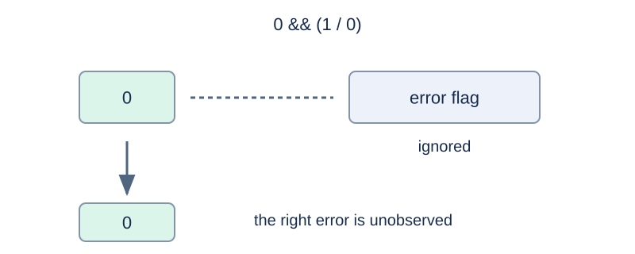

# Calculator with Short-Circuit Evaluation

## Story

An automated factory evaluates control expressions containing conditions. A calculation in an unselected branch must not make the whole instruction fail, so the calculator must follow short-circuit rules precisely.

## Formal Problem Statement

Evaluate one syntactically valid expression. Literals are nonnegative decimal integers from $0$ to $10^9$ . Leading zeros are allowed and still denote decimal values. Spaces and tabs may separate tokens. Parentheses change grouping. There are no increment or decrement operators. Precedence decreases down the table; operators in the same row have equal precedence.

| Operators | Meaning | Associativity |
| --- | --- | --- |
| Unary `+ - ! ~` | Positive, negative, logical NOT, bitwise NOT | Right |
| `* / %` | Multiplication, division, remainder | Left |
| Binary `+ -` | Addition, subtraction | Left |
| `<< >>` | Left shift, right shift | Left |
| `< > <= >=` | Signed comparisons | Left |
| `== !=` | Equal, unequal | Left |
| `&` | Bitwise AND | Left |
| `^` | Bitwise XOR | Left |
| `\|` | Bitwise OR | Left |
| `&&` | Logical AND | Left |
| `\|\|` | Logical OR | Left |
| `? :` | Conditional selection | **Left** |

Use these exact rules:

- Values are signed 32-bit two's-complement integers. Addition, subtraction, multiplication, negation, and left shifts retain the low 32 bits. Bitwise operations use these bits.
- Division truncates toward zero; remainders satisfy $a=(a/b)b+a\%b$ . As a special case, the minimum integer divided by $-1$ remains the minimum integer, and its remainder modulo $-1$ is $0$ .
- The shift count is the low five bits of the right operand, from $0$ through $31$ . Right shifts fill with the sign bit.
- Zero is false and every other value is true. Comparisons and logical operators return $0$ or $1$ .
- `a&&b` does not evaluate `b` when `a` is false. `a||b` does not evaluate `b` when `a` is true. `a?b:c` evaluates only the selected branch.
- The middle conditional branch is a full expression; the final branch excludes an unparenthesized conditional. The precise grammar is `Conditional := LogicalOr ('?' Expression ':' LogicalOr)*` . Thus `1?0:1?2:3` means `(1?0:1)?2:3` and evaluates to $3$ .
- Division or remainder by zero makes the entire expression fail only if that operation is actually required. Print `Segmentfault` on failure. An error in a condition also propagates. There are no other runtime errors.

## Input Format

Input one expression on one line. The line ending is not part of the expression.

## Output Format

Print one line: the signed decimal result, or `Segmentfault` .

## Sample 1

### Input

```text
1?0:1?2:3
```

### Output

```text
3
```

## Sample 2

### Input

```text
0 && (1 / 0)
```

### Output

```text
0
```

## Sample 3

### Input

```text
(1/0) || 1
```

### Output

```text
Segmentfault
```

## Sample 4

### Input

```text
15 << 33
```

### Output

```text
30
```

## Sample 5

### Input

```text
(1 << 31) / -1
```

### Output

```text
-2147483648
```

## Sample Explanation

The samples demonstrate left-associative conditionals, an ignored branch error, an error in a condition, a shift count reduced to five bits, and division of the minimum integer by −1.



When the left operand of logical AND is zero, division by zero on the right does not fail the expression.

## Constraints and Scoring

The expression length is $1\le n\le200000$ , including whitespace. Literals do not exceed $10^9$ . The expression obeys the grammar above.

Specifications redesigned by Codex (GPT-6): length, integer wrapping, error behavior, and left-associative conditional expressions.

| Score | Additional constraints |
| --- | --- |
| 20% | $n\le60$ |
| 30% | $n\le5000$ |
| 50% | No additional constraints |

## Resource Limits

Time: 0.5 seconds. Memory: 128 MiB.

The limit is 2 times the slowest standard-program median across five runs per formal input, rounded up to 0.5 seconds.

[Measurement environment](../../../docs/评测环境与性能.md) · [Measurements](../../../docs/benchmark-R32.json) · [Solution](solution.en.md)
