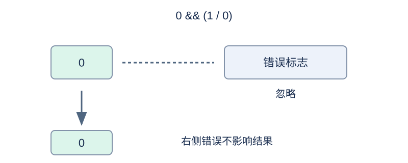

# 带短路规则的运算器

## 背景故事

自动化工厂要解释带条件判断的控制表达式。未被条件选中的计算不应让整条控制指令失败，因此运算器必须准确处理短路规则。

## 形式化问题描述

计算一行语法合法的表达式。字面量是 $0$ 到 $10^9$ 的十进制非负整数；允许前导零，仍按十进制解释。空格和制表符可出现在记号之间。括号改变结合顺序。没有自增、自减运算符。下表按优先级从高到低排列；同一行优先级相同。

| 运算符 | 作用 | 结合方向 |
| --- | --- | --- |
| 一元 `+ - ! ~` | 正号、负号、逻辑非、逐位非 | 右结合 |
| `* / %` | 乘、除、余数 | 左结合 |
| 二元 `+ -` | 加、减 | 左结合 |
| `<< >>` | 左移、右移 | 左结合 |
| `< > <= >=` | 有符号大小比较 | 左结合 |
| `== !=` | 相等、不等 | 左结合 |
| `&` | 逐位与 | 左结合 |
| `^` | 逐位异或 | 左结合 |
| `\|` | 逐位或 | 左结合 |
| `&&` | 逻辑与 | 左结合 |
| `\|\|` | 逻辑或 | 左结合 |
| `? :` | 条件选择 | **左结合** |

具体规则如下。

- 所有值为 32 位补码有符号整数。加、减、乘、取负和左移保留结果的低 32 位。逐位运算使用这 32 位。
- 除法向零取整，余数满足 $a=(a/b)b+a\%b$ .特例：最小整数除以 $-1$ 仍得到最小整数，对 $-1$ 取余得到 $0$ .
- 移位次数为右操作数的低 5 位，即 $0$ 到 $31$ ；右移使用符号位补齐。
- 零为假，其余为真；比较和逻辑运算返回 $0$ 或 $1$ .
- `a&&b` 在 `a` 为假时不计算 `b` ；`a||b` 在 `a` 为真时不计算 `b` .`a?b:c` 仅计算选中的分支。
- 条件式的中间分支是完整表达式；最后分支不包含未加括号的条件运算。精确语法为 `Conditional := LogicalOr ('?' Expression ':' LogicalOr)*` .因此 `1?0:1?2:3` 等于 `(1?0:1)?2:3` ，值为 $3$ .
- 只有实际需要计算的除法或取余遇到零除数时，整个表达式才报错，输出 `Segmentfault` .条件本身出错也会传播。除此之外没有运行时错误。

## 输入格式

输入一行表达式，行尾换行符不属于表达式。

## 输出格式

输出一行：有符号十进制结果，或 `Segmentfault` .

## 样例 1

### 输入

```text
1?0:1?2:3
```

### 输出

```text
3
```

## 样例 2

### 输入

```text
0 && (1 / 0)
```

### 输出

```text
0
```

## 样例 3

### 输入

```text
(1/0) || 1
```

### 输出

```text
Segmentfault
```

## 样例 4

### 输入

```text
15 << 33
```

### 输出

```text
30
```

## 样例 5

### 输入

```text
(1 << 31) / -1
```

### 输出

```text
-2147483648
```

## 样例说明

样例依次展示条件式左结合、忽略未使用分支的错误、条件自身错误、移位次数取低 5 位，以及最小整数除以 −1 的环绕。



逻辑与的左值为零时，右侧除零不会成为整个表达式的错误。

## 数据范围与分组

表达式长度 $1\le n\le200000$ ，包含空白字符。字面量不超过 $10^9$ .保证符合上述语法。

规格由 Codex（GPT-6）重新设计：补充长度、整数环绕与错误规则，明确条件运算左结合。

| 分值 | 额外限制 |
| --- | --- |
| 20% | $n\le60$ |
| 30% | $n\le5000$ |
| 50% | 无额外限制 |

## 资源限制

时间 0.5 秒；内存 128 MiB。

时限取标准程序正式数据五次运行的最慢中位数的 2 倍，向上取整到 0.5 秒。

[测量环境与方法](../../../docs/评测环境与性能.md) · [测量记录](../../../docs/benchmark-R32.json) · [题解](solution.zh.md)
