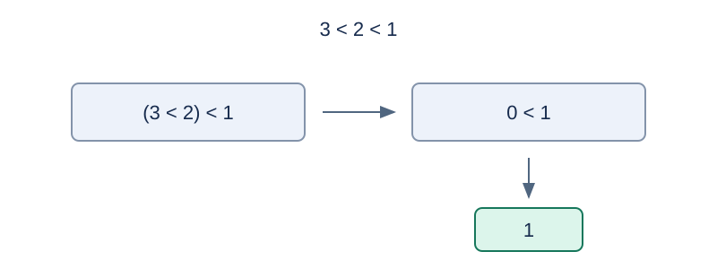

# 整数运算器

预估时间限制：0.5 秒。内存限制：128 MB。

实际时限以标准程序在目标评测环境的最慢用例中位时间乘以 $2$ ，按 $0.5$ 秒向上取整。参考环境见[评测说明](../../../docs/评测环境与性能.md)。

## 背景故事

自动化工厂需要一个小型运算器来解释控制表达式。运算器使用固定的 32 位整数规则，遇到除数为零时报告错误。

## 形式化问题描述

求给定合法表达式的值。数字字面量只能是单个 $0,\ldots,9$ ，不允许多位数。括号 `(` 、`)` 改变结合顺序。下表从高到低列出运算符优先级。

| 运算符 | 含义 | 结合方向 |
| --- | --- | --- |
| 一元 `+ - ~` | 正号、取负、逐位取反 | 从右到左 |
| 二元 `* / %` | 乘、除、余数 | 从左到右 |
| 二元 `+ -` | 加、减 | 从左到右 |
| 二元 `< >` | 小于、大于 | 从左到右 |

没有自增、自减运算符；连续的正负号按一元或二元位置分别解释。例如 `-~1` 等于 `-(~1)` ，`3<2<1` 等于 `(3<2)<1` .

每个数值都表示一个有符号 32 位整数，范围为 $[-2^{31},2^{31}-1]$ .加、减、乘及一元取负的数学结果对 $2^{32}$ 取模，再按 32 位补码解释。逐位取反作用于全部 32 位。

除法向零截断，余数满足 $a\bmod b=a-\operatorname{trunc}(a/b)b$ ，其符号与被除数一致或为零。$-2^{31}/(-1)$ 的结果也按上述规则环绕成 $-2^{31}$ ；相应余数为零。关系运算按有符号值比较，结果为 $0$ 或 $1$ .

所有操作数均需计算。任一除法或余数运算的除数为零，就输出 `Runtime Error` ；否则输出最终整数。

## 输入格式

一行一个表达式，不含空格。输入只包含一个表达式。

## 输出格式

输出一行，为计算结果或 `Runtime Error` .

## 样例

### 样例 1

### 输入

```text
--~~-~(5)+++--(3*(6+7)*4)*2/(2+2)+(1>(((2))))
```

### 输出

```text
84
```

### 样例 2

### 输入

```text
3<2<1
```

### 输出

```text
1
```

### 样例 3

### 输入

```text
9*9*9*9*9*9*9*9*9*9*9
```

### 输出

```text
1316288537
```

### 样例 4

### 输入

```text
5/(7-6-1)
```

### 输出

```text
Runtime Error
```

## 样例解释

样例 1 的结果为 84。样例 2 先计算 `3<2` 得到 0，再计算 `0<1` 得到 1。样例 3 计算 $9^{11}$ 后保留低 32 位，得到 1316288537。样例 4 的除数为零。



比较结果仍可作为下一个比较的操作数。

## 数据范围与保证

表达式长度为 $\ell$ ，$1\le\ell\le100000$ .保证语法合法；括号与一元运算符的嵌套深度没有额外限制。

规格由 Codex（GPT-6）重新设计：明确 32 位环绕、带符号除法与余数，以及最小负数除以负一的结果。

| 分值比例 | 额外条件 |
| --- | --- |
| 20% | $\ell\le30$ |
| 30% | $\ell\le1000$ |
| 50% | 无额外条件 |
