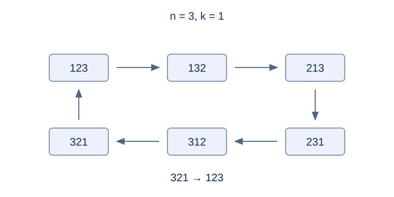

# 排列的字典序跳转

## 背景故事

展柜里的一排编号模型每天换成字典序中的下一个排列。最后一个排列之后回到第一个。管理员希望直接算出若干次轮换后的摆放顺序。

(本故事由GPT-6重写)

## 形式化问题描述

给定 $1,\ldots,n$ 的一个排列和非负整数 $k$ ，将所有 $n!$ 个排列按字典序从小到大排成一个环，输出向后前进 $k$ 步的排列。字典序比较在第一个不同位置比较数值。最后的降序排列的下一项是升序排列。$k=0$ 时保持输入排列。各组数据独立。

## 输入格式

第一行组数 $T$ .每组先读一行 `n k` ，再读一行包含 $n$ 个数的排列。

## 输出格式

每组输出一行，包含得到的 $n$ 个数。

## 样例 1

### 输入

```text
3
3 1
1 2 3
3 1
3 2 1
3 7
1 2 3
```

### 输出

```text
1 3 2
1 2 3
1 3 2
```

## 样例 2

### 输入

```text
2
1 2147483647
1
4 0
2 4 1 3
```

### 输出

```text
1
2 4 1 3
```

## 样例 3

### 输入

```text
1
4 5
2 1 4 3
```

### 输出

```text
3 1 2 4
```

## 样例说明

样例 1 展示一步跳转、从降序环绕到升序，以及跳过一个完整周期。样例 2 展示单元素排列和零步。样例 3 从 [2,1,4,3] 前进五步，得到 [3,1,2,4]。



三个元素的六个排列构成一个循环。

## 数据范围与分组

$1\le T\le10^5$ ，每组 $n\ge1$ ，所有组的 $n$ 之和不超过 $2\times10^6$ ；$0\le k\le2^{31}-1$ .

规格由 Codex（GPT-6）重新设计：明确循环字典序任务、多组格式、总规模和步数范围。

| 分值 | 额外条件 |
| --- | --- |
| 20% | 每组 $n\le8$ |
| 30% | 每组 $n\le2000$ |
| 50% | 无额外条件 |

## 资源限制

时间 0.5 秒；内存 128 MiB。时限为标准程序每例五次测量的最慢中位数乘以 2，向上取整到 0.5 秒。

[题解](solution.zh.md) · [测量环境](../../../docs/评测环境与性能.md) · [测量记录](../../../docs/benchmark-R33.json)
