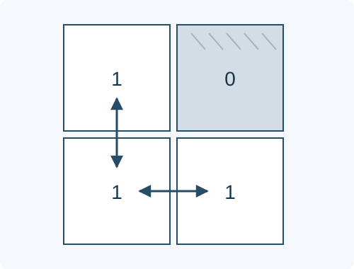

# 网格生存概率

预估时间限制：0.5 秒。内存限制：128 MB。

实际时限以标准程序在目标评测环境的最慢用例中位时间乘以 $2$ ，按 $0.5$ 秒向上取整。参考环境见[评测说明](../../../docs/评测环境与性能.md)。

## 背景故事

巡游机器人随机落在一片由道路和坑洞组成的方格区域中。它不识别危险，只会随机选择方向前进一步。请计算它完成规定步数后始终安全的概率。

(本故事由GPT-6重写)

## 形式化问题描述

给定 $n$ 行 $m$ 列的网格，每个格子为道路或坑洞。起点从全部 $nm$ 个格子中等概率选择，包括坑洞。随后进行 $k$ 步移动，每一步独立地等概率选择上、下、左、右之一，并沿该方向移动一格；不能停留，也不会重新选择越界或通向坑洞的方向。

一次过程成功，当且仅当起点、终点及经过的所有格子都是网格内的道路。将成功概率写成 $p/q$ ，其中 $p\ge0,q>0$ ，输出

$$p\cdot q^{-1}\bmod P,\qquad P=7\times2^{50}+1=7881299347898369$$

$P$ 是质数，$q^{-1}$ 是模 $P$ 的乘法逆元。可以直接取分母 $q=nm\cdot4^k$ ；本题范围保证它与 $P$ 互质。

## 输入格式

第一行三个整数 $n,m,k$ .接下来 $n$ 行，每行一个长度为 $m$ 的 `01` 串，不含空格。字符 `0` 表示坑洞，`1` 表示道路。

## 输出格式

输出一行一个整数，表示成功概率在模 $P$ 意义下的值，范围为 $0$ 到 $P-1$ .

## 样例

### 样例 1

### 输入

```text
1 1 0
1
```

### 输出

```text
1
```

### 样例 2

### 输入

```text
2 2 1
11
11
```

### 输出

```text
3940649673949185
```

### 样例 3

### 输入

```text
2 2 1
10
11
```

### 输出

```text
5910974510923777
```

### 样例 4

### 输入

```text
3 3 1
111
011
111
```

### 输出

```text
3940649673949185
```

### 样例 5

### 输入

```text
3 3 3
111
011
111
```

### 输出

```text
1067259286694571
```

### 样例 6

### 输入

```text
1 1 1
1
```

### 输出

```text
0
```

## 样例解释

第一组不移动，唯一的起点是道路，概率为一。第二组每个起点有两个安全方向，概率为二分之一。第三组四个起点与四个方向共有十六种等概率选择，其中四种安全，概率为四分之一。第四组概率也是二分之一。第五组有 $114$ 条安全的三步过程，总过程数为 $9\cdot4^3=576$ ，概率为 $19/96$ .第六组任何一步都会越界，概率为零。



方格内数字与输入字符一致；箭头仅标出成功的一步移动，其他方向仍各有四分之一的选择概率。

## 数据范围与保证

对所有数据，$n,m\ge1$ ，$1\le nm\le10^6$ ，$0\le k\le25$ .网格可能没有道路；$k=0$ 时只检查起点。

| 分值比例 | 额外条件 |
| --- | --- |
| 100% | 无额外条件 |
