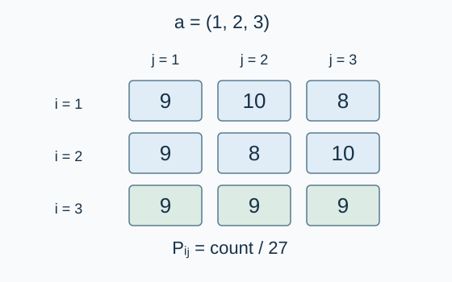

# 随机分析：期望

预估时间限制：0.5 秒。内存限制：128 MB。

实际时限以标准程序在目标评测环境的最慢用例中位时间乘以 $2$ ，按 $0.5$ 秒向上取整。参考环境见[评测说明](../../../docs/评测环境与性能.md)。

## 背景故事

实验室用一段固定顺序的随机交换程序打乱编号卡片。研究员想分析每个位置最终的平均数值。

(本故事由GPT-6重写)

## 形式化问题描述

给定长度为 $n$ 的整数序列 $a_1,\ldots,a_n$ ，下标从 $1$ 开始。元素允许重复。对当前序列执行：

```text
for i = 1, 2, ..., n:
    r = uniformly_random_integer(1, n)
    swap(a[i], a[r])
```

每轮的随机数独立产生，等概率取 $1$ 到 $n$ 中的任意整数，包含当前下标 $i$ .交换会立即改变后续轮次使用的序列。设最终序列为 $A_1,\ldots,A_n$ .

求每个位置的期望值 $E_i=\mathbb{E}[A_i]$ .

结果按模 $M=998244353$ 表示：若一个结果为非负有理数 $p/q$ ，其中 $q>0$ ，输出 $p\cdot q^{-1}\bmod M$ 在 $[0,M-1]$ 内的代表元。零结果输出 $0$ .本题范围保证所需分母在模 $M$ 意义下可逆。

## 输入格式

第一行一个整数 $n$ .第二行 $n$ 个整数 $a_1,\ldots,a_n$ .

## 输出格式

输出一行 $n$ 个整数，第 $i$ 个表示 $E_i$ 的模意义结果。

## 样例

### 样例 1

### 输入

```text
1
1
```

### 输出

```text
1
```

### 样例 2

### 输入

```text
3
1 2 3
```

### 输出

```text
517608185 480636172 2
```

### 样例 3

### 输入

```text
3
1 1 3
```

### 输出

```text
702468250 628524224 665496237
```

## 样例解释

第二组样例的真实期望依次为 $53/27,55/27,2$ ，并非三个相同的平均值。第三组样例含两个值为 $1$ 的元素，真实期望依次为 $43/27,47/27,5/3$ .输出分别将这些分数转换为模意义结果。



图中展示第二组样例。行表示最终位置，列表示数值。表中计数除以 $27$ 即为对应概率。

## 数据范围与保证

所有数据满足：$1\le n\le300$ ，$1\le a_i\le n$ .

本题的规模规格由 Codex（GPT-6）制定为 $n\le300$ ；元素范围保持为 $1\le a_i\le n$ .

| 分值比例 | 额外条件 |
| --- | --- |
| 100% | 无额外条件 |
