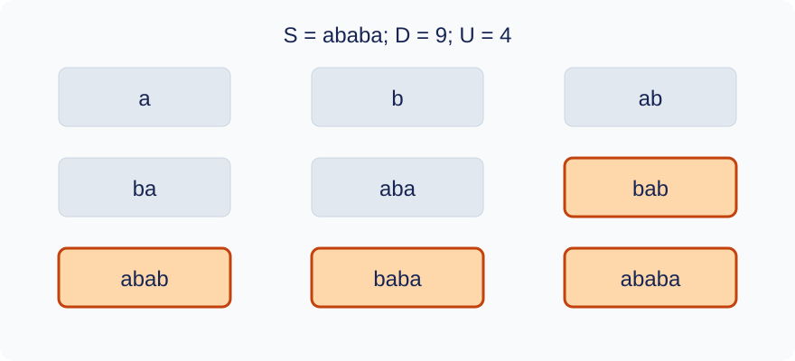

# Expected Trials for Unique Substring Hits

Time limit: 0.5 seconds. Memory limit: 128 MiB. Recalibrate as twice the slowest standard median in the target environment, rounded up to 0.5 seconds; see the [environment](../../../docs/评测环境与性能.md).

## Story

An archive uses short labels to locate positions in a long record. A randomly chosen label succeeds only if it occurs exactly once. The archivist wants the expected number of trials needed for a requested number of successful lookups.

(This story was rewritten by GPT-6.)

## Formal Problem Statement

You are given a string $S$ of length $n$ . Each trial independently chooses uniformly among the **distinct nonempty contiguous substrings** of $S$ . A substring may be selected again on later trials. Choices are distinct strings, not position intervals.

A trial succeeds exactly when its chosen substring occurs once in $S$ . Occurrences may overlap. For each query $N$ , find the expected total number of trials performed when the number of successes first reaches $N$ . This expectation is zero for $N=0$ .

Let $P=1000000007$ . Express the exact expectation as a reduced nonnegative fraction $A/B$ with $B>0$ . If $P$ divides $B$ , print $-1$ . Otherwise print the least nonnegative residue $AB^{-1}\bmod P$ .

## Input Format

The first line contains `n Q` . The second contains the length-$n$ string $S$ , whose characters have ASCII codes from 33 through 126. Each of the next $Q$ lines contains a nonnegative integer $N$ .

## Output Format

For each query, print its residue or $-1$ under the reduced-fraction rule above.

## Sample 1

### Input

```text
5 3
ababa
4
1
0
```

### Output

```text
9
250000004
0
```

## Sample 2

### Input

```text
4 3
aaaa
1
4
1000000000000000000
```

### Output

```text
4
16
196
```

## Sample 3

### Input

```text
3 3
a!a
1
2
4
```

### Output

```text
250000003
500000006
5
```

## Sample Explanation

Sample 1 has 9 distinct substrings. Exactly four occur once: `bab` , `abab` , `baba` , and `ababa` . The success probability is $4/9$ , so 4 successes require an expected 9 trials.



The 9 distinct substrings of `ababa` ; the 4 boxed strings occur exactly once.

## Constraints and Scoring

$1\le n\le10^5$ , $1\le Q\le500$ , and $0\le N\le10^{18}$ . The alphabet consists of all 94 characters with ASCII codes 33 through 126; whitespace is excluded.

Specifications redesigned by Codex (GPT-6): the exact alphabet, independent sampling and stopping-time expectation, and output when the reduced denominator is not invertible.

| Score | Additional constraints |
| --- | --- |
| 20% | $n\le20$ |
| 30% | $n\le2000$ |
| 50% | No additional constraints |

There are 10 tests worth 10% each. See the [test recipes](tests/README.md).
