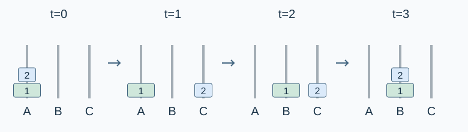

# Block Tower

Estimated time limit: 0.5 seconds. Memory limit: 128 MB.

On the target judge, multiply the reference program's largest per-case median time by $2$ and round up to a multiple of $0.5$ seconds. See the [reference environment](../../../docs/评测环境与性能.md).

## Story

A block tower must be transferred between three platforms. Every block has a name, and the mover needs a sequence of printed instructions.

## Formal Problem Statement

There are three platforms, referred to as $A,B,C$ , whose display names are given in the input. Initially all $n$ blocks are on platform $A$ , in the supplied bottom-to-top order. The other platforms are empty.

One move takes the top block from one platform and places it on top of another. Whenever block $Y$ is directly above block $X$ , $Y$ must also have been above $X$ in the initial tower, possibly with other blocks between them.

Move every block to platform $B$ using the minimum number of moves, and print the operations. Names are labels; the initial positions determine block order. Names need not be distinct.

## Input Format

The first line contains $n$ .

The next three lines give the display names of platforms $A,B,C$ . The following $n$ lines give the block names in initial bottom-to-top order.

Each name occupies a complete line of $1$ to $20$ English letters, digits, ASCII spaces or underscores. Leading, internal and trailing spaces are part of the name and must be preserved. The line ending is not part of the name.

## Output Format

Print one line per move, using exactly this format:

```text
Move <block> from <source> to <target>.
```

Replace `<block>` , `<source>` and `<target>` with the complete block, source-platform and target-platform names. Do not print angle brackets. Preserve the other letters, spaces and final period from the template. Do not print a separate move count.

## Examples

### Example 1

### Input

```text
2
226 A AA ____ 1026
CC
BB
1
2_
```

### Output

```text
Move 2_ from 226 A AA ____ 1026 to BB.
Move 1 from 226 A AA ____ 1026 to CC.
Move 2_ from BB to CC.
```

### Example 2

### Input

```text
1
A
B
C
Only
```

### Output

```text
Move Only from A to B.
```

### Example 3

### Input

```text
3
Left
Middle
Right
Large block
Mid_block
Small
```

### Output

```text
Move Small from Left to Middle.
Move Mid_block from Left to Right.
Move Small from Middle to Right.
Move Large block from Left to Middle.
Move Small from Right to Left.
Move Mid_block from Right to Middle.
Move Small from Left to Middle.
```

## Example Explanation

In the first example, the three input names correspond to $A,B,C$ in order. Move the upper block to $C$ , the lower block to $B$ , and finally the upper block to $B$ , taking three moves.



The diagram uses $A,B,C$ for platform identities and $1,2$ for initial bottom-to-top block indices. The output uses the supplied names.

## Constraints and Guarantees

$1\le n\le10$ . Each name satisfies $1\le |S|\le20$ , with the character set and whitespace rules defined in the input format.

| Score | Additional conditions |
| --- | --- |
| 100% | None |
