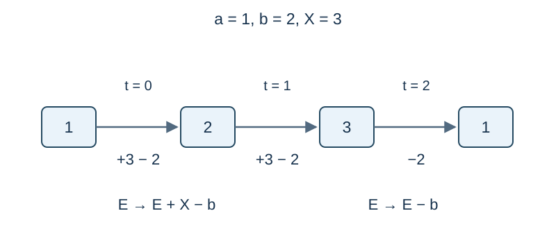

# 共用充电器

时间限制：0.5 秒。内存限制：128 MiB。参考 [评测环境与性能](../../../docs/评测环境与性能.md)。

## 背景故事

一场考试允许使用笔记本电脑，但考生们只有一个可共用的充电器。组织者可以选择充电器的固定功率，希望用最小功率保证所有电脑坚持到考试结束。

## 形式化问题描述

有 $n$ 台设备。设备 $i$ 的初始电量为 $a_i$ ，每分钟消耗 $b_i$ .考试持续 $m$ 分钟，编号为 $0,\ldots,m-1$ .

选择一个固定的非负整数功率 $X$ .每分钟开始时，最多选择一台设备充电，使它获得 $X$ 单位电量；随后所有设备各消耗 $b_i$ .只检查每分钟末的电量，所有设备都必须非负，恰好为零也合法。电量没有容量上限，同一设备可在多个不同的分钟充电。

求可行的最小 $X$ .不存在任何可行功率时输出 $-1$ .

## 输入格式

第一行包含 `n m` .第二行包含 $n$ 个整数 $a_i$ .第三行包含 $n$ 个整数 $b_i$ .

## 输出格式

输出一行一个整数：最小功率，或 $-1$ .

## 样例 1

### 输入

```text
7 7
75 96 111 18 26 5 67
11 14 16 13 4 1 11
```

### 输出

```text
73
```

## 样例 2

### 输入

```text
10 10
6461509295841908 38 62 49 89 113 8 7 26 1
4 6 14 6 12 19 11 2 9 1
```

### 输出

```text
91
```

## 样例 3

### 输入

```text
10 6
5418305720373823 1522295577184932 68 14 9738943766183541 12 28 64942086170874 58 50
13 5 19 10 14 18 6 7 11 17
```

### 输出

```text
96
```

## 样例 4

### 输入

```text
7 8
6826325183988349 2889182368658500 114922354894933 144 73 6452986168515306 3965505639613541
5 12 19 20 12 15 15
```

### 输出

```text
6
```

## 样例 5

### 输入

```text
2 2
0 0
1 1
```

### 输出

```text
-1
```

## 样例 6

### 输入

```text
2 5
0 10
0 2
```

### 输出

```text
0
```

## 样例解释

样例5中，两台设备都必须在第0分钟充电，但每分钟只能给一台设备充电，因此无解。样例6中，现有电量已足够，答案为零。



一台设备的电量变化示例：$a=1,b=2,X=3$ ，在第0、1分钟充电，三分钟末电量依次为 $2,3,1$ .

## 数据范围与保证

$1\le n,m\le5\cdot10^5$ ，$0\le a_i\le10^{16}$ ，$0\le b_i\le10^9$ .共40个测试点，每点占2.5%。

| 分值 | 额外限制 |
| --- | --- |
| 30% | $n,m\le50,\ b_i\le5$ |
| 20% | $n,m\le200,\ b_i\le20$ |
| 20% | $n,m\le200$ |
| 20% | $n,m\le50000$ |
| 10% | 无额外限制 |
