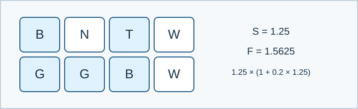

# 花园的点击系数：题解

## 算法与贡献

规格补全、支配关系证明、枚举算法和实现由 Codex（GPT-6）完成。参考程序为 [std.cpp](std.cpp)。题面以明确的20%邻居增幅计算效果，不为点击或奶量额外添加常数项。

## 先去掉两种选择

固定所有 N 的位置和土壤后，每个非 N 格子的效果 $F$ 已确定，而且 $0<F\le3.4375$ . 所有惩罚因子均非负。

把 E 换成 B 只增加产量，不降低其他因子。因此最优方案可以不含 E。

对一个 D，设其他植物贡献的产量因子为 $P\ge1$ . 它与自己的点击惩罚共同贡献

$$
(P+0.03F)(1-0.05F)
=P+F(0.03-0.05P)-0.0015F^2\le P.
$$

因此 D 换成 E 不会变差，再换成 B 也不会变差。这个替换不改变 N 的邻接关系。于是只需考虑 B、T、W、N、G。

## 枚举与计算

令 $g=nm$ . 枚举两种土壤，再枚举 N 的位置掩码。逐格统计八邻域中的 N 数量，预先计算剩余格子的 $F$ . 然后深搜每格的 B、T、W、G 四种选择。

搜索中累计 B、T、W、G 的效果之和，以及 G 的产量惩罚之积。叶子处直接代入题面公式，取最大值。没有 N 时和全部为 N 时也必须枚举；后一种方案的点击系数为零。

图中 N 影响与其横、纵坐标差均不超过1的其他格子，包括对角格子。不能只统计四联通邻居。

## 正确性

上述替换说明至少存在一个不含 E、D 的最优方案。枚举覆盖它的土壤、全部 N 位置及每个剩余格子的植物种类；累加量和乘积与定义逐项一致。因此搜索得到的最大值恰好是全局最优值。

## 复杂度与数值

若 N 有 $t$ 格，对应 $4^{g-t}$ 个布局。总数为

$$\sum_{t=0}^g\binom gt4^{g-t}=5^g.$$

时间为 $O(g^2 2^g+5^g)$ ，额外空间为 $O(g)$ . 使用 `long double` ，输出18位小数的科学计数法。全部正式答案另由完整布局枚举求得，并用60位 Decimal 重新计算最优布局；小尺寸还比较含 E、D 的七种植物枚举。

正式数据、固定种子和测量方法见[数据说明](tests/README.md)。
