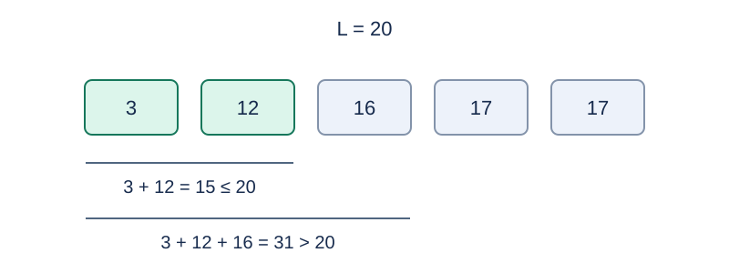

# Budget Selection from a Generated Sequence

Estimated time limit: 1.0 seconds. Memory limit: 128 MB.

The actual limit is twice the slowest per-case median time of the standard program on the target judge, rounded up to a multiple of $0.5$ seconds. See the [evaluation notes](../../../docs/评测环境与性能.md).

## Story

A recycling station generates processing costs for a large batch from a few parameters. Some items earn refunds, so costs may be negative. The station wants to process as many items as its budget allows.

(This story was rewritten by GPT-6.)

## Formal Problem Statement

Given $n,A,B,C,D,L$ , set $x_0=A$ and generate, in order for $i=1,\ldots,n$ ,

$$x_i=C+\operatorname{rem}(x_{i-1}B,D)$$

Here $\operatorname{rem}(u,v)=u-\operatorname{trunc}(u/v)v$ , division truncates toward zero, and $D\ne0$ . The remainder is zero or has the sign of $u$ ; $D$ may be negative. Use exact integer multiplication during generation, without 32-bit wrapping.

Choose distinct positions from $x_1,\ldots,x_n$ whose values sum to at most $L$ . Find the maximum number of chosen positions. Equal values at different positions may all be chosen. The empty set has sum zero. If no set satisfies the budget, output $0$ by convention. Thus, with a negative budget, an output of zero does not necessarily mean the empty set is feasible.

## Input

The first line contains $n,A,B,C,D$ . The second contains $L$ .

## Output

Print the maximum number of selected positions, or zero when no feasible set exists.

## Examples

### Example 1

### Input

```text
5 3 4 5 19
20
```

### Output

```text
2
```

### Example 2

### Input

```text
4 0 1 -2 100
-10
```

### Output

```text
4
```

### Example 3

### Input

```text
3 0 0 1 7
-1
```

### Output

```text
0
```

## Example Explanation

Sample 1 generates 17, 16, 12, 3, and 17. Choose 3 and 12 for a cost of 15; the three smallest values sum to 31, exceeding the budget of 20. Sample 2 generates -2, -4, -6, and -8, whose total of -20 meets the budget of -10. In sample 3 all values are 1 and the budget is -1, so no set is feasible.



The minimum cost of two positions is 15; three positions cost at least 31.

## Constraints and Guarantees

All data satisfy $1\le n\le2\times10^7$ , $|A|,|B|,|C|,|D|,|L|\le10^9$ , and $D\ne0$ .

Specifications redesigned by Codex (GPT-6): the sequence recurrence, signed remainder, nonzero divisor, and output for an infeasible budget are explicit.

| Score | Additional conditions |
| --- | --- |
| 20% | $n\le20$ |
| 30% | $n\le100000$ |
| 50% | No additional conditions |
