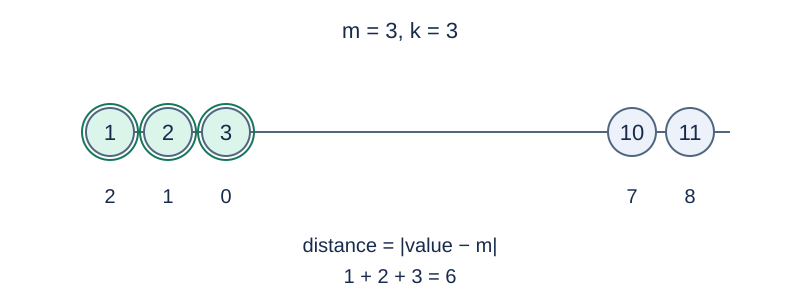

# 最接近中位数的数

预估时间限制：0.5 秒。内存限制：128 MB。

实际时限以标准程序在目标评测环境的最慢用例中位时间乘以 $2$ ，按 $0.5$ 秒向上取整。参考环境见[评测说明](../../../docs/评测环境与性能.md)。

## 背景故事

观测站收到一组有正有负的测量值，准备保留最接近中心的若干条记录。偏离中心同样远时，站点优先保留数值较大的记录。

(本故事由GPT-6重写)

## 形式化问题描述

给定 $n$ 个整数 $a_1,\ldots,a_n$ 以及 $k$ .将全部数排序为 $b_1\le\cdots\le b_n$ .中位数定义为

$$m=\begin{cases}b_{(n+1)/2},&n\text{ 为奇数},\\(b_{n/2}+b_{n/2+1})/2,&n\text{ 为偶数}.\end{cases}$$

按 $|a_i-m|$ 从小到大选择 $k$ 个位置；距离相同时优先选择数值较大的位置。相同数值的不同位置分别计数，任选同值位置不会改变答案。输出选中数值的和。中位数始终由完整输入序列确定。

## 输入格式

第一行两个整数 $n,k$ .第二行 $n$ 个整数 $a_i$ .

## 输出格式

输出一行一个整数，表示选中数值之和。

## 样例

### 样例 1

### 输入

```text
5 3
1 2 3 10 11
```

### 输出

```text
6
```

### 样例 2

### 输入

```text
8 5
1 1 1 1 4 7 7 7
```

### 输出

```text
8
```

### 样例 3

### 输入

```text
4 1
-9 -1 1 9
```

### 输出

```text
1
```

## 样例解释

样例 1 的中位数为 3，选择 1、2、3，和为 6。样例 2 的中位数为 2.5，四个 1 与一个 4 距离均为 1.5，全部选中，和为 8。样例 3 的中位数为 0，距离相同时优先选择 1。



双圆框标出被选中的三个值；下方列出它们到中位数的距离。

## 数据范围与保证

所有数据满足 $1\le k\le n\le10^6$ ，$|a_i|<10^9$ .

规格由 Codex（GPT-6）重新设计：明确偶数个数时取两个中间值的算术平均，距离按数值差计算；边界与样例使用这一统一定义。

| 分值比例 | 额外条件 |
| --- | --- |
| 20% | $n\le20$ |
| 30% | $n\le10000$ |
| 50% | 无额外条件 |
