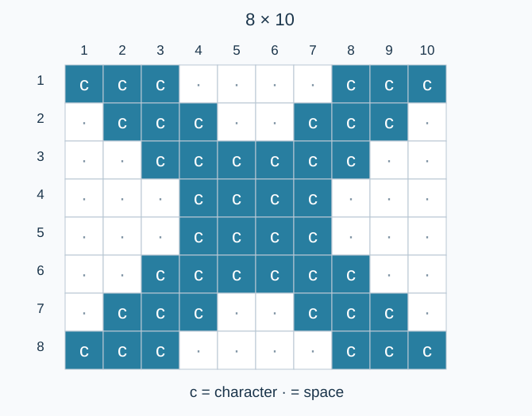

# 字符 X

预估时间限制：0.5 秒。内存限制：128 MB。

实际时限以标准程序在目标评测环境的最慢用例中位时间乘以 $2$ ，按 $0.5$ 秒向上取整。参考环境见[评测说明](../../../docs/评测环境与性能.md)。

## 背景故事

为了获取练习资料，一名学生需要完成网站的字符打印验证：用指定字符绘制一个固定大小的 X。

## 形式化问题描述

对每个字符 $c$ ，输出一个 $8$ 行、$10$ 列的字符矩形。行号 $i$ 从 $1$ 到 $8$ ，列号 $j$ 从 $1$ 到 $10$ .当下列条件至少一个成立时，位置 $(i,j)$ 输出 $c$ ；否则输出一个空格：

$$i\le j\le i+2\qquad\text{或}\qquad9-i\le j\le11-i$$



图中的点仅用于标出空格位置，实际输出应使用空格。两条斜带重叠时，仍只输出一个字符。

## 输入格式

第一行一个整数 $T$ .接下来 $T$ 行，每行一个字符 $c$ .

## 输出格式

每个字符对应连续 $8$ 行，每行恰好 $10$ 个字符，后接换行符。保留行首和行尾空格，组间不加空行。总共输出 $8T$ 行；$T=0$ 时不输出任何内容。

## 样例

### 样例 1

### 输入

```text
3
A
c
9
```

### 输出

```text
AAA    AAA
 AAA  AAA 
  AAAAAA  
   AAAA   
   AAAA   
  AAAAAA  
 AAA  AAA 
AAA    AAA
ccc    ccc
 ccc  ccc 
  cccccc  
   cccc   
   cccc   
  cccccc  
 ccc  ccc 
ccc    ccc
999    999
 999  999 
  999999  
   9999   
   9999   
  999999  
 999  999 
999    999
```

### 样例 2

### 输入

```text
1
Z
```

### 输出

```text
ZZZ    ZZZ
 ZZZ  ZZZ 
  ZZZZZZ  
   ZZZZ   
   ZZZZ   
  ZZZZZZ  
 ZZZ  ZZZ 
ZZZ    ZZZ
```

### 样例 3

### 输入

```text
0
```

### 输出

```text

```

## 样例解释

样例 1 依次用大写字母、小写字母和数字绘制同一个图案。样例 2 的第二行和第七行各有一个行尾空格。样例 3 没有打印任务，输出为空。

## 数据范围与保证

对 100% 的数据：$0\le T\le20$ ；$c$ 为大写英文字母、小写英文字母或十进制数字。

| 分值比例 | 额外条件 |
| --- | --- |
| 100% | 无额外条件 |
