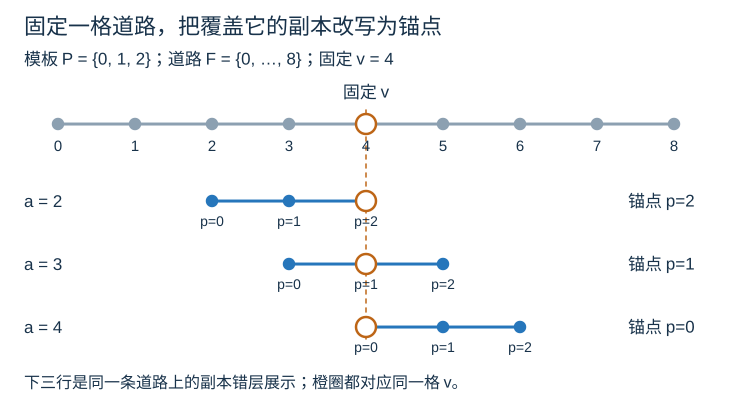
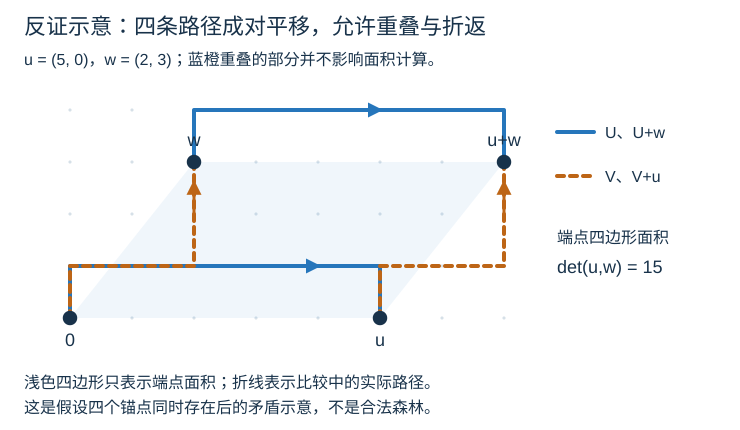
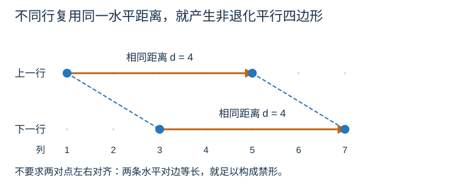

# 一类四邻接网格图森林的匹配问题：带对数上界的完整证明

本文保留候选列表算法较早的带对数上界及其图示，解释静态乘积界和调和求和从何而来。一般三次方上界现已由[完整历史收费证明](research/proofs/cubic-bound.zh.md)解决；本篇的较弱上界仍正确。算法与代码见[题解](solution.zh.md)和[std.cpp](std.cpp)，探索过程见[研究综述](complexity-research.zh.md)。

## 1. 结论，以及真正需要估计的量

设棋盘边长为 $n$，移动数为 $m$，道路集合为 $F$，道路格数为 $N=|F|\le n^2$。道路格之间的四邻接图是森林。

算法从全部道路格开始维护合法起点。只有累计位移第一次出现时，才遍历当前候选并删掉不合法起点。令 $W$ 为这些遍历中检查候选的总次数，则

$$
T=O(n^2+m+W).
$$

读图需要处理平方量级的格子；全部移动和输出仍要处理；其余工作就是候选检查。**本证明的目标是控制所有轮次候选数之和，不是只数筛选轮数。**

将证明

$$
\boxed{
W\le N\sum_{j=1}^{L}\min\left\{1,\frac{2n-1}{j}\right\},
\qquad L=\min(m,N).
}
$$

因此

$$
\boxed{
T=O\bigl(n^2+m+nN\log(n+1)\bigr)
\subseteq O\bigl(n^3\log(n+1)+m\bigr).
}
$$

空间为 $O(n^2)$。当 $N=0$ 或 $m=0$ 时，$W=0$，空和按零处理。写成 $\log(n+1)$ 也包含 $n=1$ 的边界。

本篇的逐前缀求和单独只能给出上述较弱界。已有合法输入族给出 $\Omega(n^3+m)$ 下界，适用于 $m\ge n-1$；后续[一般证明](research/proofs/cubic-bound.zh.md)已补上对数缺口，得到匹配的三次方加移动数上界。

## 2. 证明路线：先固定时刻，再改换计数方向

如果只知道每轮最多检查 $N$ 个候选、最多筛选 $N$ 轮，就只得到平方道路数的粗界。更有用的问题是：

> 已经要求匹配很多个不同位置时，还能保留多少个起点？

固定一个已经访问完的位移集合 $P$。它包含零位移，并记录**全部**历史要求。合法起点集合为

$$
A(P)=\{a:a+P\subseteq F\}.
$$

我们希望证明一个“模板越大，副本越少”的乘积界：

$$
\boxed{|A(P)|\,|P|\le(2n-1)N.}
$$

直接比较所有副本很难：它们可以大量重叠。换一种看法，固定一格道路，数有多少个副本覆盖它。每格只要被覆盖线性次，对全部道路求和，就得到了乘积界。

整个证明分为四步：

1. 把覆盖同一道路格的副本，表示成模板内部的一组锚点。
2. 用森林中的唯一路径，证明这些锚点不能组成非退化平行四边形。
3. 用“每行一个基准点，加上水平距离”的计数，将锚点数限制在线性范围。
4. 双重计数得到乘积界，再对前缀大小求调和和。

前两步把算法问题变成几何禁形，第三步是初等计数，最后一步才回到时间复杂度。

**先看总费用如何出现。** 暂时把乘积界当作已证：模板大小翻倍时，候选数量的上界减半，但这一档可能经历的新位置筛选轮数翻倍，所以每个倍增尺度至多花 $O(nN)$。不足 $n$ 个点的模板总共也只花这个量级；模板最多有道路数个点，从线性大小到平方大小只有 $O(\log(n+1))$ 个尺度。因此总费用为 $O(nN\log(n+1))$。第 8 节给出精确求和及逐档计费表。

这里限制的是“模板大小乘候选数量”，并没有声称模板达到线性大小后，候选就必须降到线性个。单个时刻的乘积界也不是全部扫描费用；后者仍需要跨前缀求和。

## 3. 为什么固定前缀是一棵树

这里的“前缀”是已访问位移的集合，重复访问只保留一个点。实际行走每次走向相邻格，所以这个集合连通。

若 $A(P)\ne\varnothing$，取任意合法起点 $a$。平移 $p\mapsto a+p$ 把模板的四邻接图嵌入道路森林。模板如果有环，道路里也会有同一个环。因此模板连通且无环，是一棵树。

另外，模板能整体放进棋盘，所以它的包围盒若有 $H$ 行、$B$ 列，则

$$
H\le n,\qquad B\le n.
$$

位移可以有负坐标，这不影响包围盒的行数和列数。这里限制的是跨度，不是模板必须位于棋盘原坐标内。

**只在有候选存活的前缀上使用树结构。** 清空全部候选的最后一个新位移可能使模板成环，也可能使跨度过大；我们随后会用这一轮开始前的模板来收费。

## 4. 把“副本覆盖一格”改写为“模板中的锚点”

固定道路格 $v$，定义

$$
S_v(P)=\{p\in P:v-p\in A(P)\}.
$$

如果 $p\in S_v(P)$，起点 $a=v-p$ 就是合法候选，其完整副本是

$$
a+P=v-p+P.
$$

这个副本把模板中的点 $p$ 对齐到道路格 $v$。我们称 $p$ 为锚点。

| 原来的对象 | 改换视角后的对象 |
| --- | --- |
| 一个覆盖固定道路格的完整合法副本 | 模板中的一个锚点 |
| 多个副本在道路中重叠 | 同一模板中的多个点 |
| 需要估计全部副本的总大小 | 先估计每格对应的锚点数 |

下面用一条水平道路作例子，只写列坐标，省略共同的行坐标。取 $P=\{0,1,2\}$、$F=\{0,\ldots,8\}$，则全部合法起点为 $A(P)=\{0,\ldots,6\}$。固定 $v=4$ 后，只有起点 $a=2,3,4$ 的三个副本覆盖这一格；对应的模板锚点依次为 $p=2,1,0$。

图中下方三行只是把同一条道路上的副本错层展示，并不是三条不同道路。橙圈对应同一个物理格点，但其在不同副本中的模板位置不同。知道其中一个锚点后，起点由 $a=v-p$ 唯一确定。

注意，锚点集合不是所有访问时刻的成功位移之并。此处所有锚点对应的副本，都必须包含**同一个完整模板**。接下来的路径比较依赖这一点。

## 5. 核心引理：锚点不能形成非退化平行四边形

取四个不同锚点，满足

$$
p_0+p_3=p_1+p_2.
$$

我们将证明它们必须共线。“非退化”就是排除四点共线的情形；共线的等距点本来就可能出现。

### 5.1 相同端点迫使两条路径完全相同

在模板中，记 $U$ 为从 $p_0$ 到 $p_1$ 的唯一路径。比较道路中的两条路径：

| 使用的合法副本 | 副本内的模板路径 | 道路中的起点 | 道路中的终点 |
| --- | --- | --- | --- |
| $P-p_1+v$ | $p_0\to p_1$ | $v+p_0-p_1$ | $v$ |
| $P-p_3+v$ | $p_2\to p_3$ | $v+p_2-p_3$ | $v$ |

平行四边形等式给出

$$
v+p_0-p_1=v+p_2-p_3.
$$

这两条简单路径都存在于道路森林中，起点相同，终点也相同。森林里两点间只有一条简单路径，所以两条路径逐边相同。移回模板，得到：从 $p_2$ 到 $p_3$ 的路径，正是 $U$ 的平移。

同理，记 $V$ 为从 $p_0$ 到 $p_2$ 的路径。比较以 $p_2$、$p_3$ 为锚点的副本，得到：从 $p_1$ 到 $p_3$ 的路径，正是 $V$ 的平移。

将 $p_0$ 移到原点，记

$$
u=p_1-p_0,\qquad w=p_2-p_0.
$$

现在模板里包含四条路径：

$$
U:0\to u,\quad V:0\to w,\quad
U+w:w\to u+w,\quad V+u:u\to u+w.
$$

沿它们可以走出一条闭合游走。四条路径可能重叠和折返，不能直接把它说成简单环。下一步专门处理这个问题。

图中取 $u=(5,0)$、$w=(2,3)$。蓝色实线表示 U 及其平移，橙色虚线表示 V 及其平移，部分线段重合。浅色四边形仅表示四个端点的几何关系，实际比较的对象是折线路径。**这是反证假设下的路径关系示意，不是一份合法森林输入。**

### 5.2 用有向面积处理重叠和折返

对平面向量定义行列式

$$
\det(x,y)=x_1y_2-x_2y_1.
$$

给有向边 $x\to y$ 赋权 $\det(x,y)/2$，一条路径的权值 $I$ 就是各边权之和。反向走一条边，其权值变号。

这里不需要用到复杂的面积定理，只要下面两个性质。

**性质一：树中的闭合游走权值为零。** 删除树的一条边后，顶点被分成两部分。一个回到出发点的游走，从一部分跨到另一部分的次数，必须等于反向跨回来的次数。因此每条边的正反贡献都抵消。

**性质二：路径平移后的权值变化只取决于端点。** 若路径从 $a$ 走到 $b$，整体平移 $t$，则

$$
I(\gamma+t)-I(\gamma)=\frac12\det(t,b-a).
$$

逐边展开即可看出：

$$
\det(x+t,y+t)-\det(x,y)=\det(t,y-x).
$$

把各边的位移相加，中间顶点全部消去，只留下 $b-a$。

对前面四条路径组成的闭合游走，按 $U$、$V+u$、反向的 $U+w$、反向的 $V$ 行走，其权值为

$$
\begin{aligned}
I(U)+I(V+u)-I(U+w)-I(V)
&=\frac12\det(u,w)-\frac12\det(w,u)\\
&=\det(u,w).
\end{aligned}
$$

它完全位于模板树中，所以权值又必须为零。于是

$$
\det(u,w)=0.
$$

两个位移方向平行，四个锚点共线，核心引理得证。

上图的具体数值是 $\det(u,w)=5\cdot3-0\cdot2=15$。即使抵消蓝橙重叠部分的正反经过，整段闭合游走仍有非零权值；如果它位于树中，权值却必须为零。这说明矛盾来自可计算的有向边权，而不依赖“看起来围了一圈”的判断。

**这一招的用途：** 森林提供“相同端点的路径必须相同”；平移把它变成四条成对对应的路径；有向边权再把“可能重叠的闭合游走”变成一个可计算的代数矛盾。无需假设四条路径彼此不交。

## 6. 初等计数：这样的锚点至多有线性个

考虑一个位于 $H\times B$ 整数矩形中的点集，假设它不含非退化平行四边形。

在一条非空行内，若有 $k$ 个点，就选最左点作为基准。它到其余点的正水平距离有 $k-1$ 种，且同一行内这些距离互不相同。

**不同行不能使用同一个正距离。** 否则两行各取一对相距相同的点，便得到具有两条等长水平对边的非退化平行四边形。

图中的两行都用了距离 $d=4$。不要求两对点上下对齐：两条水平对边等长就已经足够。蓝色虚线只是连接端点以显示被禁止的几何形状，不代表模板中的道路路径。

正整数距离只有 $1,\ldots,B-1$。设非空行数为 $r$，各行点数为 $k_1,\ldots,k_r$，则

$$
\sum_{i=1}^{r}(k_i-1)\le B-1,\qquad r\le H.
$$

所以

$$
|S|=\sum_{i=1}^{r}k_i
=r+\sum_{i=1}^{r}(k_i-1)
\le H+B-1.
$$

直观上，每行可以“免费”放一个基准点；其余每个点都要占用一个不能跨行重复的水平距离。行和距离各只有线性种。

将此结论用于锚点集合：

$$
\boxed{|S_v(P)|\le H+B-1\le2n-1.}
$$

这个点集计数是 Jánosik、Nádor、Nagy、Simon 的 [Proposition 3.5](https://arxiv.org/html/2601.14465v2#S3.SS2) 所用论证的矩形版本。上文已给出完整证明，不需要读者先学习该论文。

## 7. 双重计数：模板大小与副本数量的乘积界

现在数所有二元组

$$
(a,p)\in A(P)\times P.
$$

按候选起点计数，每个起点配有整个模板，数量是 $|A(P)|\,|P|$。

按落到的道路格 $v=a+p$ 计数，固定 $v$ 时，合法二元组与 $S_v(P)$ 中的锚点一一对应：知道锚点后，起点唯一确定为 $a=v-p$。因此

$$
\boxed{
|A(P)|\,|P|
=\sum_{v\in F}|S_v(P)|
\le(H+B-1)N
\le(2n-1)N.
}
$$

这不是估算副本并集的大小，而是在保留重数的情况下计数。副本可以重叠；我们刚刚证明，每个道路格承受的重数有限。

回看第 4 节的水平道路例子：七个合法起点各带有三个模板点，按副本数共有二十一个配对。按道路格从左到右数，覆盖重数依次为一、二、三、三、三、三、三、二、一，因而

$$
7\cdot3=1+2+3+3+3+3+3+2+1=21.
$$

道路并集只有九个点，但双重计数的总量是二十一个；重叠不会让这些配对消失。

若 $A(P)=\varnothing$，左边是零，不等式也成立。

## 8. 从一个时刻到全部时刻：对数来自哪里

按实际执行候选循环的顺序编号，令 $q_j$ 为第 $j$ 轮加入的新位移，并记

$$
q_0=0,\qquad P_{j-1}=\{q_0,\ldots,q_{j-1}\}.
$$

第 $j$ 轮开始前，恰好记录了 $j$ 个不同位移，候选是 $A(P_{j-1})$。代入乘积界，再结合候选总不超过道路数，得到

$$
|A(P_{j-1})|
\le\min\left\{N,\frac{(2n-1)N}{j}\right\}.
$$

这解释了分母为什么是 $j$：当前轮尚未检查的新位移不在旧模板里，初始零位移则已经在模板里。

只要本轮确实执行候选循环，旧候选非空，所以旧模板可以嵌入道路，必须满足 $j\le N$。每轮至少需要一次实际移动，因此实际筛选轮数 $K$ 满足

$$
K\le\min(m,N)=L.
$$

这也包括可能清空候选的最后一次筛选。程序遇到某个坐标绝对值达到棋盘边长时直接清空，不做候选循环；重复位移和清空后的移动也只产生常数处理费用。

逐轮相加：

$$
W=\sum_{j=1}^{K}|A(P_{j-1})|
\le N\sum_{j=1}^{L}\min\left\{1,\frac{2n-1}{j}\right\}.
$$

记 $c=2n-1$。若 $L\le c$，直接有 $W\le NL\le cN$。若 $L>c$，则

$$
\begin{aligned}
W
&\le cN+cN\sum_{j=c+1}^{L}\frac1j\\
&\le cN\left(1+\ln\frac{L}{c}\right).
\end{aligned}
$$

由于 $L\le N\le n^2$，便有

$$
W=O(nN\log(n+1)).
$$

也可以按倍增区间理解：模板大小每扩大一倍，候选上界减半，这一段的筛选轮数却翻倍，所以每个尺度至多花道路数乘边长的量级。一共有对数个尺度。**对数来自跨尺度求和，不来自某次图遍历，也不来自数据结构操作。**

沿用 $c=2n-1$，将扫描开始前的模板大小 j 分档，可以把这一解释写成下面的精确上界表。所有区间都截断到实际扫描轮数，空区间忽略。

| 模板大小所在区间 | 本档轮数至多 | 每轮候选至多 | 本档检查次数至多 |
| --- | --- | --- | --- |
| $1\le j<c$ | $c-1$ | $N$ | $(c-1)N$ |
| $c\le j<2c$ | $c$ | $N$ | $cN$ |
| $2c\le j<4c$ | $2c$ | $N/2$ | $cN$ |
| $4c\le j<8c$ | $4c$ | $N/4$ | $cN$ |
| $2^r c\le j<2^{r+1}c$，其中 $r\ge0$ | $2^r c$ | $N/2^r$ | $cN$ |

最后一行是前面各个倍增档的通式，不是额外一档。因为 $c=\Theta(n)$，每档至多花 $O(nN)$；候选非空时模板大小不超过 $N\le n^2$，所以总共至多有 $O(\log(n+1))$ 档。表中都是上界，并不表示实际输入必然在每一档都花满这份费用。

## 9. 逐前缀证明的局限，以及后续如何去掉对数

乘积界对每一个固定前缀成立。把各前缀分别按其最坏值估计后相加，可能重复使用了同一批道路资源；仅靠这个静态界不能控制跨前缀的总费用。

需要区分两个问题：

- 单个前缀能否接近乘积界？可以，已有合法梳状构造在多个参数尺度上达到同阶。
- 同一张道路图、同一条实际查询，能否在越来越多的尺度上都花满一份道路数乘边长的费用？后续的全历史线性预算排除了这种累计行为。

分别为不同尺度选择不同输入，再把费用相加，不能构成一个运行时间下界。反过来，仅凭候选集合递减，也不能把调和和自动改成常数。

后续[一般证明](research/proofs/cubic-bound.zh.md)把全部成功检查改按水平标签收费，每个标签的道路交域至多使用四次，因此一次性控制全部历史。它没有逐项收紧本篇的乘积界。[研究综述](complexity-research.zh.md)保留了走到这一步的子类结果、反例和路线变化。

## 10. 使用本证明时最容易混淆的地方

| 容易混淆的说法 | 正确的条件或结论 |
| --- | --- |
| 新位移不多，所以总时间是三次方 | 还要估计每轮候选数之和 |
| 所有历史成功位移都不含非退化平行四边形 | 本证明只对同一个完整模板的锚点集合成立 |
| 四条对应路径构成简单环 | 它们可能重叠；使用闭合游走的有向边权 |
| 候选副本没有新增面积，就没有新增费用 | 副本并集可以不增长，仍会发生成功检查 |
| 最后一轮新模板仍然是树 | 只保证本轮开始前仍有候选的旧模板是树 |
| 找到很大的辅助计数量，就是算法反例 | 必须核对真实候选、完整前缀以及实际移动数 |
| 位集程序也满足这个扫描界 | 此处分析的是逐候选列表；位集逐轮工作量另算 |

学习这份证明时，最值得带走的是三个步骤：**固定完整状态，改换计数方向，再把无环条件变成可计数的几何限制。**
