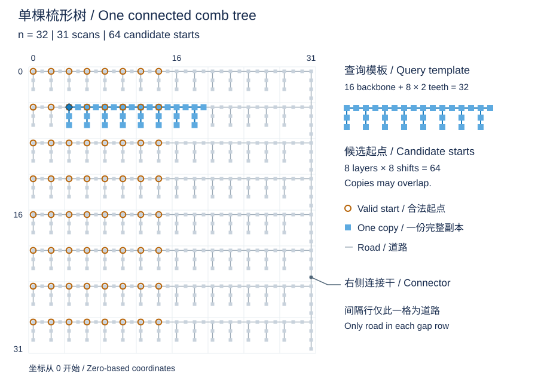

# Comb-tree questions: quadratically many candidates after linearly many scans, but no supercubic cost

Discussion note: 2026-10-11. This article supplements [comb scales and mixed heights](comb-scales.en.md). It addresses a connected host, a linear scan threshold, and template occurrence counts, then explains the illustrated construction's complexity. See also the [Chinese version](comb-candidates.zh.md).

## 1. What is being counted

Let $n$ be the board side length and $R=|F|\le n^2$ the road count; other research documents usually denote the road count by uppercase N. Let $P$ be the complete set of visited displacements, with valid starting points

$$
A(P)=\{a:a+P\subseteq F\}.
$$

An occurrence is an orientation-preserving translation, and copies may overlap. This is neither vertex-disjoint packing nor arbitrary rotation or abstract tree isomorphism.

An “effective change” here means a first visit to a displacement that makes the current program scan its candidates. The answer need not change. Returning to a previously visited displacement does not add a scan round, although it still contributes to the move count. The initial zero displacement is not a scan round either.

If candidates survive to the end, visiting the complete template causes exactly $|P|-1$ scans. Let $q_j$ be the candidate count before scan j. The actual candidate-check total is

$$
W=\sum_j q_j.
$$

The candidate count at one prefix and its sum over all rounds are different quantities.

## 2. Answers to the three questions

| Question | Answer |
| --- | --- |
| Does restricting the road forest to one tree exclude the many-candidate counterexample? | No. The host below is a single induced grid tree. Connected hosts are a useful subproblem, but connectedness does not establish the next two claims. |
| Is there a uniform linear scan threshold after which only linearly many candidates remain? | No. For any fixed positive integer $c$, a template with $cn$ vertices can still have quadratically many candidates. |
| Can a template of size $n$, $2n$, or $4n$ occur only linearly often? | No. Exact translation counts are given below. Vertex-disjoint copies would admit a linear area bound, but the problem does not impose disjointness. |

An existing family even makes both the template and candidate count grow faster than the side length; see the [original parameter family](comb-scales.en.md). Fixed multiples make the following counts more transparent.

## 3. An exact construction with a single host tree

Coordinates are zero-based, with rows increasing downward and columns rightward. Choose a positive integer $c$ and let $n\ge8$ be divisible by $4c$. Set

$$
h=4c-2,\qquad g=\frac{n}{h+2}=\frac{n}{4c},\qquad w=\frac n2.
$$

Make precisely the following cells roads:

1. Fill each row $r=i(h+2)$, for $0\le i<g$, with a horizontal backbone of length n.
2. From its even columns $0,2,\ldots,n-4$, extend teeth h cells downward.
3. Fill the rightmost column $n-1$ to connect all backbones.

Keep columns $n-3,n-2$ empty outside backbone rows so that no tooth gains an extra adjacency to the connector. Consecutive layers have a separating row containing only the connector. Each comb attaches to the connector only at its backbone's right endpoint, and neighbouring teeth are nonadjacent. Thus all induced four-neighbour edges form one tree.

The template is rooted at its upper-left corner. It contains a horizontal backbone of length w and downward teeth of length h at every even backbone column. Hence

$$
|P|=w+\frac w2h=\frac n4(h+2)=cn.
$$

Its backbone must align with a host backbone, and the starting column must be even. The rightmost translation that would fit geometrically puts the final template tooth in the deleted host column, so it is invalid. The valid starts are exactly

$$
A(P)=\left\{\bigl(i(h+2),2j\bigr):0\le i<g,\ 0\le j<\frac n4\right\}.
$$

Consequently,

$$
\boxed{|A(P)|=g\frac n4=\frac{n^2}{16c}.}
$$

A real walk can first finish the backbone, return along it, and then visit and return from each tooth. Its length is $O(|P|)$, and it triggers exactly $cn-1$ new-position scans. Every final candidate also matches every earlier complete prefix; no deleted candidate is restored.

| Fixed constant | Template vertices | New-position scans | Final candidates |
| --- | --- | --- | --- |
| 1 | $n$ | $n-1$ | $n^2/16$ |
| 2 | $2n$ | $2n-1$ | $n^2/32$ |
| 4 | $4n$ | $4n-1$ | $n^2/64$ |

For any fixed c, the candidate count divided by the side length is $n/(16c)$, which grows without bound. That disproves a linear bound; exceeding the side length in a single finite example would not. For any earlier fixed linear threshold, choose a larger fixed c. Candidates only disappear, so at that earlier threshold at least these candidates were still present.

## 4. Illustration with teeth of length two

Grey cells and thin lines show roads and all adjacency edges. The rightmost vertical connector joins the eight layers into one tree. Orange circles are starting points, not current walker positions. Moving the upper-left corner of the blue copy to any circle keeps every template cell on a road. Copies at adjacent starts overlap extensively; they do not require separate road resources.

| Side length | New-position scans | Final candidates | Candidates / side length |
| ---: | ---: | ---: | ---: |
| 16 | 15 | 16 | 1 |
| 32 | 31 | 64 | 2 |
| 64 | 63 | 256 | 4 |
| 128 | 127 | 1024 | 8 |
| 256 | 255 | 4096 | 16 |

Doubling the side length roughly doubles the scan count and quadruples the final candidate count. The asymptotic argument allows the parameter to grow without bound; examples within the official side-length limit only check the construction.

## 5. Why this construction does not produce supercubic work

First consider the illustrated fixed tooth length of two. The query completes the template in the order above and may then continue arbitrarily. The proof covers that query and every continuation; it does not settle every host and every initial query.

**Inside the original layer: many candidates, few new positions.** One comb layer has only linearly many road cells. More robustly, while query displacements remain between rows zero and two, any surviving complete prefix has three rows and at most n columns, hence only linearly many distinct positions. Each scan checks at most quadratically many candidates, so this stage costs at most cubic work. Revisiting old positions adds no scans.

**The first crossing of a separating row fixes the starting column.** The complete template has already placed every candidate root on a host backbone. At the first exit from those three rows, the new displacement row must be minus one or three. From every candidate it lands in a separating row or outside the board. The sole road in a separating row is on the rightmost connector. Thus, if the new displacement is $(x,y)$, every surviving start a must satisfy

$$
a_{\rm col}=n-1-y.
$$

At most one start per layer survives, leaving linearly many candidates. This crossing scan is still charged at the old candidate count, at most quadratic; the reduction is used only for subsequent scans.

**After crossing layers: more new positions, fewer candidates.** Whenever a candidate survives, translation embeds the complete displacement set injectively into the roads. Its size therefore cannot exceed the road count. At most quadratically many further scans each inspect linearly many candidates, again giving at most cubic work. The final scan that deletes every candidate can be charged separately; only move processing remains afterward.

This construction cannot provide quadratically many new-position scans while retaining quadratically many candidates throughout.

## 6. Why longer teeth or mixed heights do not directly overcome the bound

Longer teeth provide more positions within a layer but leave room for fewer layers. At a uniform height, the template has size $\Theta(n(h+1))$, while the candidate count is $\Theta(n^2/(h+2))$; their static product remains cubic in order.

**The static product alone does not upper-bound the whole execution.** Earlier prefixes may have more candidates, so multiplying the final count by all rounds is invalid. For the construction in Section 3, the stated visit order, and any continuation, split the charges rigorously:

1. Completing the initial backbone and performing the first vertical scan costs $O(nR)$.
2. Starts are now in even columns of host backbones, so there are $O(gn)$ candidates. Before the first exit from rows zero through h, a surviving prefix has at most $n(h+1)$ displacements, costing $O(g(h+1)n^2)$.
3. Crossing a separating row fixes the starting column and leaves at most g candidates. Subsequent scans number at most the order of the road count, costing $O(gR)$. An extra $O(R)$ suffices for the final all-failing scan.

Using $g=n/(h+2)$ and $R\le n^2$ gives

$$
W=O\bigl(nR+g(h+1)n^2+gR+R\bigr)=O(n^3).
$$

Apply the bound on distinct in-band positions to the last prefix with a surviving candidate. A start that has already failed cannot witness the width of future prefixes.

When different tooth heights share one board, each height cannot independently occupy the entire board. The existing [mixed-height proof](comb-scales.en.md) considers comb forests separated by empty rows, with queries completing the backbone before growing the teeth in any interleaving order. It charges each candidate's lifetime against the total tooth-height budget of that one board. Its host and ordering hypotheses remain in force; this is not an extension to arbitrarily connected mixed combs.

## 7. What this discussion records and subsequent progress

The single-tree counterexample, failure of the linear threshold, and general comb-scale relationship were already documented. This note adds exact counts for fixed multiples of the side length, a durable static illustration, and the complete accounting argument based on fixing the starting column at a separating row.

The follow-up question of extending any forest to an induced grid tree, including obstructions between two large trees and among linearly many large trees, is recorded in [the tree-extension note](tree-extension.en.md). It examines a reduction from forests to a single tree, complementing the already connected comb host here.

These results refute the auxiliary claim that candidates must become linear after linearly many scans. A large candidate count does not by itself imply supercubic total work.

The local explanation here covers only the stated construction. The later [general proof](../proofs/cubic-bound.en.md) improves the bound for arbitrary induced four-neighbour forests from $O(n^3\log(n+1)+m)$ to $O(n^3+m)$; reading moves and writing answers contributes $O(m)$. See the [research overview](../../complexity-research.en.md) for the research history.
