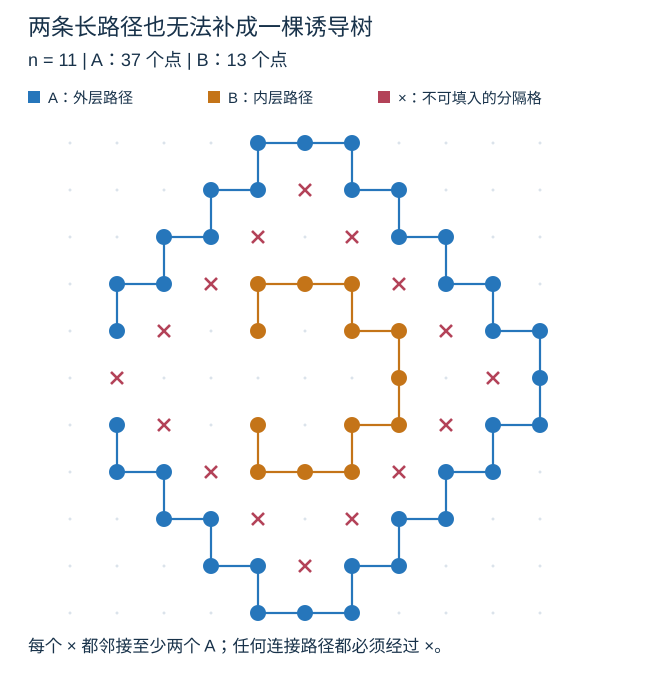
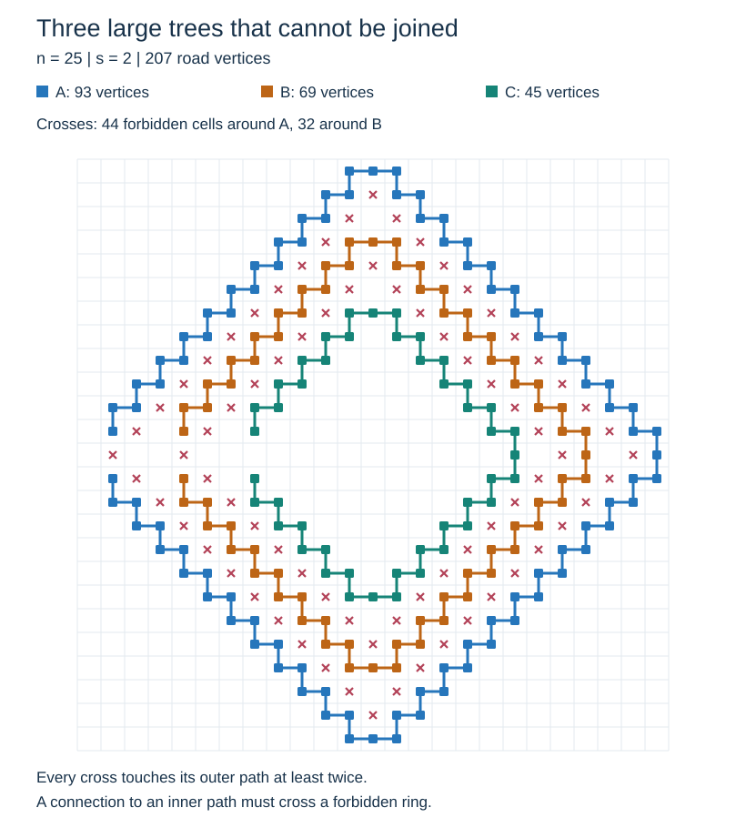

# 诱导网格森林无法总是通过补点变成树

讨论补记：2026-10-12。固定道路位置并保留全部四邻接边时，森林不一定能通过添加格点变成一棵树。这种障碍不仅存在于小例：一张方形网格中可以同时有线性数量的树，每棵都有线性个点，任意两棵都无法补点连成诱导树。本文记录问题、构造、证明与示例。英文版见 [English](tree-extension.en.md)。

## 1. 问题的准确含义

用 $n$ 表示网格边长，用 $R=|F|$ 表示道路格数。讨论中用户所说的“大写 N 级别”指本文的边长 n；其他研究文档的大写 N 通常指道路格数。这里的“线性数量”给出的是 $\Theta(n)$ 构造，不只是一个大 O 上界。

对整数格点集合 S，令 G(S) 包含 S 中所有曼哈顿距离为一的点对作为边。问题是：对任意使 G(F) 为森林的道路集合 F，是否总存在有限集合 S，使

$$
F\subseteq S,\qquad G(S)\text{ is a tree}?
$$

这与“原森林能否由同一嵌入下的一棵诱导网格树删除顶点得到”等价。原有道路不能移动、删除或缩放；补点后产生的四邻接边也不能选择性忽略。下文甚至允许把网格任意扩大。

如果只讨论抽象图，答案是可以：增加一个新顶点，并向每个分量各选一个顶点连边，就得到树。如果保留网格位置但允许自由删边，也可以在连通的较大矩形网格中把原森林扩充成生成树。这两种操作都不同于本题只允许添加道路格的诱导图模型。

| 问题 | 结论 |
| --- | --- |
| 任意诱导四连通网格森林都能由一棵诱导网格树删点得到吗？ | 不能；一个 5×5 的两分量反例已经足够。 |
| 障碍能否发生在两棵都达到线性大小的树之间？ | 能；两棵甚至都可以是简单路径，并有线性个直接相邻两侧的禁止桥接格。 |
| 这样的树的数量也能达到线性级别吗？ | 能；同时有线性棵、每棵线性大小，而且任取两棵都无法补点连成诱导树。 |
| 扩大网格、绕远路能否解决下面的构造？ | 不能；必须经过的格点本身就禁止填入，与外部空间大小无关。 |

## 2. 一个禁止补点的基本事实

设 A 是必须保留的一棵树，空格 x 与 A 中两个不同顶点 u、v 相邻。A 中已有唯一的 u 到 v 路径，填入 x 后，这条路径加上两条新边就形成环。

因此，**任何包含 A 的诱导树都不能包含 x**。这不是“某一种补点顺序会失败”，而是任何最终超图都不可能是树；同时添加其他点也不会消除已经存在的环。

只要这样的禁止格点把另一个分量与 A 分开，就不可能连接它们。后面的构造都使用这个事实。

## 3. 5×5 的反例

下面每个字符代表一个格点。A 是一条 13 点路径，B 是一个孤立点，× 和 · 都是空格；× 特别标出 B 的四个邻格。

```text
· A A A ·
· A × A A
· × B × A
· A × A A
· A A A ·
```

A 与 B 不相邻，原图确实是两个分量的诱导森林。每个 × 都与至少两个 A 顶点相邻，因此都不能填入。B 向外走的第一步却必须经过某个 ×，所以 B 永远无法连接到 A。

这个例子可以放在任意更大的网格内部，论证仍然成立。这里仅称它为一个小反例，不声称它在边长或道路数意义下最小。

## 4. 两棵线性大小的树也可以互相隔离

### 4.1 带缺口的阶梯路径

以原点为中心，令

$$
\rho(x,y)=|x|+|y|.
$$

对整数 $t\ge2$，先构造阶梯环

$$
C_t=\{(x,y):\rho(x,y)=t\}
\cup\{(x,y):\rho(x,y)=t+1,\ xy\ne0\},
$$

再删除同一侧连续的三个点：

$$
P_t=C_t\setminus\{(-1,-t),(0,-t),(1,-t)\}.
$$

如果把第一个坐标视为行、第二个坐标视为列，缺口就在最左侧。两层半径上的点沿四个象限依次交替连接，C_t 是一个诱导简单环：每个点度数为二，且整环连通。两层各有 $4t$ 个点。删去连续三个点后，得到一条诱导简单路径，满足

$$
|P_t|=8t-3,\qquad P_t\subseteq[-t,t]^2.
$$

### 4.2 两条路径的参数族

取整数 $k\ge5$，令

$$
n=2k+1,\qquad A=P_k,\qquad B=P_{k-3}.
$$

两条路径都放得进边长为 n 的网格，而且

$$
|A|=8k-3=4n-7,\qquad |B|=8k-27=4n-31.
$$

A 的点半径至少为 k，B 的点半径至多为 k 减二，所以它们之间没有四邻接边。两棵树的大小都是 $\Theta(n)$。



图中两条路径本身都有缺口；真正阻止连接的是空格中的整圈 ×，而不是某条道路构成了环。

### 4.3 缺口为什么不能成为通道

考虑空格圈

$$
X_k=\{(x,y):\rho(x,y)=k-1\}.
$$

非坐标轴上的圈内点有两个向外的邻点，均位于 A 的半径 k 那一层。坐标轴上的点原本有三个这样的邻点；即使面对路径缺口，也只少了一个，仍有两个。删除的另两个缺口点半径为 k 加一，不会与这圈格点相邻。

所以 X_k 中每个点都因第 2 节的事实而禁止填入。另一方面，四邻接移动每一步都使半径增加或减少一；从 B 的半径区域走到 A，必然经过 X_k。扩大网格也不改变这个必经条件。

这证明两条线性大小的路径无法补点连成诱导树。禁止格点数量为

$$
|X_k|=4k-4=2n-6.
$$

除四个坐标轴点和缺口旁的两个点以外，其余禁止格点还直接邻接 B。因此，同时邻接两棵树、却一填入就成环的格点恰有

$$
4k-10=2n-12=\Theta(n).
$$

例如图中的边长为 11，两棵路径分别有 37、13 个点，禁止圈有 16 个点，其中 10 个直接邻接两棵路径。这把单个小障碍扩展成了线性规模的阻隔。

## 5. 线性数量的树可以同时存在

取正整数 s，令

$$
n=12s+1,\qquad t_i=6s-3i\quad(0\le i\le s),\qquad T_i=P_{t_i}.
$$

也就是从半径 6s 开始，每次减三，一直嵌套到半径 3s。所有路径都位于同一张边长为 n 的网格中。相邻层之间的半径差足以避免四邻接边，因此这些路径恰好是森林的全部分量。

树的数量为

$$
s+1=\frac{n+11}{12}=\Theta(n).
$$

每棵树的大小为

$$
|T_i|=48s-24i-3,\qquad 2n-5\le |T_i|\le4n-7.
$$

因此每个分量都有 $\Theta(n)$ 个点，既没有靠孤立点凑数量，也没有嵌套到只剩常数大小的内层。总道路数为

$$
R=\sum_{i=0}^{s}|T_i|=(s+1)(36s-3)=36s^2+33s-3=\Theta(n^2).
$$



对每个非最内层的路径，取

$$
X_i=\{(x,y):\rho(x,y)=t_i-1\}\qquad(0\le i<s).
$$

每个 X_i 格点都与 T_i 的至少两个点相邻，因而禁止填入；全部更内层的路径都位于其内侧。对任意两棵不同路径，选较外层所对应的这一圈，就证明它们无法连接。**这个结论只保留所选的两棵路径时也成立，不依赖其他分量的阻挡。**

这些互不重叠的分隔圈共有

$$
\sum_{i=0}^{s-1}|X_i|=18s^2+2s=\Theta(n^2)
$$

个禁止填入的格点。

| s | 网格边长 | 树的数量 | 最小树点数 | 最大树点数 | 总道路数 |
| ---: | ---: | ---: | ---: | ---: | ---: |
| 1 | 13 | 2 | 21 | 45 | 66 |
| 2 | 25 | 3 | 45 | 93 | 207 |
| 3 | 37 | 4 | 69 | 141 | 420 |
| 5 | 61 | 6 | 117 | 237 | 1062 |
| 10 | 121 | 11 | 237 | 477 | 3927 |
| 20 | 241 | 21 | 477 | 957 | 15057 |
| 33 | 397 | 34 | 789 | 1581 | 40290 |

参数无界增长给出渐近族；表格仅列具体实例。对其他足够大的边长，可以选不超过它的最大一个上述边长，再在周围补空格。两种边长仅差常数，线性大小、线性数量和不可连接性都保留。

在每棵树至少占用线性个道路格的要求下，分量数量至多为

$$
\frac{n^2}{\Omega(n)}=O(n).
$$

所以这里的线性分量数已经达到面积约束允许的渐近阶。这个最优性结论带有“每棵树线性大小”的前提，不能扩张为任意网格森林的分量数上界。

## 6. 对复杂度研究的意义

这排除了一个直接归约：不能假设任意道路森林都能在保持原位置和诱导性的同时补成一棵树，再仅通过这一步把单树结论推广到森林。其他归约若允许移动、缩放、改变边模型，或者对各分量分别计费，需要另外证明其对匹配和费用的影响。

这些反例**没有给出超三次方的真实候选检查开销**。相反，所有分量都是路径，已经属于[根叶链证明](../proofs/complexity-chains.zh.md)中去掉对数的已证子类。树的分量数量与平移候选数量也不是同一个量。

先前关于单棵梳形树、线性轮数后的平方候选，以及为何相关构造仍只有三次方费用的问题，已记在[梳形树问答](comb-candidates.zh.md)。一般森林的 $O(n^3+m)$ 上界现已由[完整历史收费证明](../proofs/cubic-bound.zh.md)得到；研究过程见[综述](../../complexity-research.zh.md)。

## 7. 可复现的有限核对

[构造验证脚本](../verify_tree_extension.py)直接从坐标生成全部四邻接边，核对小反例、两路径参数族和表中的所有嵌套实例：分量恰为指定的路径、点数和边数正确、没有意外跨层边、所有禁止格确实邻接外层至少两个点，以及分隔圈的半径关系。

从仓库根目录运行：

```text
python topics/simulation/grid-forest-matching/research/verify_tree_extension.py
python topics/simulation/grid-forest-matching/research/check_documents.py
```

脚本验证的是有限实例及精确计数。任意参数下的不可扩充性由第 2、4、5 节的证明保证，不依赖有限搜索，也没有把这些静态森林当成超三次方的查询输入。
