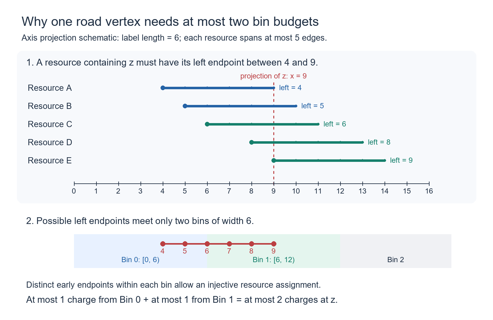

# A general cubic upper bound for the candidate-list algorithm

Date: 2026-10-12. This is a self-contained proof chain following the audit of the [capacity-two draft](reference-capacity.en.md). The spacing lemma uses two actual finite axis segments. It needs **no infinite physical-axis extension, planar separation, or high-power assumption**.

## 1. Result and overall strategy

Let the road set induce a forest in a square grid. Write the board side, road count, move count, and total candidate checks as

$$
n,\qquad N\le n^2,\qquad m,\qquad W.
$$

The candidate-list algorithm, which filters only at newly discovered displacements, satisfies

$$
\boxed{W\le(5n-3)N},\qquad
\boxed{T=O(n^2+m+nN)\subseteq O(n^3+m)}.
$$

Space remains quadratic. Horizontal road strips give the matching cubic-plus-moves worst-case lower bound when the number of moves is at least the board side minus one. Thus the logarithm in the general upper bound can be removed.

The old proof bounds candidates separately at each prefix size and then sums, allowing each scale to claim a fresh road budget. Here we pair **successful checks over the entire history** by host target and query row, and charge them by horizontal displacement label:

1. Keep only the earliest success for each target and query row as a star center, paying these directly.
2. Pair every later success with its star, assigning a horizontal label and its complete early prefix as a resource.
3. For one label, pay the common-cut class first. Every remaining individual resource projects to less than one label-axis length.
4. Delete one reference class in each host intersection component. Equal-early remaining copies are separated by more than a label-axis length. Bin by this length: early endpoints are distinct in a bin, and a road vertex participates in at most two bins.
5. Each label uses at most four intersection budgets. Summing them merely counts ordered same-row road pairs, giving road count times board side.

These are proof-only groupings, not new algorithm steps.

### 1.1 Notation and objects at a glance

| Symbol | Meaning and ambient space |
| --- | --- |
| $n,N,m,W$ | Board side, road vertices, actual moves, and individual candidate checks; distinguish side length from road count |
| $P_j,t(x)$ | The first $j+1$ distinct query displacements and a vertex's discovery index; these indices are not actual walk-step numbers |
| $a,e,f,h=f-e$ | Late candidate source, early query vertex, late query vertex, and horizontal label; the early candidate is $a+h$ |
| $G_h,K,S_{a,e}$ | Road translation intersection, one of its connected components, and a marker's complete early-prefix resource; the resource consists of host road vertices |
| $w_x,\alpha,\rho$ | Query path word, host source path word, and the map from words to grid displacements; equal displacements do not imply equal abstract words |
| $g,k_e$ | The uniform host-component translation word and its pullback to the query; the source path word conjugates them |
| $L,J$ | Current host translation axis and chosen reference query axis; axes belong to the direction-word tree and need not be horizontal grid lines |
| $p,q,\ell=qp,\delta=h/q$ | Primitive direction-period length, number of repetitions in the label, label-axis length, and grid displacement per period |
| $\lambda_{a,e}$ | Leftmost coordinate of the resource projected onto the host axis; bins use this coordinate and tree-edge lengths, not horizontal bounding boxes |

Assigning a resource vertex to a marker is only a counting correspondence: every actual successful check receives an allowed road vertex, with bounded reuse per vertex. Roads are not removed or consumed, and the algorithm does not compute these axes or bins.

### 1.2 What the four budgets pay

| Category after fixing one label | Maximum charge per intersection vertex | Why this suffices | Proof location |
| --- | --- | --- | --- |
| Markers paid at the common cut | One | They share one query translation class, with injective early images | Sections 3.3 and 4 |
| Reference class in each intersection component | One | Same-class injection; distinct components have disjoint vertex sets | Sections 3.3 and 5 |
| Other strict markers | Two | Unit assignment per bin; a resource vertex participates in at most two bins | Sections 6 and 7 |

Thus the coefficient four is “one plus one plus two.” Star centers and at most one failure per candidate are paid outside the label charge, producing the total scan coefficient. These four budgets cannot be claimed anew for different prefix scales: they already cover the fixed label's **entire history**.

An individual resource shorter than a label-axis length does not imply that a connected union of such resources is short. Opposite early arms refute the latter claim. The new proof allows long unions and controls bin participation at each vertex instead.

## 2. Successful checks, stars, and resources

List distinct query displacements in discovery order:

$$
q_0=0,q_1,\ldots,q_L,\qquad P_j=\{q_0,\ldots,q_j\}.
$$

Retain only the longest prefix with at least one successful candidate. This is the query tree; a final filter that eliminates every candidate is charged separately to failures. The walk makes prefixes connected, and a complete match makes them induced trees. The final successful query occupies at most the board side many rows.

For each successful nonroot check, the queried point maps from a candidate source to a host target. Fix a target and query row, and choose their earliest successful point as star. Every later success in that group gives one mark

$$
(a,e,f),\qquad t(e)<t(f),\quad h=f-e=(0,d),\quad d\ne0.
$$

The star's candidate is the late source plus the label. Complete histories give

$$
a+P_{t(f)}\subseteq F,\qquad a+h+P_{t(e)}\subseteq F.
$$

For a fixed label define its intersection and each mark's resource:

$$
G_h=F\cap(F-h),\qquad S_{a,e}=a+P_{t(e)}\subseteq G_h.
$$

Each resource is a connected subtree. Denote the label's mark count by

$$
\widetilde M_h.
$$

There is only one star per target and query row, and each candidate fails at most once. Hence

$$
W\le(n+1)N+\sum_h\widetilde M_h.
$$

It remains to bound each label's marks by four times its intersection size.

## 3. The direction-word tree and three facts

Encode east/west and north/south by two inverse letter pairs, cancelling adjacent inverse letters. Reduced words form a free group whose Cayley graph is a tree. Root an actual road tree and represent each vertex by the word of its unique root path; this embeds the road tree as a subtree of the free tree.

An actual tree path never immediately backtracks, so its direction word is reduced. Directions determine the next grid cell, so different paths cannot become the same reduced word. The map from words to grid displacement is a homomorphism, but it is not injective on the entire free tree. **Equal coordinates imply equal vertices only inside the same actual road tree.**

Write the coordinate homomorphism and query root words as

$$
\rho:\mathbb F\longrightarrow\mathbb Z^2,\qquad w_x\in\mathbb F.
$$

If the host source has direction-word vertex

$$
\alpha,
$$

then the image of a query point in its complete matched prefix is

$$
\alpha w_x.
$$

A connected translation preserving all edge directions is one uniform left multiplication.

### 3.1 One host intersection component has a uniform translation

Take a component containing a mark. A resource contains its source and early-endpoint image, and the two successful prefixes meet at the marked target. The component and its label translate therefore lie in the same actual road tree. Translation by the label on the component is one nonidentity left multiplication:

$$
g:K\longrightarrow K+h,\qquad \rho(g)=h.
$$

Applying it at the early image gives

$$
g\alpha w_e=\alpha w_f,\qquad
k_e:=w_f w_e^{-1}=\alpha^{-1}g\alpha.
$$

Marks with identical query translation words are called one query class.

### 3.2 Axes, periods, and coordinates

A nonidentity left multiplication has a unique translation axis. Conjugate it to a cyclically reduced word and repeat that word in both directions to construct the axis. The displacement of an off-axis point equals the axis translation length plus twice its distance to the axis, proving uniqueness.

Orient the axis toward the label translation. Let its primitive direction period, label-axis length, and power be

$$
p\ge1,\qquad \ell=qp,\qquad q\ge1.
$$

There is no high-power hypothesis. Each primitive period has grid displacement

$$
\delta=h/q\ne0.
$$

A nonidentity left multiplication commuting with this translation preserves its axis. It cannot reverse a nonzero translation or fix an axis vertex, so it shifts along the axis. Preservation of edge directions requires an integer multiple of the primitive period. Its axis and grid displacements are therefore

$$
sp,\qquad s\delta,\qquad s\in\mathbb Z\setminus\{0\}.
$$

A nonidentity left multiplication cannot preserve a second distinct axis either: a reflection would fix a vertex or invert an edge, neither of which is possible in this free action; a nonzero translation already has a unique axis.

### 3.3 A fixed query class has unit resource capacity

First take two sources of the same class inside one host component, with group vertices

$$
\alpha,\beta.
$$

Their identical query translation and conjugacy relations imply

$$
T=\beta\alpha^{-1},\qquad Tg=gT.
$$

If the sources differ, their grid difference is an integer multiple of the horizontal period, so they have the same row. If their resource early-endpoint images coincide, their late targets coincide and their query early endpoints have the same row. Uniqueness of the earliest star for that target and row forces the early endpoints, and then sources, to be equal.

Thus a query class injects into its resource early-endpoint images. Images in different host components are disjoint, so the unit-capacity conclusion combines across components.

## 4. A common cut pays one intersection budget

For one label define the maximum early index, common prefix, and old paired set:

$$
t_* =\max t(e),\qquad P=P_{t_*},\qquad I=P\cap(P-h).
$$

Both candidates of a mark attaining the maximum early index match the complete common prefix. The prefix and its translate therefore embed simultaneously in one host tree, so the old paired set is connected or empty.

For any mark the set

$$
R_{e,f}=P_{t(e)}\cap(P_{t(f)}-h)
$$

is connected and contains the early endpoint: after translation it is the intersection of the two successful full prefixes, containing the marked target.

On any connected query translation intersection, the word

$$
w_{x+h}w_x^{-1}
$$

is constant along edges, since the original edge and its translated edge have the same direction.

Consequently, all marks whose late endpoints already lie in the common prefix, or whose early prefixes meet the old paired set, belong to its one query class. In the latter case the connected set above joins the early endpoint to a point in the old paired set, preserving the translation word along the path. Section 3.3 pays all these marks with one intersection budget.

Call the remaining marks strict. Take the cutoff at the first visit to the old paired set, or just after the common prefix if the set is empty. Strict marks satisfy

$$
\tau=\min_{x\in I}t(x)\quad(I\ne\varnothing),\qquad
\tau=t_*+1\quad(I=\varnothing),
$$

$$
t(e)<\tau,\qquad t(f)>t_*,\qquad
P\cap(P_{\tau-1}+h)=\varnothing.
$$

In particular, each individual strict resource satisfies

$$
S_{a,e}\cap(S_{a,e}+h)=\varnothing.
$$

Only the strict part remains to be paid:

$$
\widetilde M_h\le |G_h|+\widetilde M_h^{\rm strict}.
$$

## 5. Why every remaining source matches the reference late prefix

Inside one host intersection component, choose a strict mark with latest early index as reference:

$$
(a_*,e_*,f_*),\qquad J=\operatorname{Axis}(k_{e_*}).
$$

Pay its entire query class with one component budget by Section 3.3.

A nonreference mark has an earlier early endpoint. If its late endpoint were no later than the reference late endpoint, then the connected reference set

$$
R_{e_*,f_*}=P_{t(e_*)}\cap(P_{t(f_*)}-h)
$$

would contain both early endpoints, forcing their query translation words to agree. This contradicts their different classes. Hence

$$
t(e)<t(e_*)<t(f_*)<t(f).
$$

The nonreference source matches its own complete late prefix and therefore also the complete reference late prefix. The unique query path between the reference endpoints contains an axis segment at least as long as the label-axis length. Fix one such segment:

$$
A\subseteq P_{t(f_*)}\cap J,\qquad |E(A)|=\ell.
$$

Every remaining source matches this same actual query path completely.

## 6. The finite second-axis lemma

Take two nonreference marks in one host component with the same early endpoint and different sources. Adding the label also fixes their common late endpoint, so they have the same query translation and axis. Write

$$
I_e=\operatorname{Axis}(k_e),\qquad L=\operatorname{Axis}(g).
$$

The conjugacy relations give

$$
\alpha I_e=\beta I_e=L,\qquad
T=\beta\alpha^{-1},\qquad Tg=gT.
$$

Different query classes have different axes. Their translations are conjugate to the same host translation and thus have equal lengths and the same nonzero grid displacement. On the same axis they would be identical or inverse translations; inverse translations have opposite grid displacements and are excluded. Therefore

$$
I_e\ne J.
$$

By Section 3.2, the relative axis and grid displacements are

$$
sp,\qquad b-a=s\delta,\qquad s\ne0.
$$

Suppose, for contradiction, that the axis separation is no larger than the label-axis length:

$$
|s|p\le\ell.
$$

The reference axis has the same primitive period and displacement. Write its primitive translation as

$$
u_*,\qquad k_{e_*}=u_*^q,\qquad \rho(u_*)=\delta.
$$

The actual reference segment has the label-axis length, so it contains two vertices

$$
v,\quad u_*^s v\in A.
$$

Their axis and grid separations are the corresponding multiples of the primitive period. Both complete reference late prefixes ensure that the following two host points really lie in the same actual road tree, and their coordinates agree:

$$
a+\rho(u_*^s v)=a+s\delta+\rho(v)=b+\rho(v).
$$

Coordinate injectivity within that actual road tree gives equality of group vertices, and consequently

$$
\alpha u_*^s v=\beta v,\qquad
T=\beta\alpha^{-1}=\alpha u_*^s\alpha^{-1}.
$$

The relative translation's axis is both the host axis and this source's image of the reference axis. Uniqueness gives

$$
L=\alpha J=\alpha I_e,
$$

contradicting the distinct query axes. Thus

$$
\boxed{|\Delta_{\rm axis}(a,b)|>\ell.}
$$

**Dependency boundary.** The two compared points belong to two successful copies of the same actual query segment. No coordinate coincidence on virtual axes is treated as vertex equality, and no periodic extension of the entire intersection is asserted. The proof simultaneously covers straight axes, curved axes, and every positive power.

## 7. Left-endpoint bins give nonreference capacity two

Use integer coordinates on the host axis and nearest-point projections for resource left endpoints and spans. An individual strict resource has span shorter than the label-axis length: otherwise its connecting path contains an axis segment with two vertices separated by that length. The host translation maps one to the other, making their grid difference the label, contrary to individual resource disjointness.

Therefore

$$
\lambda_{a,e}=\min\pi_L(S_{a,e}),\qquad
\operatorname{diam}\pi_L(S_{a,e})\le\ell-1.
$$

Equal-early resources are images under a relative left multiplication preserving the host axis. Projection is equivariant under that translation, so the separation from Section 6 also applies to resource left endpoints:

$$
e=e',\quad a\ne b\quad\Longrightarrow\quad
|\lambda_{a,e}-\lambda_{b,e}|>\ell.
$$

Use the half-open bins

$$
\lambda_{a,e}\in[j\ell,(j+1)\ell),\qquad j\in\mathbb Z.
$$

Early endpoints are distinct in each bin. Allocate resource vertices in increasing early-index order. The current complete early prefix contains all previous distinct query early endpoints, its own early endpoint, and the root, so it has more vertices than have already been assigned. An unused resource vertex always exists. Thus each bin has a unit allocation.

If a host point belongs to a resource, its projection and the resource's left endpoint satisfy

$$
x=\pi_L(z),\qquad \lambda_{a,e}\in[x-\ell+1,x].
$$

This integer interval meets at most two bins. Combining their unit allocations therefore uses each resource vertex at most twice. Nonreference strict marks have capacity two; the reference class costs one more:

$$
\widetilde M_h^{\rm strict}(K)\le3|K|.
$$

**Connected resource unions need not be disjoint from their translates.** Different resources may extend in opposite directions and span a full label length; their union may cross many bins. The charge only needs individual shortness, large equal-early spacing, and at most two bins per point.

Here the label-axis length is six and the fixed projection is nine. A resource containing that vertex can start only between four and nine, meeting at most two bins. This is an axis-projection counting schematic, not a claim that all displayed intervals arise together from one query. The [drawing script](../plot_cubic_bins.py) reproduces it.

## 8. Sum over components, labels, and the entire history

Select references separately in each host intersection component. Components are vertex-disjoint. Including the common-cut budget gives

$$
\boxed{\widetilde M_h\le4|G_h|.}
$$

If road counts in rows are denoted by

$$
k_r,
$$

summing all positive and negative horizontal labels counts precisely the ordered pairs of different road vertices in one row:

$$
\sum_{h=(0,d),\ d\ne0}|G_h|
=\sum_r k_r(k_r-1)\le(n-1)N.
$$

Adding stars and at most one failure per candidate finally yields

$$
\begin{aligned}
W&\le(n+1)N+\sum_h\widetilde M_h\\
&\le(n+1)N+4(n-1)N=(5n-3)N.
\end{aligned}
$$

Reading the grid, handling every move, and producing outputs still count, so

$$
T=O(n^2+m+nN)\subseteq O(n^3+m).
$$

Empty roads or no moves give zero scans. If only the root succeeds, there are no marks. Moves after all candidates fail need only constant processing time. The proof never assumes that the final failing query prefix is a tree.

The lower bound is direct as well: fill every other row with a horizontal road path and move right to the opposite end. Candidates per row before successive scans decrease from the board side to two, giving

$$
W=\left\lceil\frac n2\right\rceil
\sum_{j=1}^{n-1}(n-j+1)
=\left\lceil\frac n2\right\rceil\frac{(n-1)(n+2)}2
=\Theta(n^3).
$$

Pad with back-and-forth moves on visited edges; producing all outputs still takes linear time. Thus the worst-case bounds match in the following move range:

$$
m\ge n-1\quad\Longrightarrow\quad
T_{\rm worst}=\Theta(n^3+m).
$$

## 9. Audit record

The theoretical audit completed the derivation above. Compared with the previous draft, the finite second-axis lemma removes infinite physical extensions and the high-power restriction, reducing the fixed-label charge from five budgets to four. The refuted connected-union disjointness conjecture is not used.

Computational verification checks definitions, classifications, and allocation implementations; it does not replace the general arguments in Sections 4–8. Subsequent verification built per-marker certificates with the [independent complete-charge verifier](../verify_cubic_bound.py). The [report](../cubic-bound-results.json) has status `passed`. Both editorials, the overview, and historical document status notices are synchronized.

### 9.1 Independent verification scope

The new implementation recomputes candidates from actual walks, collecting successful events before selecting earliest stars. It does not use the earlier history, scenario-classification, or bin-verification routines. Axis coordinates come from distance differences to two distant abstract axis vertices, without physical extensions or horizontal bounding boxes. References are selected separately in each actual component for every label. Checks cover the common-cut class, temporal reversal, individual resource spans, equal-early spacing, and every allocation.

| Check | Actual coverage or result |
| --- | --- |
| All cases | 1,886, all passed |
| Three-by-three enumeration | All 416 induced forests among 512 vertex subsets; one depth-first discovery order for every road root, giving 1,710 cases including the empty board |
| Constructions and order changes | 24: the original eight fixtures, opposite early arms, low powers, power one, nested and bent combs, and three roots times three orders on a smaller bent comb |
| Random and boundary cases | Fixed-seed 120 forests, 30 random walks, and two single-vertex boundary cases |
| Candidate scans | 604,846; every answer and scan count agrees with the independent bitset implementation |
| Additional answer checks | 1,871 small cases enumerated from complete prefixes; 17 cases compared with the original C++ program |
| All historical markers | 13,750 across 748 per-case label groups; each assigned exactly once |
| Charge partition | 3,137 common-cut, 8,390 reference, and 2,223 nonreference markers |
| Equal-early spacing | 1,367 consecutive pairs after sorting; two come from curved power-one axes |
| Nonempty power coverage | Components with nonreference markers: one each at powers one, two, and three, nineteen at power at least four; five have curved axes |
| Observed maximum occupancy | One for nonreference assignments and two overall per label, within the proved bounds of two and four; this does not establish optimal constants |

The small-board enumeration covers vertex sets and roots, **not every discovery order or every walk**. The larger bent comb retains its original-order check; the three-root, three-order perturbations use a 1,375-vertex instance of the same family to keep complete certificates manageable. The preceding larger perturbation run did not complete and is excluded from these totals.

### 9.2 Power-one curved-axis coverage is nonempty

The construction first specifies the required prefix edges of a coarse graph. The query visits heights three, nine, and twenty-one on a vertical spine, then visits one rightward edge at each height in reverse order. The host contains late prefixes at phases zero and two, the corresponding translated early prefixes, and a horizontal connector. The coarse vertex set itself is not an induced forest and must not be used as an input board.

Scale vertices by six, replacing vertical edges by six vertical steps and horizontal edges by the ten-step path “east two, south two, east two, north two, east two.” Subdivide only the specified coarse edges, then check **all** induced grid edges of the final vertex set. They form a tree. The resulting instance has 811 road vertices and 294 actual moves, with seven label markers: three reference and four nonreference.

Its label moves six grid columns but translates ten edges along the tree axis. This ten-step direction period is primitive, so the power is one. Each of two nonreference early endpoints has two copies separated by two primitive periods, strictly exceeding one label-axis length. Thus curved geometry, the lowest power, repeated early endpoints, and a different reference class are all tested nonvacuously. The report retains the complete per-marker assignments.

### 9.3 Follow one actual successful check through to its assignment

Use the saved power-one instance above, in the generator's construction coordinates. Select its nonreference marker

$$
a=(-54,0),\quad e=(54,0),\quad f=(54,6),\quad h=(0,6),\qquad t(e)=54,\quad t(f)=146.
$$

The corresponding early and late successes reach exactly the same host target:

$$
(a+h)+e=(0,6)=a+f.
$$

The early query vertex is the first success for this target and query row, so it is the star center. The early candidate matches its complete early prefix and the late candidate its complete late prefix. Both facts are required: checking only the two endpoints above is insufficient. The first fifty-five query vertices are discovered consecutively down the spine, so the resource is exactly

$$
S_{a,e}=\{(r,0):-54\le r\le0\},\qquad |S_{a,e}|=55.
$$

It belongs to bin zero, and the certificate assigns it its source vertex inside that resource. The table gives every assignment for this label. Early and late columns are discovery indices of distinct displacements, not actual walk-step numbers. Bin indices depend on the chosen axis-coordinate origin and carry no additional geometric meaning.

| Late source | Early index | Late index | Charge category | Assigned host vertex |
| --- | --- | --- | --- | --- |
| (-126, 0) | 126 | 136 | Reference | (0, 0) |
| (-126, 6) | 126 | 136 | Reference | (0, 6) |
| (-126, 12) | 126 | 136 | Reference | (0, 12) |
| (-54, 0) | 54 | 146 | Bin zero | (-54, 0) |
| (-54, 12) | 54 | 146 | Bin two | (-54, 12) |
| (-18, 0) | 18 | 156 | Bin zero | (-18, 0) |
| (-18, 12) | 18 | 156 | Bin two | (-18, 12) |

Within a bin, assignment proceeds by increasing early index: bin zero pays index eighteen before index fifty-four. The latter resource contains the vertex already used by the former, but it also contains unused vertices. Intersecting resources therefore do not prevent a unit assignment. Copies with the same early endpoint belong to bins zero and two, respecting the spacing condition.

This example connects an actual certificate to the definitions. Its seven assigned vertices happen to be distinct; that does not prove unit capacity for every instance. The general proof still uses two nonreference budgets and four total budgets.

These checks verify the stated assertions on the listed inputs. The general result for every size, root, and discovery order follows from Sections 2–8.
