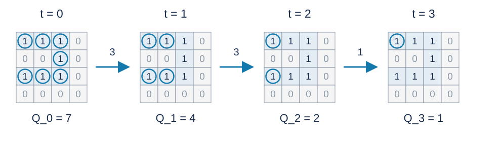

# 一类四邻接网格图森林的匹配问题：题解

## 解法与贡献

采用出题人的“保留合法起点、仅在新位移出现时筛选”方法。Codex（GPT-6）补充集合不变量、明确边界、可证明的工作量界和标准 C++17 实现。[候选列表程序](std.cpp)为首选；[位集补充题解](solution-alternative-bitsets.zh.md)及[程序](alternative-bitsets.cpp)用机器字同时处理多个起点。

## 位移集合决定答案

记执行前 $t$ 步后的累计位移为 $(x_t,y_t)$ ，初始位移为 $(0,0)$ .起点 $(r,c)$ 合法，当且仅当
$$
(r+x_i,c+y_i)
$$
对每个 $0\le i\le t$ 都是网格内的道路。每一步只是增加一个必须为道路的位置。

图中用圆圈标出样例一在对应前缀下的合法起点，数量 $Q_t$ 依次为七、四、二、一。圆圈表示起点，而不是当前位置。

如果累计位移已经出现过，则这次条件早已检查，不会删掉任何新起点。注意重复的是二维累计位移，不是单个方向。

## 列表筛选

先把全部道路格保存为候选起点，并标记初始位移。每次读入方向后更新累计位移：

1. 若候选集合为空，继续读入剩余方向并输出零。
2. 若某个累计位移坐标的绝对值达到 $n$ ，任何起点都已越界，清空候选。
3. 若位移首次出现，逐个检查候选加上这个位移后的格子是否在界内且为道路，原地压缩列表，只保留通过者。
4. 输出当前列表长度。

不再加入被删起点，因此后来回到道路也不会恢复它们。标记数组给负位移统一加偏移量；只有候选非空且坐标在安全范围内时才访问它。

**不变量证明。** 初始列表恰为初始合法起点。新位移的筛选正好加入当前步的道路条件；旧位移没有新增条件，所以列表不变。由归纳，列表始终恰好表示全部前缀合法起点。

## 已证明的复杂度

令道路数为 $N\le n^2$，真实候选检查总数为 $W$。列表程序的时间是
$$
O(n^2+m+W),
$$
空间为 $O(n^2)$。读图、移动与输出已经单独计入，因此重点是候选数的逐轮总和。

现已证明全部历史的统一扫描界
$$
\boxed{W\le(5n-3)N},\qquad
\boxed{T=O(n^2+m+nN)\subseteq O(n^3+m)}.
$$

证明按宿主目标和查询行，把每次成功检查与该组最早成功点配对；最早点称为星心。配对的水平位移为标签 $h$，完整早前缀是其可用资源，位于交域 $G_h=F\cap(F-h)$ 内。

固定标签，先用一份交域预算支付共同切口的一类标记。其余部分在每个交域连通分量内选一个最晚早端的参考类，再用一份预算支付参考类。剩余资源各自沿树轴短于一个标签长度，而同一早端的不同副本相隔超过一个标签长度。按资源投影左端点分组，组内早端互异、可单位分配；每个道路点至多参与两个组。因此每标签总共只需四份交域预算：
$$
\widetilde M_h\le4|G_h|,\qquad
\sum_{h=(0,d),\ d\ne0}|G_h|
=\sum_r k_r(k_r-1)\le(n-1)N.
$$
这里 $k_r$ 是第 $r$ 行的道路数。再加至多 $nN$ 个星心和每候选最多一次的失败检查，就得到上述扫描界。关键间距结论只使用两份实际存在的参考晚前缀，适用于直轴、弯曲轴和所有幂次。

- [一般三次方上界的完整证明](research/proofs/cubic-bound.zh.md)：宏观计费、共同切口、有限第二轴引理、容量二分组与全标签求和。
- [较早的乘积界与带对数证明](complexity.zh.md)：保留锚点图示、几何引理和调和求和，解释旧对数从何而来。
- [研究综述](complexity-research.zh.md)与[资料目录](research/README.md)：一般证明的完成过程、仍有效的子类结论、失败路线和复核脚本。

若移动数很少，还可合并每轮至多检查全部道路的界，得到
$$
O(n^2+m+N\min(m,n)).
$$
位集程序逐轮扫描机器字，其分析见[位集题解](solution-alternative-bitsets.zh.md)，不能直接套用逐候选检查界。可复现的性能测量见[性能记录](../../../docs/benchmark-R28.json)，测量结果不代替复杂度证明。

## 严格的三次方下界

令奇数行全为道路，偶数行全为障碍。道路图由 $r=\lceil n/2\rceil$ 条互不相连、各含 $n$ 个顶点的路径组成，满足森林条件。对于 $n\ge2$，先连续向右移动 $n-1$ 次；若还需要移动，就反复向左、向右，在最后两个已访问位移之间往返。

第 $j$ 次向右移动前，每条道路还剩 $n-j+1$ 个候选，且本次位移首次出现。因此前 $n-1$ 次移动的候选检查总数恰为
$$
\sum_{j=1}^{n-1}r(n-j+1)
=r\left(\frac{n(n+1)}2-1\right)
=\Theta(n^3).
$$
后续往返不会新增筛选，但读入和输出仍需 $\Omega(m)$ 时间。所以当 $m\ge n-1$ 时，这个合法输入族给出 $\Omega(n^3+m)$ 的最坏情况时间下界，与一般的 $O(n^3+m)$ 上界匹配。

## 无环条件为何不能省略

若允许道路成环，令整幅网格全为道路，并让位移依次遍历 $\{0,\ldots,k\}^2$，其中 $k=\lfloor n/2\rfloor$。采用逐行蛇形路线，只需 $(k+1)^2-1=\Theta(n^2)$ 次移动，且每步位移都不同。

所有位移都在这个小正方形内，始终至少保留 $(n-k)^2=\Theta(n^2)$ 个候选，因此检查总数为 $\Theta(n^4)$。这说明一般网格的四次方界可以达到；该网格含环，不能作为原题猜想的反例。

## 数据与复现

三个样例见题面。[生成配方](tests/plan.json)包含十份计分输入；[生成器](tests/generate.py)只依赖 Python 标准库，支持 --plan、--out-dir、--case 和 --std。正式大输入及可执行文件不放入发布包。时间和内存的参考测量见[性能记录](../../../docs/benchmark-R28.json)。
