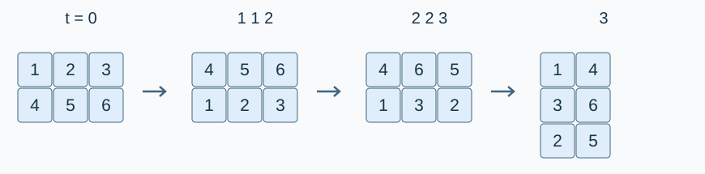

# 异星工厂：搅拌机

预估时间限制：0.5 秒。内存限制：128 MB。

实际时限以标准程序在目标评测环境的最慢用例中位时间乘以 $2$ ，按 $0.5$ 秒向上取整。参考环境见[评测说明](../../../docs/评测环境与性能.md)。

## 背景故事

一位异星工厂玩家正在制作搅拌机模组。机器把物品放在网格中，可以交换整行、交换整列或旋转整个网格。为了检查模组，需要记录每次操作后的状态。

## 形式化问题描述

初始网格有 $n$ 行、$m$ 列，每个格子有一个整数物品编号。行从上到下编号，列从左到右编号，均从 $1$ 开始。依次执行 $K$ 个操作：

- `1 a b` ：交换当前第 $a$ 行和第 $b$ 行。
- `2 a b` ：交换当前第 $a$ 列和第 $b$ 列。
- `3` ：将整个网格顺时针旋转 $90^\circ$ ，随后行数与列数交换，按新的位置重新编号。

若交换操作的任一参数不在当时合法的行或列编号范围内，则操作无效，网格保持不变。交换同一行或同一列是合法操作。

每个合法操作后输出完整网格；无效操作只输出错误提示。



图中依次为样例 1 的初始状态、交换第 $1,2$ 行、交换第 $2,3$ 列、顺时针旋转后的状态。

## 输入格式

第一行三个整数 $n,m,K$ . 接下来 $n$ 行，每行 $m$ 个整数 $x_{i,j}$ ，给出初始网格。

再接下来 $K$ 行，每行一个操作；操作 `3` 没有其他参数，操作 `1` 和 `2` 各有两个整数参数。

## 输出格式

按操作顺序输出结果。每次合法操作输出当前网格，每行相邻整数用一个空格隔开；每次无效操作输出一行 `Invalid arguments!` .

不同操作的输出之间不加空行。初始网格本身不输出。行末额外空格不影响评测。

## 样例

### 样例 1

### 输入

```text
2 3 6
1 2 3
4 5 6
1 1 2
2 2 3
3
1 1 2
1 1 3
3
```

### 输出

```text
4 5 6
1 2 3
4 6 5
1 3 2
1 4
3 6
2 5
3 6
1 4
2 5
2 5
1 4
3 6
3 1 2
6 4 5
```

### 样例 2

### 输入

```text
1 2 8
1 2
1 2 1
2 1 2
3
2 1 2
1 1 2
3
1 -1 1
3
```

### 输出

```text
Invalid arguments!
2 1
2
1
Invalid arguments!
1
2
2 1
Invalid arguments!
2
1
```

### 样例 3

### 输入

```text
1 1 5
0
3
1 1 1
2 1 1
2 30 1
3
```

### 输出

```text
0
0
0
Invalid arguments!
0
```

## 样例解释

样例 1 的前三步见图示。矩形网格旋转后变为 $3$ 行 $2$ 列，后续交换使用新编号。

样例 2 第一次尝试交换不存在的第二行，因此只输出错误提示；第一次旋转后只有一列，交换第二列同样无效。无效操作不改变后续状态。

## 数据范围与保证

对 100% 的数据：$1\le n,m\le20$ ，$1\le K\le1000$ ，$0\le x_{i,j}\le10^9$ ，$|a|,|b|\le30$ . 操作编号为 $1,2,3$ 之一。物品编号允许重复；除 $a,b$ 可能越界外，输入其余部分均合法。

| 分值比例 | 额外条件 |
| --- | --- |
| 100% | 无额外条件 |
