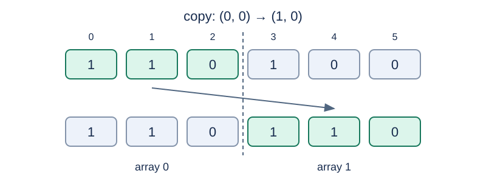

# String Functions in Contiguous Memory

Estimated time limit: 0.5 seconds. Memory limit: 128 MB.

The actual limit is twice the slowest per-case median time of the standard program on the target judge, rounded up to a multiple of $0.5$ seconds. See the [evaluation notes](../../../docs/评测环境与性能.md).

## Story

An old teaching terminal stores several character arrays next to each other. Its maintainer checks each operation: some stay inside their array, some touch a neighboring array, and some must be rejected before execution.

(This story was rewritten by GPT-6.)

## Formal Problem Statement

There are $n$ arrays indexed $0,\ldots,n-1$ . Array $i$ has length $m_i$ , and every element is $0$ or $1$ . The arrays occupy consecutive memory in index order, without gaps. Define $p_0=0$ , $p_i=\sum_{j<i}m_j$ , and $S=\sum_i m_i$ . Pointer $(x,y)$ denotes global address $p_x+y$ . Offset $y$ may be negative.

Execute the following operations in order, using the memory left by previous successful operations.

- `0 x y v c` : write $v$ to $c$ consecutive bytes starting at $(x,y)$ . Print `true` on success.
- `1 x y z w` : copy the string starting at $(x,y)$ to $(z,w)$ . A string ends at its first byte equal to $0$ . The terminating byte is included in the copy. Print `true` on success.
- `2 x y` : report the length of the string starting at $(x,y)$ . Read the terminating byte but exclude it from the length.

Validate the whole operation before changing memory, in this priority order:

1. If any required read or write address is outside $[0,S)$ , print `overflow` and change nothing. A string that reaches the end of memory without a terminator also causes this error.
2. For a copy, if the source and destination intervals share an address, print `overwrite` and change nothing. Both intervals include the terminator. Apply this check only when there is no globally invalid address.
3. Otherwise, execute normally. If any accessed address is outside the array named by its pointer, prefix the normal result with `w` , without a space.

Check source and destination accesses against their own named arrays. Warnings never prefix `overflow` or `overwrite` . In particular, a write with $c=0$ accesses nothing and always prints `true` , even when its pointer is outside global memory.

## Input

The first line contains $n$ . The second contains the $n$ lengths $m_i$ . The next $n$ lines give the initial arrays: line $i+1$ contains the $m_i$ elements of array $i$ . The next line contains the operation count $k$ , followed by $k$ operations in the formats above.

## Output

Print one line per operation: a length, `true` , a normal result prefixed with a warning, or the applicable error string.

## Examples

### Example 1

### Input

```text
2
3 3
1 1 0
1 0 0
5
2 0 0
1 0 0 1 0
2 1 0
0 0 3 0 1
2 1 0
```

### Output

```text
2
true
2
wtrue
0
```

### Example 2

### Input

```text
1
3
1 1 0
6
1 0 0 0 1
1 0 0 0 0
0 0 -1000000000 1 0
2 0 0
0 0 2 1 1
2 0 0
```

### Output

```text
overflow
overwrite
true
2
true
overflow
```

### Example 3

### Input

```text
3
3 2 4
1 0 1
1 1
1 0 0 1
19
0 2 3 1 1
0 2 4 1 0
0 2 4 1 1
0 1 2 1 1
2 0 1
2 0 0
2 0 1
2 0 3
2 0 5
2 1 -1
2 2 2
2 2 3
2 0 5
1 0 1 2 100
1 0 1 2 0
2 1 1
1 0 2 1 0
2 0 2
1 1 1 2 2
```

### Output

```text
true
true
overflow
wtrue
0
1
0
w3
w1
w4
0
overflow
w1
overflow
true
w1
overwrite
w3
wtrue
```

## Example Explanation

In sample 1, the copy writes `1 1 0` into array 1. A later write reaches its first byte through an out-of-bounds pointer relative to array 0, so it prints `wtrue` . Sample 2 demonstrates global overflow taking priority over overlap, copying onto itself, and a zero-length write. Sample 3 covers accesses across several arrays and memory state after rejected operations.



The copy in sample 1. The dashed boundary separates arrays; global addresses remain consecutive.

## Constraints and Guarantees

All data satisfy $1\le n$ , $1\le m_i$ , $S\le1000$ , and $1\le k\le50000$ . All array indices are valid. Every offset has absolute value at most $10^9$ , $0\le c\le10^9$ , and initial bytes and write values belong to $\{0,1\}$ .

Specifications redesigned by Codex (GPT-6): the total size of variable-length arrays, atomic operations, and the priority of boundary checks are explicit.

| Score | Additional conditions |
| --- | --- |
| 20% | $S\le20$ , $k\le100$ |
| 30% | $S\le100$ , $k\le1000$ |
| 50% | No additional conditions |
