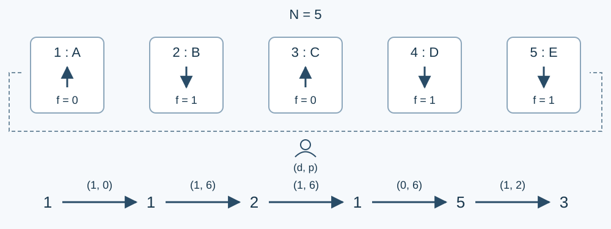

# 横版场域论

预估时间限制：0.5 秒。内存限制：256 MB。

实际时限以标准程序在目标评测环境的最慢用例中位时间乘以 $2$ ，按 $0.5$ 秒向上取整。参考环境见[评测说明](../../../docs/评测环境与性能.md)。

## 背景故事

有 $N$ 位同学站在一个左右循环的横版场域中，从我们的视角看，他们排成一列，从左到右编号为 $1,\ldots,N$。每个人要么面对我们，要么背对我们，并按照自己的朝向理解“左”和“右”。

同学们正在玩传递物品的游戏，物品最初在一号同学手中。每次，持有者会把物品传给自己左边或右边数第 $p$ 位同学；第零位就是自己。因为场域左右循环，$p$ 可以超过 $N$，跨过两端相接的位置也不会改变任何人的朝向。

每位同学都有且只有一个专业，用大写字母 `A` 到 `Z` 表示，不同同学的专业可以相同。游戏一共进行 $M$ 次传递，请在每次传递后输出物品持有者的专业。

## 形式化问题描述

从观察者的视角看，$N$ 位同学从左到右编号为 $1,\ldots,N$ ，右端与左端相接。第 $i$ 位同学的朝向为 $f_i$ ：零表示背对观察者，一表示面对观察者。每个人的专业用大写字母 $C_i$  表示，不同同学的专业可以相同。

物品初始在一号同学处。每次给出 $d,p$ ：零表示当前持有者自己的左方，一表示自己的右方；沿该方向数 $p$ 个位置，交给那里的同学。数零个位置仍是本人，可以绕队列多圈。每个人的朝向始终不变。每次传递后输出新持有者的专业。



图中上箭头表示背对位于下方的观察者，下箭头表示面对观察者。下面的编号链表示每次传递后的持有者。

## 输入格式

第一行两个整数 $N,M$ .接下来 $N$ 行，第 $i$ 行给出整数 $f_i$ 和大写字母 $C_i$ .接下来 $M$ 行，每行两个整数 $d,p$ ，描述一次传递。

## 输出格式

输出 $M$ 行，每行一个大写字母，表示对应传递后的持有者的专业。

## 样例

### 样例 1

### 输入

```text
5 5
0 A
1 B
0 C
1 D
1 E
1 0
1 6
1 6
0 6
1 2
```

### 输出

```text
A
B
A
E
C
```

### 样例 2

### 输入

```text
1 3
1 Z
0 0
1 1000000000
0 1
```

### 输出

```text
Z
Z
Z
```

## 样例解释

样例 1 的持有者依次为一号、二号、一号、五号、三号。同学的左右由当时持有者的朝向决定。样例 2 只有一位同学，任意传递后仍由他持有。

## 数据范围与保证

对 100% 的数据：$1\le N,M\le30000$ ，$f_i,d\in\{0,1\}$ ，$0\le p\le10^9$ ，$C_i$ 为大写英文字母。

“不跨越首尾”指每次按观察者方向移动指定步数时，中途编号始终在一到 $N$ 之间。分组中的步数之和是同一输入文件的所有 $p$ 之和。

| 分值比例 | 额外条件 |
| --- | --- |
| 50% | 步数之和不超过 $4000000$ ，且不跨越首尾 |
| 20% | 步数之和不超过 $4000000$ |
| 30% | 无额外条件 |
