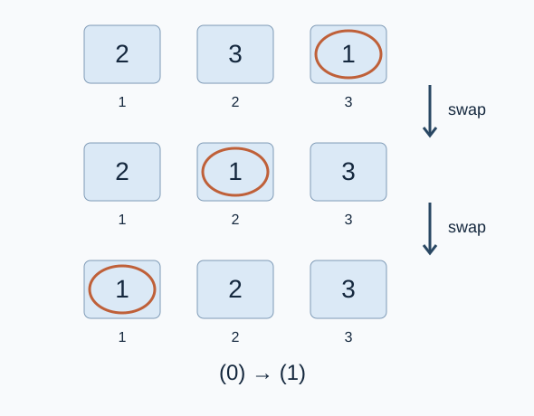

# Editorial for Gnome Sort

**Problem setter’s solution: count inversions and strict prefix minima.** Codex (GPT-6) organizes lexicographic comparisons, merge counting, 64-bit arithmetic, and the proof. The reference program retains merge sort for inversion counting.

## The counting formula

Let $I$ be the number of inversions in the input vector sequence. Let $R$ count strict prefix minima: count the first vector, then count each subsequent vector smaller than all preceding vectors.

Swapping an inverted adjacent pair removes exactly one inversion. Thus the gnome performs exactly $I$ swaps and $I$ left moves. He starts at cell $1$ and finishes at cell $n$ , so there are $I+n-1$ right moves.

Exactly $R$ right moves occur in step `(0)` . One is the initial departure from cell $1$ . Subsequently, a newly reached vector swaps all the way to the first cell exactly when it is a strict prefix minimum. The processed prefix is sorted; already reached vectors do not create an additional new return of this kind.

Every left move corresponds to one successful check in step `(1)` . Every right move is followed by a check. The special returns in step `(0)` do not correspond to a preceding failed check; other right moves do, and there is one final failed check at the last cell. Therefore there are $I+n-R$ failed checks, and the total is

$$\boxed{2I+n-R}$$

Equivalently, combine the moves that eliminate inversions and the net travel from the first to the last cell, subtract the special step `(0)` moves, and include the final stopping check.

Numbers are the vectors’ lexicographic ranks; a circle marks the current cell. Each successful check removes one inversion. After reaching the first cell, the next move follows step `(0)` .

## Implementation and correctness

Scan the input to compute $R$ . Comparisons must examine the first coordinate, then the second, rather than the sum of coordinates. Then use merge sort to obtain $I$ . When the next vector from the right half is smaller than the next vector from the left half, it forms an inversion with every remaining vector in the left half; add that remaining count.

Merge counting includes every inversion exactly once. The prefix scan counts strict minima accurately. The movement argument converts these two quantities into the number of executions of step `(1)` , proving the formula. The input vectors are distinct, but equal individual coordinates still require comparing the other coordinate.

## Complexity and other counting methods

Time is $O(n\log n)$ and space is $O(n)$ . The answer can exceed 32-bit integers, so use 64-bit arithmetic.

The source material also gives coordinate compression with a Fenwick tree, using the same $O(n\log n)$ time and $O(n)$ space. Rank vectors lexicographically, scan them in input order, and count preceding larger ranks to recover the same $I$ . That approach needs ranks and a Fenwick tree. Merge counting operates directly on vectors and is the reference choice. The methods have no asymptotic complexity difference, so neither is claimed to be universally faster.

## Supplementary solution

After ranking, scan in input order and use a Fenwick tree to count earlier larger ranks, obtaining the same inversion total. Its $O(n\log n)$ time and $O(n)$ space match merge counting. The counting structure differs and requires stored ranks; it is supplied as a complete parallel option.

[Complete editorial and measurements](solution-alternative-fenwick.en.md) · [Program](alternative-fenwick.cpp)
