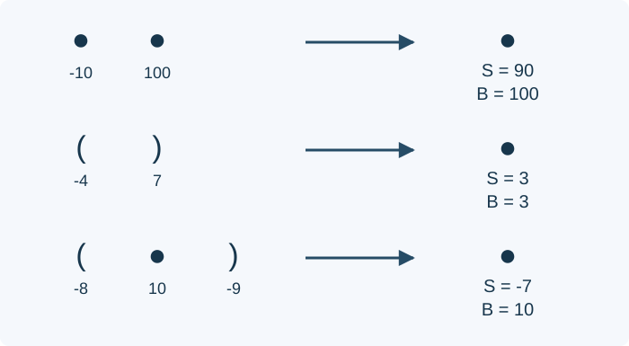

# 糖果括号: 题解

出题人解法：非负权情形的双端队列局部归约。Codex（GPT-6）基于这一结构，结合最大子段和的前后缀维护方法，扩展到带负权的合法子串，并给出证明与 C++17 实现。

## 归约结构与非负权子任务

把一个完整可匹配串压缩成合法块。双端队列里只保存未匹配括号和合法块，使用三种规则：相邻合法块连接；空括号对成为合法块；一对括号包住一个合法块后成为新块。

初始元素依次从右端插入。每次插入后，只在插入端反复应用规则，直到无法归约。原来内部不可归约，新产生的规则必然接触这一端；归约结果也仍在该端，所以不需要重新扫描内部。

忽略合法块后，未匹配括号只可能是若干右括号后接若干左括号。否则相邻的左、右括号之间至多有一个合法块，可以继续归约。任何合法子串都不能跨过这些未匹配括号，因此必定位于某个合法块内。

出题人解法为每个块只保存总权值；若所有权值非负，整个块不会比其中的子串更差，维护块总和的历史最大值即可。每次归约至少减少一个元素，因此总时间和空间均为 $O(N+M+1)$ .这能解决非负权子任务。

含负权时，仅保存总和会丢失信息。例如相邻糖果的值为 $-10,100$ ，块总和为 $90$ ，最优子串却是后一个糖果，值为 $100$ .需要保留块内可选片段的信息。

## 合法块的四个量

对合法块 $A$ 维护：

| 记号 | 含义 |
| --- | --- |
| $S_A$ | 整个块的权值和 |
| $P_A$ | 最大权值的合法前缀 |
| $Q_A$ | 最大权值的合法后缀 |
| $B_A$ | 最大权值的合法子串 |

前缀、后缀和子串均允许为空，所以后三个量至少为零。总和 $S_A$ 必须保留真实值，不能把负数截为零。

单个糖果权值为 $w$ 时，$S=w$ ，$P=Q=B=\max(0,w)$ .空块的四个量均为零。未匹配括号单独保存其真实权值，尚不能作为合法块参与答案。

## 相邻合法块的连接

设 $C=AB$ ：

$$
\begin{aligned}
S_C&=S_A+S_B\\
P_C&=\max(P_A,S_A+P_B)\\
Q_C&=\max(Q_B,S_B+Q_A)\\
B_C&=\max(B_A,B_B,Q_A+P_B)
\end{aligned}
$$

前缀要么止于 $A$ ，要么取完整个 $A$ 再接上 $B$ 的合法前缀；后缀同理。

对子串，若横跨两块边界，它在 $A$ 中的部分必须是合法后缀，在 $B$ 中的部分必须是合法前缀。证明可用括号高度：每个完整合法块从高度零出发，始终非负，最后回到零。跨界子串若从 $A$ 的正高度处开始，走到块边界时便低于起点，无法合法。因此它必须从高度零处开始，并在 $B$ 的高度零处结束。跨界最优值就是 $Q_A+P_B$ .

这些前后缀必须合法，不能用忽略括号的普通最大子段和代替。

## 在合法块外包一对括号

设 $C=(A)$ ，左右括号的权值分别为 $u,v$ ：

$$
\begin{aligned}
S_C&=u+S_A+v\\
P_C=Q_C&=\max(0,S_C)\\
B_C&=\max(B_A,S_C)
\end{aligned}
$$

外层左括号之后，直到外层右括号之前，括号高度始终大于零。因此非空合法前缀、后缀都只能是整个 $C$ .同理，包含最外层任一括号的合法子串必须是整个 $C$ ；其他候选全部位于 $A$ 内部。

即使 $B_A$ 很大，也不能用它替代 $S_A$ 来计算整个包裹块：连续子串不能跳过里面不喜欢的部分。空括号对就是 $A$ 为空的情况。

圆点表示合法块，圆点或括号下面的数是权值；右侧列出归约结果的总和 $S$ 与最优合法子串值 $B$ .第一行和第三行说明两者可能不同；其余前后缀信息按上述公式维护。

## 在线维护与正确性

三种归约只由类型决定，负权不会改变它们是否可用。对每次归约按上述公式更新四个量，由单糖果和空块开始归纳，每个块的四个量始终准确。任何合法子串都位于某个归约后的块内，因此当前答案是各块的 $B$ 与零的最大值。

插入只增加端部元素，旧子串仍然存在，所以最优答案不会下降。归约公式也保留参与块内部的最优值。维护一个初值为零的全局答案，每次插入和归约完成后，用端部合法块的 $B$ 更新即可；不用每次遍历整个队列。

处理右端时，检查括号规则需要交换从该端看到的开闭方向，但连接公式仍按物理上的从左到右顺序计算。混淆顺序会交换前缀和后缀，导致之后的双端插入错误。

## 复杂度、实现与方案选择

设 $L=N+M$ .每次插入增加一个元素，每次归约至少删除一个元素，总归约次数为 $O(L)$ ，每次仅需常数次运算。因此总时间为 $O(L+1)$ ，空间为 $O(L+1)$ ，单次插入摊还为常数时间。

任一连续片段的权值和的绝对值不超过 $2\times10^6\cdot4\times10^9=8\times10^{15}$ ，四个量及所有中间求和均可用有符号 64 位整数保存。实现不使用递归，深层嵌套不会产生调用栈溢出；初始类型以一个字节保存，以控制内存。

[std.cpp](std.cpp) 使用支持全部数据的四信息归约。非负权时，总和维护的出题人方案也是线性的，状态更少，但不能直接用于含负权的数据。逐次扫描可作小规模核对，完整数据下可能达到二次时间。离线按括号层次激活相邻原子块也可独立验证，但需要保存全部操作、匹配层次及并查集状态，时间为 $O(L\alpha(L))$ ，不优于在线线性方案，作为内部校验使用。
