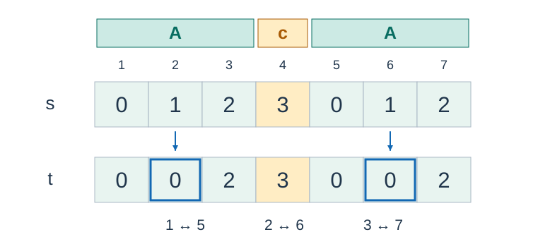

# Cloning Vat

- Indicative time limit: 0.5 s (reference environment: [environment and measurements](../../../docs/评测环境与性能.md); for guidance only)
- Actual time limit: 2 times the reference solution's baseline runtime on its slowest official test file in the target judging environment, rounded up in 0.5 s increments; if the judge only supports coarser increments, round up again to a supported value.
- Memory limit: 8 MB

## Story

Yuri is testing a Cloning Vat with DNA of the form $AcA$ : split it at the middle nucleotide, clone one side, and compare it with the other. The laboratory samples may not yet have this form, and each sample specifies exactly how many nucleotides must change. Find the lexicographically smallest valid modification.

## Formal Problem Statement

Given a string $s$ of odd length $n$ over `0` , `1` , `2` , `3` , and an integer $m$ , let $h=(n-1)/2$ . Construct a string $t$ of the same length such that:

1. $t_i=t_{h+1+i}$ for every $1\le i\le h$ : the first and last halves are equal in left-to-right order.
2. Exactly $m$ positions satisfy $t_i\ne s_i$ , including the middle position.

The middle character $t_{h+1}$ is unrestricted by the equality condition. Count differences between the final and initial strings, rather than the number of editing steps.



Figure 1: For input string `0123012` and $m=2$ , one valid result is `0023002` . Paired positions are $1$ and $5$ , $2$ and $6$ , and $3$ and $7$ . They are aligned in the same direction, not mirrored from opposite ends. Bold outlines mark changed positions.

Print the lexicographically smallest valid string, using character order `0` < `1` < `2` < `3` . If none exists, print `failed` . Queries are independent.

## Input Format

The first line contains $q$ . Each of the next $q$ lines contains $n,m,s$ in that order.

## Output Format

Print $q$ lines, each containing the required string or `failed` .

## Sample 1

### Input

```text
2
3 3 000
3 0 100
```

### Output

```text
111
failed
```

### Explanation

The first query must change every position, so the smallest available character is `1` . The second permits no changes although its halves differ.

## Sample 2

### Input

```text
4
1 0 3
1 1 3
7 2 0123012
3 1 000
```

### Output

```text
3
0
0023002
010
```

### Explanation

A length-one string consists only of the middle character. In the last query, changing only the middle preserves the smallest left half, `0` .

## Constraints and Guarantees

- $1\le q\le1000000$ . Each $n$ is positive and odd, and $\sum n\le1000000$ over all queries.
- $0\le m\le n$ . String $s$ has exactly $n$ characters, all from `0` through `3` .

### Test Groups

| Score share | Additional conditions |
| --- | --- |
| 100% | No additional conditions |
