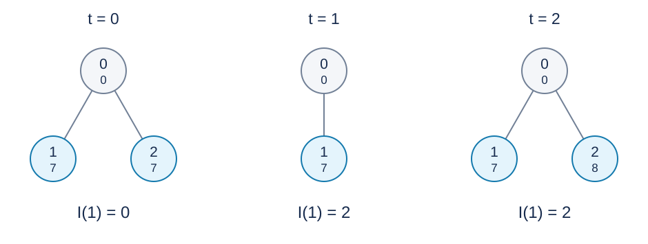

# Path Independence in a Dynamic Tree: Solution

**Problem setter’s solution: reverse root-to-leaf strings, order the leaves lexicographically, and check only neighbouring strings. GPT-6 provides exact doubling blocks, generation-aware IDs, iterative subtree deletion, and an offline doubling alternative.**

## 1. Turn suffixes into prefixes and inspect neighbours

Reverse the root-to-$u$ value string to obtain $r_u$ , which follows parents from $u$ to the root. A longest common suffix becomes a longest common prefix, or LCP.

Order the current leaves by their reversed strings. The largest LCP with any other string is attained by a predecessor or successor. Indeed, all strings with a fixed prefix form a contiguous lexicographic interval. If a more distant string shares a prefix of length $k$ with $r$ , the immediate neighbour between them shares that prefix too. Checking one neighbour on each side suffices.

Break ties between identical full strings with a unique internal ID so every leaf remains in the container. Identical strings have full-length LCP and can give independence zero. With no neighbour, the maximum LCP is zero.

## 2. The setter’s ordered structures and doubling

A reversed path satisfies $r_u=(a_u,r_{\operatorname{parent}(u)})$ , so its lexicographic key can use its own value and the order of its parent’s reversed path.

The setter uses two randomized Treaps: one containing all current vertices and supplying parent-string order labels, and another containing only leaves for neighbour queries. Inserting a first child removes its parent from the leaf set; deleting the last child adds its parent back. Doubling stores hashes of the next $2^k$ values and compares blocks from largest to smallest to find an LCP.

This method requires strictly ordered labels and collision-free equality decisions. Floating interval midpoints and triple hashes are particular numerical representations, not proofs of exactness. Relabeling after Treap rotations also traverses affected subtrees.

With $I$ vertex insertions/deletions, $Q$ queries, maximum Treap height $h$ , and $R_{\rm label}$ total node visits during relabeling, its work can be expressed as
$$
O(Ih+Q(h+\log q)+R_{\rm label}),
$$
with $O(q\log q)$ doubling space. Random priorities normally give expected logarithmic height, but an unbounded relabeling term must not be silently omitted.

## 3. Exact block IDs

The reference program keeps reversed paths, ordered leaves, and neighbour LCP queries, using exact block identifiers.

Let $\mathrm{up}[u][k]$ be the ancestor $2^k$ edges above $u$ . Let $\mathrm{block}[u][k]$ identify the first $2^k$ values starting at $u$ , creating it only when that full block exists. A one-value block uses the value plus one. A longer block is identified by its two halves:
$$
\left(\mathrm{block}[u][k-1],
\mathrm{block}[\mathrm{up}[u][k-1]][k-1]\right).
$$
At each level, an ordered map assigns the same ID to identical pairs and distinct IDs to different pairs. Induction on length proves that IDs are equal exactly when all values in the blocks are equal. There are no probabilistic collisions.

For an LCP, inspect $k$ from largest to smallest. If both remaining strings have at least $2^k$ values and their block IDs agree, skip that block on both paths. The accumulated length is the exact LCP, found in $O(\log q)$ time.

To compare whole reversed strings, compute their LCP. If one ends there, the shorter string is smaller; otherwise compare the next values. Break complete equality by internal ID. An ordered leaf set using this comparator supports exact search, insertion, and deletion.

## 4. Reused IDs and deletion

Allocate a fresh internal ID for every insertion. An external problem ID maps only to its current entity; reusing it cannot revive an old deleted entity.

Store child lists by internal entity. Delete a subtree with an explicit stack, visit only live entities, erase its leaves, and clear their external mappings. Then decrease the surviving parent’s live child count and add it to the leaf set if needed. Old child records may remain: each created edge is scanned at most once when its parent entity is deleted, and already-dead children are skipped.

Ancestor blocks become fixed at creation. Deleting an entire subtree never changes a surviving vertex’s ancestor chain, so keys already in the ordered set retain their relative order. Root deletion removes the actual subtree; legal input has no subsequent operation.

## 5. Correctness and complexity

The exact-block induction proves LCP and comparator correctness. Lifecycle updates keep precisely the current leaves in the set. The neighbour property then yields the maximum LCP over every other leaf. Subtracting it from path length gives the requested independence.

At most $q+1$ entities are created. Each insertion builds $O(\log q)$ blocks using $O(\log q)$ ordered-map work per block. Set comparisons take $O(\log q)$ , and a set search needs $O(\log q)$ comparisons. All subtree deletions together visit only created entities and edges. Total time is $O(q\log^2 q)$ and space is $O(q\log q)$ .

The [reference program](std.cpp) reads and answers operations incrementally without future input. The coequal [offline doubling method](solution-alternative-offline.en.md) precomputes each entity’s ordering rank, reducing operation processing to logarithmic time and avoiding many ordered-map allocations. It requires reading and replaying the entire input. Both pass the full range; measured peaks are about $31$ MiB offline and $109$ MiB online. See the [measurements](../../../docs/benchmark-R29.json).

## Illustration

The figure shows three stages $t$ of sample two: two equal-valued leaves, deletion of ID two, and reinsertion of ID two with value eight. A circle’s upper number is its ID and its lower number is its value; blue denotes a current leaf. $I(1)$ is leaf one’s independence.

## Data and reproduction

The statement contains three samples. The [test plan](tests/plan.json) defines ten scored inputs. The [generator](tests/generate.py) uses only the Python standard library and accepts --plan, --out-dir, --case and --std. Large generated inputs and executables stay outside the published package. See the [reference measurements](../../../docs/benchmark-R29.json) for runtime and memory.
