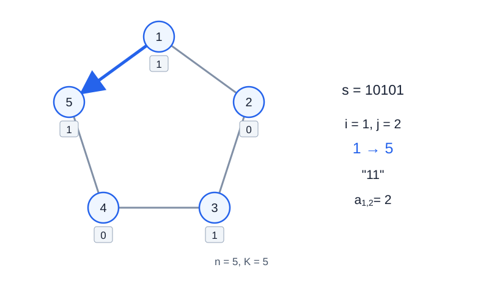

# 魔法面包

- 参考时间限制：**1.0 秒**（[评测环境与性能](../../../docs/评测环境与性能.md)）。
- 实际时限：在目标环境实测标准程序最慢测试文件的中位时间，乘以 2，再按 0.5 秒向上取整。
- 内存限制：**512 MB**。

## 背景故事

农场种着两种魔法小麦，名字分别叫“五颜”和“六色”，用 $0$ 和 $1$ 表示。麦田围成一个环，每块田旁都有自动合成机单元。

合成机会把送入的小麦序列按固定长度分块。只有每块都是回文、而且所有块完全相同时，它才能顺利制作魔法面包。农场主人不愿走超过一圈，希望知道以每块麦田为一端，最多可以取用多长的一段。

## 形式化问题描述

给定长度为 $n$ 的二进制字符串 $s$ ，其下标 $1,\ldots,n$ 按此顺序首尾相接成环。

对每个位置 $i$ 和每个级别 $j$（$1\le j\le K$），考虑以 $i$ 为**一个端点**的连续非空环段。可以从 $i$ 出发沿任一方向选取，长度不能超过 $n$ ，每个位置至多使用一次。

一段长度为 $\ell$ 的序列可以制作 $j$ 级面包，当且仅当 $j$ 整除 $\ell$ ，并且从选定端点开始，每 $j$ 个字符分成一块后，所有块完全相同且每块都是回文。回文指正向与反向读取结果相同的字符串。

令 $a_{i,j}$ 为这样的环段的最大长度，不存在时为 $0$ . 对每个 $i$ 输出

$$X_i=\bigoplus_{j=1}^{K}\bigl(j\cdot a_{i,j}\bigr)$$

其中 $\oplus$ 为按位异或，先计算乘积，再进行异或。

## 输入格式

第一行两个整数 $n,K$ .

第二行一个长度为 $n$ 的字符串 $s$ ，仅含字符 `0` 和 `1` .

## 输出格式

输出 $n$ 行，第 $i$ 行为整数 $X_i$ .

## 样例 1

### 输入

```text
5 5
10101
```

### 输出

```text
22
24
8
24
22
```

## 样例 2

### 输入

```text
6 6
110011
```

### 输出

```text
42
21
34
34
21
42
```

## 样例 3

### 输入

```text
1 20
0
```

### 输出

```text
1
```

## 样例解释

样例 1 中，位置 $1$ 对应的五个长度依次为 $(2,2,3,0,5)$ ，所以 $X_1=2\oplus4\oplus9\oplus0\oplus25=22$ . 长度为 $2$ 的环段可以从位置 $1$ 反向经过位置 $5$ ，得到 `11` .



数字为位置编号，下方的方框内为小麦类型。箭头展示位置 $1$ 向位置 $5$ 的取段方向。

样例 2 中，位置 $2$ 的六个长度为 $(4,4,3,4,0,0)$ ，乘以各自级别后异或得到 $21$ . 样例 3 只有级别 $1$ 可以制作面包。

## 数据范围与保证

对 100% 的数据：$1\le n\le1000000$ ，$1\le K\le20$ . 允许 $K>n$ ，此时所有 $j>n$ 的 $a_{i,j}$ 均为 $0$ .

| 分值比例 | 额外条件 |
| --- | --- |
| 100% | 无额外条件 |
