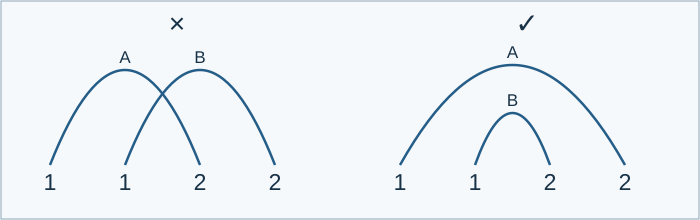

# Noncrossing 1212 Subsequences

Indicative time limit: 0.5 seconds. Memory limit: 2048 MiB. Recalibrate as twice the slowest standard median in the target environment, rounded up to 0.5 seconds. See the [environment](../../../docs/评测环境与性能.md).

## Story

A signal operator records two pulse types as 1 and 2 and wants to extract as many 1212 groups as possible. Marks pairing a 1 with its following 2 may nest, but may not cross.

(This story was rewritten by GPT-6.)

## Formal Problem Statement

Given a length-$n$ string $s$ containing only 1 and 2, choose as many subsequences as possible subject to these rules:

1. Each subsequence is exactly 1212: positions $a<b<c<d$ satisfy $s_a=s_c=1$ and $s_b=s_d=2$ .
2. No string position is used by two selected subsequences.
3. Each subsequence marks two pairs, $(a,b)$ and $(c,d)$ . Two marked pairs from different subsequences must not cross: endpoint orders $u<x<v<y$ and $x<u<y<v$ are forbidden.

Pairs may nest or be disjoint. Rule 3 checks only the adjacent 1-to-2 pairs, not the middle 2-to-1 connection. Characters may be left unused. The empty string has answer zero.



The figure shows only two 1-to-2 pairs. The crossing on the left is forbidden; the nesting on the right is allowed. These pairs do not by themselves depict complete 1212 subsequences.

## Input Format

The first line contains $n$ , and the second contains $s$ . For $n=0$ , the second line is empty.

## Output Format

Print the maximum number of selected subsequences.

## Sample 1

### Input

```text
16
1121122121222111
```

### Output

```text
2
```


## Sample 2

### Input

```text
20
11221122111112222122
```

### Output

```text
5
```


## Sample 3

### Input

```text
0

```

### Output

```text
0
```


## Sample 4

### Input

```text
4
1122
```

### Output

```text
0
```

## Constraints and Scoring

$0\le n\le10^7$ . The string contains only 1 and 2.

| Score | Additional constraints |
| --- | --- |
| 100% | None |

There are ten formal files worth 10% each.

See the [test recipes](tests/README.md).
