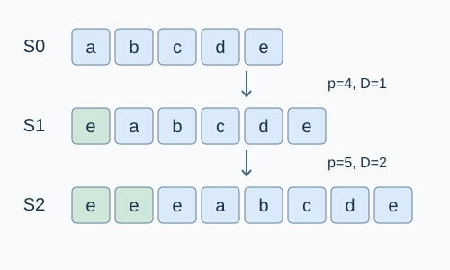

# Paper Tiger Sequence

Estimated time limit: 0.5 seconds. Memory limit: 16 MB.

On the target judge, multiply the reference program's largest per-case median time by $2$ and round up to a multiple of $0.5$ seconds. See the [reference environment](../../../docs/评测环境与性能.md).

## Story

An archivist extends a “paper tiger” strip by copying a short cyclic segment of its current text to the front. Recover several historical versions by their version numbers.

(This story was rewritten by GPT-6.)

## Formal Problem Statement

The initial string is $S_0$ . Perform $N$ growth operations. Operation $i$ uses parameter $p_i$ to construct $S_i$ from $S_{i-1}$ . String indices start at $0$ .

Let the current length be $L=|S_{i-1}|$ . The added length is

$$D=\left\lceil\frac{L}{5}\right\rceil$$

Copy $S_{i-1}[(p_i+k)\bmod L]$ in order for $k=0,1,\ldots,D-1$ , forming $T_i$ . Set

$$S_i=T_i+S_{i-1}$$

Here $+$ denotes concatenation. Every copied character comes from the string before growth, wrapping to its beginning after the last character.

Given $M$ pairwise distinct version numbers, print the corresponding strings in query order.

## Input Format

The first line contains the nonempty string $S_0$ , consisting of English letters and digits. Letters are case-sensitive.

The second line contains $N,M$ . The next $N$ lines contain $p_1,\ldots,p_N$ in order. Each of the following $M$ lines contains a version number $q$ .

## Output Format

Print $M$ lines, each containing the complete string $S_q$ requested by that query. For $M=0$ , print nothing.

## Examples

### Example 1

### Input

```text
0123456789
5 6
8
10
12
14
15
5
4
3
2
1
0
```

### Output

```text
345676789789898890123456789
6789789898890123456789
789898890123456789
898890123456789
890123456789
0123456789
```

### Example 2

### Input

```text
A
0 1
0
```

### Output

```text
A
```

### Example 3

### Input

```text
abcde
2 3
4
5
2
0
1
```

### Output

```text
eeeabcde
abcde
eabcde
```

## Example Explanation

The first example requests all six versions in decreasing order. The second example performs no growth.

In the third example, the first operation copies one character `e` from index $4$ , producing `eabcde` . The second operation copies two characters cyclically from index $5$ , obtaining `ee` , so the new string is `eeeabcde` .



## Constraints and Guarantees

$1\le |S_0|\le10$ , $0\le N\le70$ , and $0\le p_i\le10^9$ .

$0\le M\le N+1$ . Every queried version satisfies $0\le q\le N$ , and query indices are pairwise distinct.

| Score | Additional conditions |
| --- | --- |
| 100% | None |
