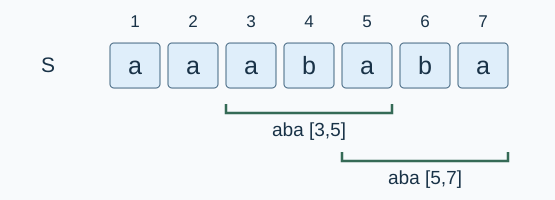

# Skewer Substring Queries

Estimated time limit: 0.5 seconds. Memory limit: 128 MB.

On the target judge, use twice the largest per-case median runtime of the reference program, rounded up to a multiple of $0.5$ seconds. See the [reference environment](../../../docs/评测环境与性能.md).

## Story

After finishing a geometry assignment, a team visits a skewer shop. The colorful ingredients lined up on sticks remind them of their next order: counting how often a pattern appears within part of a string.

## Formal Problem Statement

Given a lowercase English string $S$ , number its positions from $1$ to $|S|$ . Each query gives integers $l,r$ and a nonempty string $t$ . Count the occurrences of $t$ in $S_lS_{l+1}\cdots S_r$ .

An occurrence must lie entirely inside $[l,r]$ . Distinct starting positions count separately, and occurrences may overlap. If the pattern is longer than the query interval, the answer is zero.



In the whole string `aaababa` , `aba` occurs at $[3,5]$ and $[5,7]$ , giving two occurrences.

## Input

The first line contains $S$ . The second line contains the number of queries $M$ . Each of the next $M$ lines contains $l,r,t$ , separated by spaces.

## Output

Output $M$ lines, each containing the occurrence count for one query.

## Samples

### Sample 1

### Input

```text
aaababa
6
1 2 aa
1 7 aba
3 6 aba
4 7 aba
1 3 aa
1 7 c
```

### Output

```text
1
2
1
1
2
0
```

### Sample 2

### Input

```text
aaaaa
5
1 5 aaa
2 4 aaaa
1 5 a
2 4 aa
1 1 aa
```

### Output

```text
3
0
5
2
0
```

### Sample 3

### Input

```text
abcdef
3
1 6 xyz
1 3 abc
2 6 abc
```

### Output

```text
0
1
0
```

## Sample Explanation

In sample 1, the query interval $[3,6]$ contains only the `aba` starting at position $3$ . The occurrence starting at position $5$ extends beyond the right endpoint.

In sample 2, `aaa` occurs three times in `aaaaa` , with overlap. Searching for `aaaa` inside an interval of length three gives zero.

## Constraints and Guarantees

For 100% of the data: $1\le l\le r\le |S|\le1000$ , $1\le M\le1000$ , and $1\le|t|\le40$ . Both $S$ and all query patterns contain only lowercase English letters.

| Score | Additional conditions |
| --- | --- |
| 100% | None |
