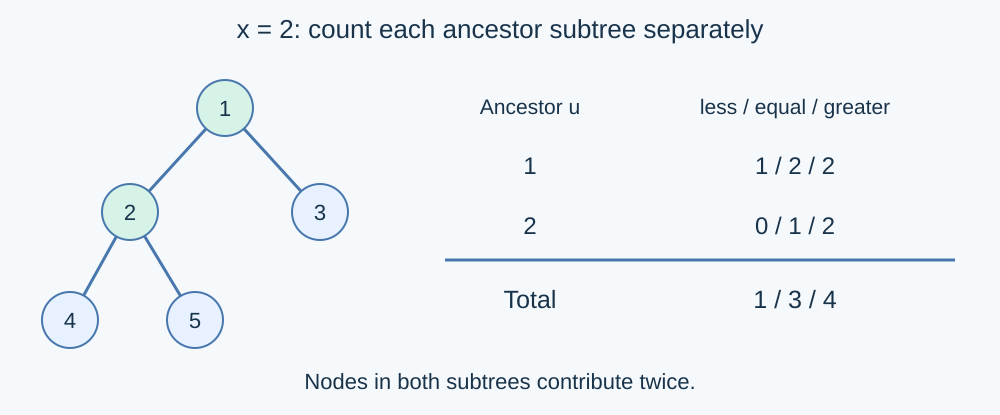

# Depth Counts across Ancestor Subtrees

Estimated time limit: 14 seconds. Memory limit: 512 MB.

The limit is twice the slowest median runtime of the reference program on the target platform, rounded up to a multiple of $0.5$ seconds. See the [evaluation environment](../../../docs/评测环境与性能.md).

## Story

A hierarchy of directories forms a tree. A report examines the subtree of a chosen node and the subtrees of all its ancestors, classifying entries by depth. An entry appearing in several examined subtrees must be counted in each one.

(This story was rewritten by GPT-6.)

## Formal Problem Statement

You are given a tree with $n$ nodes labelled $1,\ldots,n$ , rooted at node one. The root has depth zero; every other depth is the number of edges to the root. A subtree includes its root, and a node is included among its own ancestors.

For each node $x$ , examine the subtree of every ancestor $u$ of $x$ , including $x$ itself. Sum the counts of nodes whose depths are smaller than, equal to, and greater than the depth of $x$ , respectively. A node $y$ appearing in several examined subtrees contributes once in each subtree.

Formally, let $A(x)$ be the ancestor set including $x$ , let $S(u)$ be the subtree including $u$ , and let $d_x$ be the depth. Output

$$\left(\sum_{u\in A(x)}\sum_{y\in S(u)}[d_y<d_x],\quad\sum_{u\in A(x)}\sum_{y\in S(u)}[d_y=d_x],\quad\sum_{u\in A(x)}\sum_{y\in S(u)}[d_y>d_x]\right).$$

Brackets denote an indicator: one if the enclosed condition holds, zero otherwise. Output exact counts without a modulus.

## Input Format

The first line contains $n$ . The second contains $n-1$ integers: the parents of nodes $2,3,\ldots,n$ , in that order. A parent may have a larger label than its child. The second line is empty when $n=1$ .

## Output Format

Print $n$ lines. Line $x$ contains the shallower, equal-depth and deeper counts for node $x$ , in that order.

## Samples

### Sample 1

### Input

```text
5
1 1 2 2
```

### Output

```text
0 1 4
1 3 4
1 3 2
4 5 0
4 5 0
```

### Sample 2

### Input

```text
4
3 1 3
```

### Output

```text
0 1 3
3 5 0
1 2 4
3 5 0
```

### Sample 3

### Input

```text
1
```

### Output

```text
0 1 0
```

## Sample Explanation

For node two in the first sample, the root subtree contributes $(1,2,2)$ and its own subtree contributes $(0,1,2)$ , giving $(1,3,4)$ . Node four examines the subtrees of nodes one, two and four. In the second sample, node two has parent three, so label order is not depth order. The last sample counts only the root.



## Constraints and Guarantees

$1\le n\le2\times10^6$ , $1\le f_i\le n$ .

The input is guaranteed to form a tree rooted at node one.

| Score | Additional constraints |
| --- | --- |
| 100% | None |
