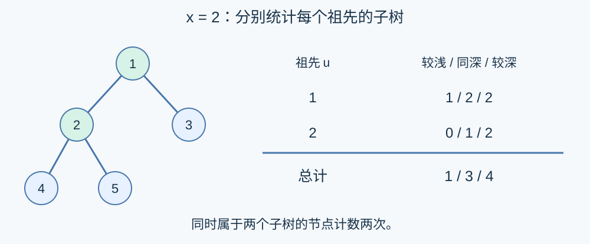

# 祖先子树的分层统计

预估时间限制：14 秒。内存限制：512 MB。

实际时限以标准程序在目标环境的最慢用例中位时间乘以 $2$ ，按 $0.5$ 秒向上取整。参考环境见[评测说明](../../../docs/评测环境与性能.md)。

## 背景故事

一份分层目录用一棵树表示。统计人员会分别查看某个节点及其所有祖先的目录范围，按节点所在层数分类计数。一个节点出现在多个目录范围中时，每次出现都需要计入。

(本故事由GPT-6重写)

## 形式化问题描述

给定一棵有 $n$ 个节点、以节点一为根的树。节点编号为 $1,\ldots,n$ ，根的深度为零，其他节点的深度为到根的边数。节点的子树包含它自身，祖先集合也包含自身。

对每个节点 $x$ ，依次考虑 $x$ 及其所有祖先 $u$ 的子树。分别求这些子树内深度小于、等于、大于 $x$ 深度的节点数之和。如果节点 $y$ 属于多个这样的子树，就在每个子树中分别计数。

形式化地，令 $A(x)$ 为包含自身的祖先集合，$S(u)$ 为包含自身的子树，$d_x$ 为深度，输出

$$\left(\sum_{u\in A(x)}\sum_{y\in S(u)}[d_y<d_x],\quad\sum_{u\in A(x)}\sum_{y\in S(u)}[d_y=d_x],\quad\sum_{u\in A(x)}\sum_{y\in S(u)}[d_y>d_x]\right).$$

方括号内条件成立时值为一，否则为零。答案精确输出，不取模。

## 输入格式

第一行一个整数 $n$ .第二行 $n-1$ 个整数，依次给出节点 $2,3,\ldots,n$ 的父节点。父节点编号不保证小于子节点编号。$n=1$ 时第二行为空。

## 输出格式

输出 $n$ 行，第 $x$ 行三个整数，依次为节点 $x$ 的较浅、同深、较深计数。

## 样例

### 样例 1

### 输入

```text
5
1 1 2 2
```

### 输出

```text
0 1 4
1 3 4
1 3 2
4 5 0
4 5 0
```

### 样例 2

### 输入

```text
4
3 1 3
```

### 输出

```text
0 1 3
3 5 0
1 2 4
3 5 0
```

### 样例 3

### 输入

```text
1
```

### 输出

```text
0 1 0
```

## 样例解释

第一组中，节点二需要统计根的子树与自身子树：分别得到 $(1,2,2)$ 和 $(0,1,2)$ ，相加为 $(1,3,4)$ .节点四的统计涉及节点一、二、四的三个子树。第二组中节点二的父节点为三，编号顺序不等于深度顺序。第三组只统计根自身。



## 数据范围与保证

$1\le n\le2\times10^6$ , $1\le f_i\le n$ .

保证输入构成以节点一为根的树。

| 分值比例 | 额外条件 |
| --- | --- |
| 100% | 无额外条件 |
