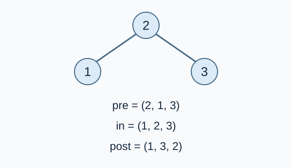

# 二叉树遍历

预估时间限制：0.5 秒。内存限制：128 MB。

实际时限以标准程序在目标评测环境的最慢用例中位时间乘以 $2$ ，按 $0.5$ 秒向上取整。参考环境与测量见[评测说明](../../../docs/评测环境与性能.md)。

## 背景故事

档案员用先序和中序两种顺序记录了同一棵二叉树。现在需要补齐后序记录，请根据已有的两份记录恢复它。

(本故事由GPT-6重写)

## 形式化问题描述

给定同一棵有根二叉树的先序遍历和中序遍历。树有 $n$ 个结点，编号为 $1$ 到 $n$ ，每个编号恰好出现一次。左右子树有区别，也都可以为空。

- 先序：根结点、左子树、右子树。
- 中序：左子树、根结点、右子树。
- 后序：左子树、右子树、根结点。

求这棵树的后序遍历。

## 输入格式

第一行一个整数 $n$ .第二行 $n$ 个整数，依次为先序遍历。第三行 $n$ 个整数，依次为中序遍历。

## 输出格式

输出一行 $n$ 个以空格分隔的整数，表示后序遍历。

## 样例

### 样例 1

### 输入

```text
8
3 1 4 5 6 2 7 8
5 4 1 6 3 2 7 8
```

### 输出

```text
5 4 6 1 8 7 2 3
```

### 样例 2

### 输入

```text
4
1 2 3 4
4 3 2 1
```

### 输出

```text
4 3 2 1
```

### 样例 3

### 输入

```text
3
2 1 3
1 2 3
```

### 输出

```text
1 3 2
```

## 样例解释

第三组样例的根为 $2$ ，左孩子为 $1$ ，右孩子为 $3$ ，所以后序遍历为 $1,3,2$ .第二组样例是一条只有左孩子的链。



图中的 `pre` 、`in` 、`post` 分别表示先序、中序、后序。左右孩子在图中保持左右位置。

## 数据范围与保证

所有数据满足：$1\le n\le10^6$ .两份遍历均为 $1$ 到 $n$ 的排列，保证来自同一棵二叉树。

| 分值比例 | 额外条件 |
| --- | --- |
| 100% | 无额外条件 |
