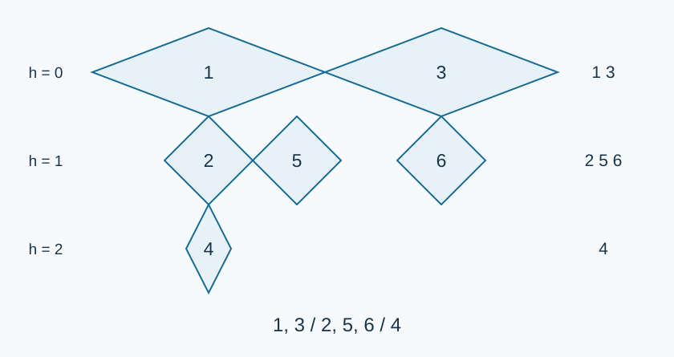

# 菱形衣架的排列: 题解

## 方法与贡献

出题人解法先访问当前衣架，再递归访问下方、右方孩子，并按层收集编号。Codex（GPT-6）改用显式栈避免深链溢栈，保留这一遍历作为 [std.cpp](std.cpp)。另提供按水平链逐行输出的 [alternative.cpp](alternative.cpp) 与[完整题解](solution-alternative.zh.md)；它无需缓存全部输出行。两者均为线性时间，可通过完整数据，按是否需要保留各行选择。

## 为什么下方子树先于右方子树

记当前层为 $h$ ，水平半对角线为 $H=B^{-h}$ .右方孩子中心比当前中心大 $2H$ .下方子树中任一路径仅能通过更低层的右边向右移动，每条移动不超过 $2H/B$ ，总共少于 $n$ 条边，故总横向位移小于 $2nH/B<2H$ .

因此，同一目标层中，下方子树内的衣架都严格位于右方子树内的衣架左侧。两个子树内部也满足同一性质。当前衣架又在所有同行后继左侧。所以按“当前、下方、右方”访问，再只保留某层的访问项，恰好得到该层从左到右的顺序。比较两个衣架时可应用于它们的最低共同祖先；同层祖先关系只可能由右方边组成，也保持顺序。

## 首选：显式深度优先遍历

先统计父结点标记，没有父亲的唯一衣架就是根。栈中保存衣架和层数。弹出后将编号加入对应行，再依次压入右方孩子（同层）和下方孩子（下一层）。后进先出使下方先访问。维护最大层数，最后按层输出各行。

树合法且连通，所有衣架恰好访问一次；上述几何分离证明每行顺序正确，层数递增保证从上到下。下方路径不会跳过层，所以零至最大层都非空。

## 复杂度与实现

时间 $O(n)$ ，空间 $O(n)$ ，包括输入树、遍历栈和按层保存的全部编号。无需构造指数大小的坐标或浮点数；只保存整数层数。

按行方案把每行的水平链依次扫完，并把各衣架的下方孩子放入下一行队列。它同样线性，输入树仍需 $O(n)$ 空间，额外行队列仅需 $O(w)$ ，其中 $w$ 为最大行宽；深度优先方案则方便后续访问已生成的任意行。不要用结点编号排序代替几何顺序，也不要把根固定为一号。

## 数据生成与验证

使用 Python 3 标准库运行 `tests/generate.py --out-dir <目录>` 可按 [plan.json](tests/plan.json) 生成输入；可重复使用 `--case` 选择编号，使用 `--std <可执行程序路径>` 同时生成输出。先自行以 C++17 编译所需源码。固定计划与种子可重现输入；生成大数据放在题目目录之外。

[性能记录](../../../docs/benchmark-R30.json)保留每份正式输入和源码的哈希、五轮时间及峰值工作集。所有交付方案均通过完整数据。320 个小输入用大整数构造精确几何坐标，再按层和横坐标排序核验；全部正式输入比较两种遍历方案。
