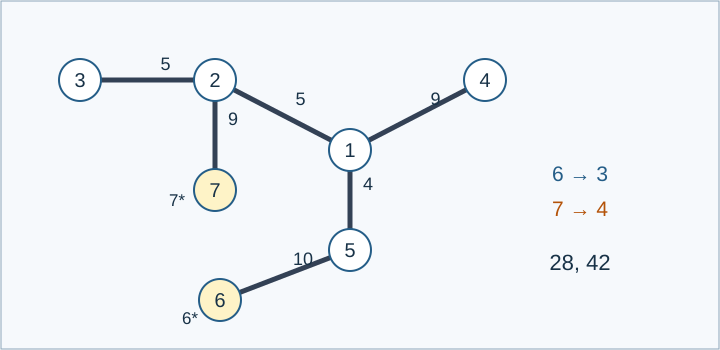

# 挖地铁：题解

## 算法与贡献

Codex（GPT-6）给出适用于 $n\le1000$ 的精确连通子树动态规划，实现于 [std.cpp](std.cpp)。不能贪心固定第一条最长路径：样例6只需两次覆盖全部42权值，但固定某条单次最优路径再扩展可能需要三次。各操作次数的最优边集也不一定互相包含。

## 最优覆盖可以连通

若路径并集不连通，取来自两个不同连通块的路径 $s_1\to t_1$ 和 $s_2\to t_2$ ，交换终点，改成 $s_1\to t_2$ 与 $s_2\to t_1$ . 树上这两条新路径保留两条旧路径的全部边，还补上两块间的连接路径，且起点仍被标记。重复操作即可得到连通并集，操作数不变、权值不减。

因此只需枚举包含至少一个标记点的连通子树。

## 一棵子树需要多少条路径

对非空边子树 $S$ ，设叶子总数为 $L$ ，未标记叶子数为 $q$ ，则覆盖它的最少操作数是

$$c(S)=\max\left(q,\left\lceil\frac L2\right\rceil\right).$$

必要性：每个叶子必须充当某条路径的端点。一条路径最多照顾两个叶子，但它的标记起点不能照顾未标记叶子，所以至少需要 $q$ 条、也至少需要 $\lceil L/2\rceil$ 条。

充分性：取 $i\ge c(S)$ . 准备 $i$ 个标记起点位置和 $i$ 个任意终点位置。把所有未标记叶子放到终点位置，其余叶子放入剩余位置，优先使用起点位置。由于 $q\le i$ 且 $L\le2i$ ，一定放得下。空余起点可重复使用子树内任一标记点，其他位置任意补齐。任意配对得到 $i$ 条路径；把零长度路径也视作一个点，所有叶子均在并集中。若并集不连通，使用上一节的交换终点操作将其连通。包含子树所有叶子的连通子图必然包含子树全部边，故完成覆盖。

## 树形动态规划

任选根。处理点 $u$ 时，维护包含 $u$ 的连通选中部分，用以下状态：

- 子节点方向已经贡献的叶子数 $L$ 与未标记叶子数 $q$ ；
- 是否包含标记点 $b$ ；
- 已选子边数 $d$ ，只需区分0、1、至少2；
- 在相同状态下的最大边权和。

子节点交给父节点的表假设父边被选中，但不计父边权值。合并一个子节点时，要么整支不选，要么取该表中的一个状态并加上连接边权；叶子计数相加，标记信息取或，$d$ 加1并截断到2。

合并完成后有两种用途：

1. 向父亲返回：若 $d=0$ ，$u$ 是叶子，补入它的两项计数；否则 $u$ 不是叶子。
2. 在 $u$ 处封闭成完整子树：要求 $d>0$ 且包含标记点。若 $d=1$ ，$u$ 是叶子；否则不是。按上式求 $c(S)$ ，用权值更新对应答案。

所有连通子树都有唯一的最高点，所以第二步会考虑全部候选。相同状态只保留最大值，不会影响未来合并，因为后续只依赖这些计数和标记状态。

最后对答案取前缀最大值。少于 $i$ 次的方案可重复操作补足到恰好 $i$ 次。第一个等于全树边权和的位置就是 $\mathrm{need}$ ；正权保证达到总和等价于覆盖全部边。

## 复杂度与实现

大小为 $s$ 的部分最多有 $O(s^2)$ 个状态。合并大小为 $a,b$ 的两部分需要 $O(a^2b^2)$ 时间；把乘积展开并按两个部分首次合并的位置计费，总时间上界为 $O(n^4)$ . 遍历顺序迭代生成，不依赖系统递归深度。

处理完一个子表就释放它。同一时刻保留的完整子表对应不相交部分，其大小平方和不超过 $n^2$ . 再加循环使用的密集暂存表，额外空间为 $O(n^2)$ . 暂存表用时间戳避免每次全量清空，只遍历实际存在的状态。

小规模直接枚举允许路径的边掩码及其并集，不使用上述叶子公式；大规模星形树枚举两类叶子数量，单起点树用独立的边际收益合并核对。[验证与性能](tests/README.md)。
