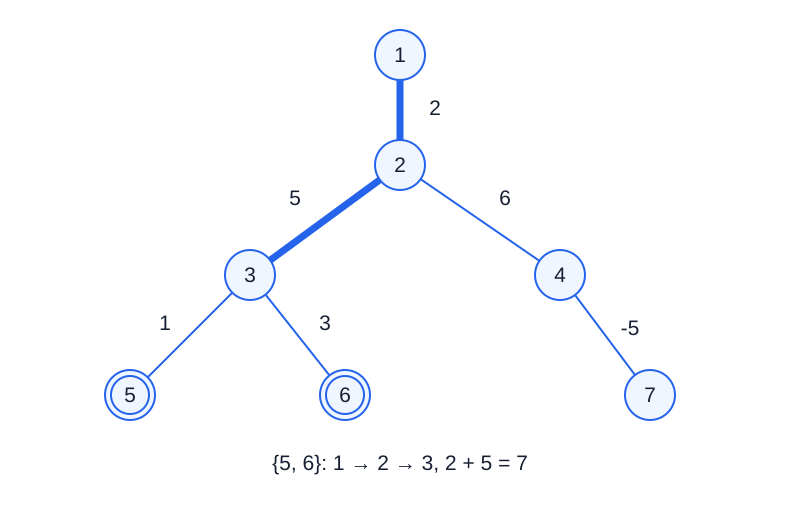

# Dynamic Directory Tree

- Indicative time limit: **1.5 seconds** ([environment and measurements](../../../docs/评测环境与性能.md)).
- Actual limit: measure the reference solution on the target system, take the largest median time over test files, multiply by 2, and round up to a multiple of 0.5 seconds.
- Memory limit: **512 MB**.

## Story

A computer shop is building an editable directory index. Connections between directories have weights. A technician may move a whole subtree, change the root from which the tree is viewed, or update a connection. A query asks about the initial path shared by routes from the current root to several directories.

(This story was rewritten by GPT-6.)

## Formal Problem Statement

You are given an undirected weighted tree with $n$ vertices numbered $1,\ldots,n$ . Its initial root is vertex $1$ . Edge weights may be negative.

Process the following operations in order. Every parent-child relation and subtree is defined using the **current root immediately before the operation**.

1. `1 a b v` : move the entire subtree rooted at $a$ below $b$ . If $b$ belongs to that subtree, including when $a=b$ , ignore the operation. Otherwise remove the edge from $a$ to its parent and add the edge $a,b$ with weight $v$ . The current root does not change.
2. `2 a` : set the current root to $a$ , leaving all undirected edges and their weights unchanged.
3. `3 a b v` : if an edge directly connects $a,b$ , change its weight to $v$ ; otherwise ignore the operation.
4. `4 k a1 a2 ... ak` : consider the simple paths from the current root to these $k$ vertices. Their intersection is an initial path from the root. Output the **sum of edge weights** on this common path.

If the common path consists only of the root vertex, its sum is $0$ . An answer may otherwise be negative. The subtree rooted at the current root is the entire tree, so operation 1 on that root is always ignored.

## Input Format

The first line contains $n,m$ , the number of vertices and operations.

Each of the next $n-1$ lines contains $a,b,v$ , describing an undirected edge and its weight.

Each of the next $m$ lines contains an operation in the format above.

## Output Format

For each operation 4, output one integer on its own line, in query order. If there are no queries, output nothing.

## Sample 1

### Input

```text
7 16
1 2 2
2 3 5
2 4 6
3 5 1
3 6 3
4 7 -5
4 1 5
4 1 6
4 1 2
4 1 7
4 2 5 6
4 3 6 3 7
1 4 6 6
4 1 7
4 3 6 5 7
3 4 5 1
3 4 7 1
4 1 7
2 7
4 1 1
4 1 5
4 2 5 1
```

### Output

```text
8
10
2
3
7
2
11
7
17
17
11
10
```

## Sample 2

### Input

```text
3 8
1 2 -4
2 3 1
4 2 2 3
1 1 3 9
1 2 3 8
3 1 3 9
2 3
4 2 1 2
1 1 3 7
4 2 1 2
```

### Output

```text
-4
1
0
```

## Sample 3

### Input

```text
2 0
1 2 0
```

### Output

```text

```

## Sample Explanation

The first two-vertex query in sample 1 asks about vertices $5,6$ . Both paths contain $1\to2\to3$ , whose edge-weight sum is $2+5=7$ .



Thick lines mark the common path; numbers beside edges are their weights.

The answers in sample 2 are $-4,1,0$ . Two attempts to move a subtree inside itself and one update to a nonexistent edge are ignored. Sample 3 has no operations, so its output is empty.

## Constraints and Guarantees

For all test cases: $2\le n\le200000$ , $0\le m\le200000$ , and every initial or assigned edge weight satisfies $|v|\le10000$ . Every vertex identifier lies in $1,\ldots,n$ , and the initial edges form a tree.

Each query has $1\le k\le200000$ distinct vertices. The sum of $k$ over all queries is at most $200000$ .

| Score share | Additional conditions |
| --- | --- |
| 100% | None |
