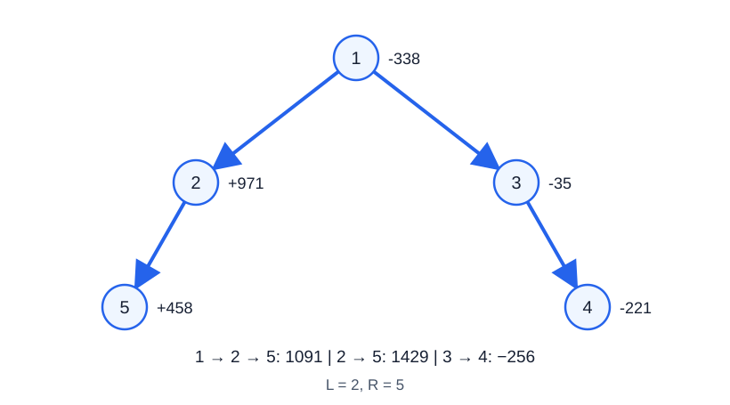

# 庆典计划

- 参考时间限制：**3.5 秒**（[评测环境与性能](../../../docs/评测环境与性能.md)）。
- 实际时限：在目标环境实测标准程序最慢测试文件的中位时间，乘以 2，再按 0.5 秒向上取整。
- 内存限制：**512 MB**。

## 背景故事

庆典筹备组把活动安排画成了一棵树：沿着树向下走，就能选出一条连续的节目路线。每个节目都有一个收益，筹备费用较高的节目也可能带来负收益。

路线的节目数必须在指定范围内。每个节目都可能被选为庆典的重点，筹备组希望分别知道：必须包含这个节目时，整条路线的收益最多是多少。

(本故事由GPT-6重写)

## 形式化问题描述

给定一棵有 $n$ 个节点的无向树，节点编号为 $1,\ldots,n$ ，以节点 $1$ 为根。节点 $i$ 的权值为 $v_i$ .

合法路径从某个节点出发，每一步走向当前节点的一个孩子，包含的**节点数**在 $L$ 到 $R$ 之间，含端点。路径的收益是其所有节点的权值之和。

对每个节点 $i$ ，分别求所有包含 $i$ 的合法路径中的最大收益。各节点的答案独立计算，不要求选出的路径互不相交。

## 输入格式

第一行三个整数 $n,L,R$ .

第二行 $n$ 个整数 $v_1,\ldots,v_n$ .

接下来 $n-1$ 行，每行两个整数 $u,v$ ，表示一条无向边。

## 输出格式

输出 $n$ 行，第 $i$ 行为节点 $i$ 的答案。如果没有包含该节点的合法路径，输出 `-1061109568` . 合法路径的收益可以为负数。

## 样例 1

### 输入

```text
5 2 5
-338 971 -35 -221 458
1 2
3 1
3 4
2 5
```

### 输出

```text
1091
1429
-256
-256
1429
```

## 样例 2

### 输入

```text
1 1 1
-7
```

### 输出

```text
-7
```

## 样例 3

### 输入

```text
4 3 4
2 -1 4 3
1 2
1 3
1 4
```

### 输出

```text
-1061109568
-1061109568
-1061109568
-1061109568
```

## 样例解释

样例 1 中，路径 $1\to2\to5$ 的收益为 $1091$ ，路径 $2\to5$ 的收益为 $1429$ ，路径 $3\to4$ 的收益为 $-256$ . 路径 $5\to2\to1\to3$ 不合法，因为它没有始终向孩子移动。



图中节点内为编号，节点旁为权值；箭头表示从父节点到孩子的方向。

样例 2 允许仅包含一个节点。样例 3 的最长向下路径只有两个节点，因此所有答案均为无解标记。

## 数据范围与保证

对 100% 的数据：$1\le L\le R\le n\le500000$ ，$-1000\le v_i\le1000$ ，$1\le u,v\le n$ . 输入的边恰好构成一棵树。

| 分值比例 | 额外条件 |
| --- | --- |
| 100% | 无额外条件 |
