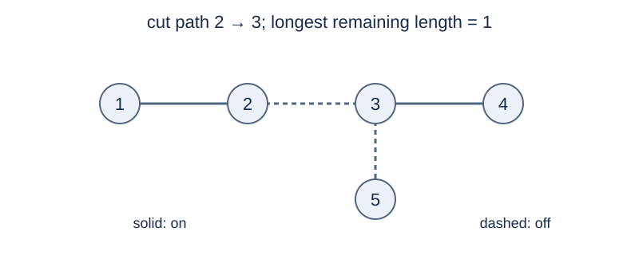

# Giant Christmas Tree

## Story

Little B, the mayor of Brookbend Village, has built a giant Christmas tree in the Silverspruce Snowfields. In graph-theoretic terms, it is a tree with $N$ vertices numbered $1,\ldots,N$ and $N-1$ edges.

A strip of lights hangs along each edge, and its initial on/off state is given. The mayor plans to perform $M$ operations. Each time, he chooses two vertices and switches off every strip along the path between them. Strips already switched off remain off.

After each operation, the mayor wants to know the length of the longest continuous path of lights still on. Treat each edge's strip as having length one.

## Formal Problem Statement

An undirected tree has $N$ vertices numbered $1,\ldots,N$ . Each edge is initially lit or dark. An operation gives $u,v$ and makes every edge on the unique path from $u$ to $v$ dark.

After each operation, print the maximum length of a simple path using only lit edges, measured in edges. Paths of length zero are allowed; if no lit edge remains, the answer is $0$ . An operation with $u=v$ changes nothing. Dark edges never light up again.

## Input Format

The first line is `N M` . Each of the next $N-1$ lines is `u v s` , where $s=1$ means lit and $s=0$ means dark. Each of the next $M$ lines is an operation `u v` .

## Output Format

Print one integer after each operation, for $M$ lines in total.

## Sample 1

### Input

```text
5 3
1 2 1
2 3 1
3 4 1
3 5 0
1 1
2 3
1 4
```

### Output

```text
3
1
0
```

## Sample 2

### Input

```text
5 3
1 2 1
1 3 1
1 4 1
1 5 1
2 3
4 4
4 5
```

### Output

```text
2
2
0
```

## Sample 3

### Input

```text
2 2
1 2 0
1 2
2 2
```

### Output

```text
0
0
```

## Sample Explanation

The first operation of sample 1 changes nothing, so the answer is 3. After edge 2—3 is switched off, the longest lit path has length 1. Sample 2 uses a star and an operation with equal endpoints. Sample 3 starts with no lit edge.



Sample 1 after its second operation: solid edges are lit; dashed edges are dark.

## Constraints and Scoring

$2\le N\le10^5$ and $1\le M\le2\times10^5$ . All vertex indices are valid, and the input edges form a tree.

Specifications redesigned by Codex (GPT-6): input for initial light states, path lengths, and empty operations.

| Score | Additional constraints |
| --- | --- |
| 20% | $N\le30,\ M\le100$ |
| 30% | $N,M\le2000$ |
| 50% | No additional constraints |

## Resource Limits

Time: 2.5 seconds. Memory: 1024 MiB.

The limit is 13 times the slowest standard-program median across five runs per formal input, rounded up to 0.5 seconds. The larger multiplier accommodates the alternative algorithm with a different use case.

[Measurement environment](../../../docs/评测环境与性能.md) · [Measurements](../../../docs/benchmark-R32.json) · [Solution](solution.en.md)
