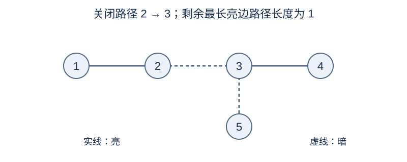

# 大圣诞树

## 背景故事

溪湾村长小B在银杉雪原上建造了一棵大圣诞树。从图论上看，它是一棵有 $N$ 个节点、$N-1$ 条边的树，节点编号为 $1,\ldots,N$。

树上的每条边都挂着一条灯带，每条灯带都有给定的初始亮灭状态。村长打算进行 $M$ 次操作：每次选择两个节点，把它们之间路径上的所有灯带熄灭；已经熄灭的灯带保持不变。

每次操作后，村长都想知道，树上还亮着的最长连续灯带路径有多长。每条边上的灯带长度视为一。

## 形式化问题描述

有一棵 $N$ 个结点的无向树，结点编号为 $1,\ldots,N$ .每条边初始为亮或暗。每次操作给定 $u,v$ ，将树上唯一的 $u$ 到 $v$ 路径的所有边设为暗。

每次操作完成后，输出只经过亮边的简单路径的最大长度，长度按边数计算。允许长度为零的路径；若没有亮边，答案为 $0$ .$u=v$ 时不改变任何边。暗边不会重新亮起。

## 输入格式

第一行 `N M` .接下来 $N-1$ 行为 `u v s` ，其中 $s=1$ 表示亮边，$s=0$ 表示暗边。再接下来 $M$ 行，每行 `u v` 表示一次操作。

## 输出格式

每次操作后输出一行整数，共 $M$ 行。

## 样例 1

### 输入

```text
5 3
1 2 1
2 3 1
3 4 1
3 5 0
1 1
2 3
1 4
```

### 输出

```text
3
1
0
```

## 样例 2

### 输入

```text
5 3
1 2 1
1 3 1
1 4 1
1 5 1
2 3
4 4
4 5
```

### 输出

```text
2
2
0
```

## 样例 3

### 输入

```text
2 2
1 2 0
1 2
2 2
```

### 输出

```text
0
0
```

## 样例说明

样例 1 的第一次操作不改边，答案为 3；第二次关闭边 2—3 后，最长亮边路径长度为 1。样例 2 展示星形树和重复端点。样例 3 初始就没有亮边。



样例 1 第二次操作后的状态；实线亮，虚线暗。

## 数据范围与分组

$2\le N\le10^5$ ，$1\le M\le2\times10^5$ .所有结点编号合法，输入边保证构成一棵树。

规格由 Codex（GPT-6）重新设计：补齐初始灯状态的输入，明确路径长度和空操作。

| 分值 | 额外限制 |
| --- | --- |
| 20% | $N\le30,\ M\le100$ |
| 30% | $N,M\le2000$ |
| 50% | 无额外限制 |

## 资源限制

时间 2.5 秒；内存 1024 MiB。

时限取标准程序正式数据五次运行的最慢中位数的 13 倍，向上取整到 0.5 秒。采用较大倍数，以容纳具有不同用途的补充算法。

[测量环境与方法](../../../docs/评测环境与性能.md) · [测量记录](../../../docs/benchmark-R32.json) · [题解](solution.zh.md)
