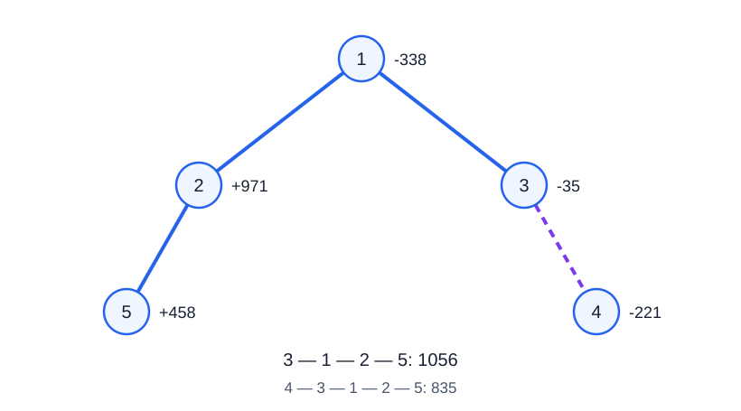

# Grinder

- Indicative time limit: **2.5 s** ([environment and measurements](../../../docs/评测环境与性能.md)).
- Deployment time limit: measure the reference program in the target environment, multiply the slowest case's median time by 2, and round up to the next 0.5 seconds.
- Memory limit: **256 MB**.

## Story

> “Who wants to play?”

The Grinder was originally designed to clear roads. It is still used to clear roads.

The map is a tree, and every vertex has a cleanup value. Some locations cost more to clear than they earn, so their values are negative. To speed up its work, the Grinder activates its turbocharger. A trip must cover at least $L$ roads to make that power worthwhile, but the limited fuel supply allows at most $R$ roads.

Any vertex may have an emergency that requires immediate cleanup. For each vertex, find the maximum total value of a path that visits it and satisfies the road-count limits.

## Formal Problem Statement

You are given an undirected tree with $n$ vertices numbered $1,\ldots,n$ . Vertex $i$ has weight $v_i$ .

A trip is a simple path, with no repeated vertex, whose **number of edges** is between $L$ and $R$ , inclusive. Its value is the sum of all vertex weights on the path, including both endpoints and counting each vertex once. A trip may start anywhere and travel in either direction.

For every vertex $i$ , independently find the maximum value of a valid path containing $i$ . When $L=0$ , a path consisting of a single vertex may be valid.

## Input Format

The first line contains $n,L,R$ .

The second line contains $n$ integers $v_1,\ldots,v_n$ .

Each of the next $n-1$ lines contains two integers $u,v$ , describing an undirected edge.

## Output Format

Print $n$ lines. Line $i$ contains the answer for vertex $i$ , or `-1061109568` if no valid path contains it. A valid path may have a negative value.

## Sample 1

### Input

```text
5 2 4
-338 971 -35 -221 458
1 2
3 1
3 4
2 5
```

### Output

```text
1091
1091
1056
835
1091
```

## Sample 2

### Input

```text
1 0 0
-7
```

### Output

```text
-7
```

## Sample 3

### Input

```text
4 3 3
2 -1 4 3
1 2
1 3
1 4
```

### Output

```text
-1061109568
-1061109568
-1061109568
-1061109568
```

## Sample Explanation

In sample 1, path $1\to2\to5$ has two edges and value $1091$ ; path $3\to1\to2\to5$ has three edges and value $1056$ ; path $4\to3\to1\to2\to5$ has four edges and value $835$ .



The solid highlight shows $3\to1\to2\to5$ . The dashed segment extends it to vertex $4$ . The tree is unrooted, so vertical placement does not restrict travel direction.

In sample 2, the zero-edge path has value $-7$ . Every simple path in sample 3 has at most two edges, so none is valid.

## Constraints and Guarantees

For all test cases: $1\le n\le300000$ , $0\le L\le R\le n-1$ , $-1000\le v_i\le1000$ , and $1\le u,v\le n$ . The input edges form a tree.

| Score | Additional restrictions |
| --- | --- |
| 100% | None |
