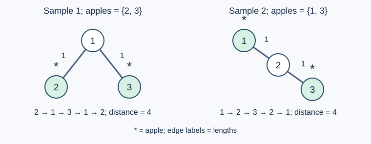

# 哈根农场

- 参考时间限制：0.5 秒。
- 实际时限：标准程序在目标环境的最慢用例中位耗时乘以 2，再按 0.5 秒向上取整。
- 内存限制：512 MB。
- [参考评测环境与测量](../../../docs/评测环境与性能.md)

## 背景故事

> 苹果是奥比岛的特色，不得不品尝。——物流高手
>
> 哈根农场的苹果养人啊，多吃一些，多吃一些。——鸡蛋舞者

哈根农场有一棵硕大的苹果树，树上曾结出数以亿计的苹果。这棵树有 $n$ 个节点，以 $1$ 号节点为根，每根树枝都有自己的长度。

每当小奥比来到这里，苹果树便会等概率地随机选中一个节点，在它的子树中结出一批苹果。苹果数量在 $1$ 到子树大小之间均匀随机确定；数量确定后，再等概率地选出相应数量的节点，每个选中节点结出一个苹果。

随后，小奥比拿起苹果杆，准备从任意节点出发，沿树枝摘完所有苹果，再回到出发点。他想知道，最短移动距离的期望是多少，并将答案对 $1000000007$ 取模。

## 形式化问题描述

给定一棵有 $n$ 个节点的无向树，节点编号 $1,\ldots,n$ ，以节点 $1$ 为根，每条边有非负整数长度。按以下顺序生成苹果：

1. 从全部 $n$ 个节点中等概率选择节点 $u$ .
2. 设 $u$ 的子树大小为 $s$ ，从 $1,\ldots,s$ 中等概率选择整数 $k$ .
3. 在 $u$ 的子树的所有大小为 $k$ 的节点集合中等概率选择一个集合，每个选中节点结出一个苹果。

观察苹果位置后，可以从树上任意节点出发，沿边行走，访问全部苹果节点并回到起点。边可以重复经过，每次都计入其长度。

设最短行走距离的期望为有理数 $E$ ，输出 $E$ 模 $P=1000000007$ 的值：若 $E=A/B$ ，答案为 $A\cdot B^{-1}\bmod P$ .上述范围保证所需分母在模 $P$ 下可逆。

## 输入格式

第一行一个整数 $n$ .接下来 $n-1$ 行，每行三个整数 $u,v,w$ ，表示节点 $u,v$ 之间有一条长度为 $w$ 的边。

## 输出格式

一行一个整数，表示期望距离模 $P$ 的结果。

## 样例 1

### 输入

```text
3
1 2 1
1 3 1
```

### 输出

```text
407407411
```

## 样例 2

### 输入

```text
3
1 2 1
2 3 1
```

### 输出

```text
740740747
```

## 样例 3

### 输入

```text
1
```

### 输出

```text
0
```

## 样例解释

样例一的期望为 $20/27$ ；样例二为 $29/27$ .样例三只有一个节点，起点即苹果所在节点，行走距离为 $0$ .



星号表示苹果。图示为一次具体选点后的路线；题目还需要对所有随机选择求期望。

## 数据范围与保证

$1\le n\le2000$ ；$1\le u,v\le n$ ；$0\le w\le10000$ .输入边组成一棵树。

| 分值比例 | 额外条件 |
| --- | --- |
| 100% | 无额外条件 |
