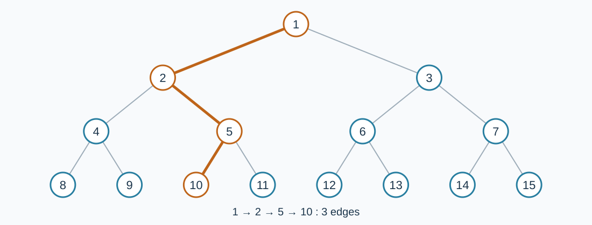

# 无限二叉树上的距离

预估时间限制：0.5 秒。内存限制：128 MB。

实际时限以标准程序在目标评测环境的最慢用例中位时间乘以 $2$ ，按 $0.5$ 秒向上取整。参考环境见[评测说明](../../../docs/评测环境与性能.md)。

## 背景故事

你在解谜游戏中搭建了一棵用正整数编号的无限二叉树。白兔准备沿树上的道路旅行，请你回答不同地点之间需要走多少条边。

## 形式化问题描述

无向图的顶点集合为所有正整数。对每个正整数 $i$ ，恰有边连接 $i$ 与 $2i$ ，以及 $i$ 与 $2i+1$ ，没有其他边。

对每次询问给出的 $a,b$ ，求从顶点 $a$ 到顶点 $b$ 的最短路边数。允许 $a=b$ ，此时答案为零。



图中只画出前四层。路径 $1\to2\to5\to10$ 包含三条边。

## 输入格式

第一行一个整数 $m$ ，表示询问数。接下来 $m$ 行，每行两个整数 $a,b$ .

## 输出格式

对第 $i$ 次询问，输出一行 `Case #i: ans` ，将 `i` 和 `ans` 替换为询问编号和答案。编号从 $1$ 开始，冒号后恰有一个空格。

## 样例

### 样例 1

### 输入

```text
6
1 10
5 5
10000 10001
2 4
2 5
50000 60000
```

### 输出

```text
Case #1: 3
Case #2: 0
Case #3: 2
Case #4: 1
Case #5: 1
Case #6: 28
```

### 样例 2

### 输入

```text
4
1 1000000000000000000
576460752303423488 576460752303423487
1000000000000000000 1000000000000000000
576460752303423488 864691128455135232
```

### 输出

```text
Case #1: 59
Case #2: 117
Case #3: 0
Case #4: 118
```

### 样例 3

### 输入

```text
1
1 1
```

### 输出

```text
Case #1: 0
```

## 样例解释

样例 1 中，$10000$ 与 $10001$ 的父亲都是 $5000$ ，因此距离为 $2$ .顶点与自身之间的距离为零。样例 2 包含大编号和跨越根节点两侧的路径。

## 数据范围与保证

对 100% 的数据：$1\le m\le10^5$ ，$1\le a,b\le10^{18}$ .

| 分值比例 | 额外条件 |
| --- | --- |
| 100% | 无额外条件 |
