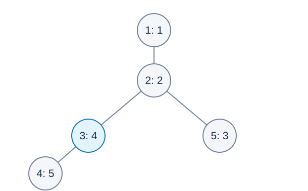

# Lexicographically Largest Heap Labels — Solution

## Methods and Contributions

The preferred method is the setter's interval allocation in vertex-number order: binary lifting finds a processed ancestor, a Fenwick tree maintains remaining subtree sizes, and an occupancy segment tree locates label intervals. Codex (GPT-6) supplies the invariant proof, iterative traversal, the specified moduli, and a static ancestor-set sorting alternative. Binary lifting, Fenwick trees, segment trees, persistence and Cantor expansion are classical techniques; the contributions concern their formulation, proof and implementation for this problem.

The diagram shows the optimal assignment for sample one. Each node displays “vertex number: assigned label”.

## Why Assign a Whole Subtree the Largest Labels?

Consider a remaining tree or forest with a consecutive available label interval $[L,R]$ . Let $x$ be its smallest-numbered vertex and let its current subtree have size $s$ .

Its $s-1$ descendants require larger labels, so $a_x\le R-s+1$ . This bound is attainable: give its entire subtree the largest $s$ labels, set $a_x=R-s+1$ , assign the descendants in any valid heap order, and use the smaller labels outside. Any ancestors of $x$ outside the subtree also correctly receive smaller labels.

Vertex $x$ is the next lexicographic priority, so an optimum must attain this bound. This forces its descendants to use all $s-1$ larger labels. The problem splits into the forest inside the subtree after removing $x$ , and the forest remaining after removing the whole subtree. Each has a fixed consecutive label interval and follows the same rule.

This establishes an upper bound, a construction attaining it, and independence of the recursive parts.

## Preferred Method: Scan Numbers and Maintain Intervals

Process vertices $1,2,\ldots,N$ . Processed vertices separate the remaining forest. For an unprocessed vertex $u$ , let $t$ be its nearest processed strict ancestor, or virtual root zero if absent.

The unprocessed component containing $u$ belongs to $t$ . Maintain these invariants:

1. Each processed vertex $t$ has an allocation interval $[a_t,r_t]$ . The virtual root has $a_0=0,r_0=N$ .
2. Its remaining unprocessed component uses a consecutive free prefix beginning at $a_t+1$ . Subcomponents already removed occupy later intervals whose root labels are marked occupied.
3. $s_u$ counts unprocessed vertices below $u$ reachable without passing through a processed vertex.

Let $b$ be the smallest occupied label in $[a_t+1,r_t]$ , or $r_t+1$ if there is none. The free component interval ends at $b-1$ . The whole-subtree rule gives

$$a_u=b-s_u,\qquad r_u=b-1$$

Mark $a_u$ occupied. The newly rooted block's remaining vertices now belong to $u$ , and the former component loses exactly its final $s_u$ labels. All three invariants are preserved.

### Nearest Processed Ancestor

When processing $u$ , processed vertices are precisely those with numbers below $u$ . Precompute binary ancestors and the minimum vertex number in each jump segment. From large jumps to small, skip segments whose ancestor numbers are all greater than $u$ . The parent of the final position is $t$ . Virtual vertex zero prevents jumping above the root.

### Remaining Subtree Sizes

Compute original subtree sizes and DFS entry and exit times $\operatorname{in}(v)$ and $\operatorname{out}(v)$ . Each event has its own index, giving $2N$ events.

With Fenwick prefix sum $F$ , the current size is

$$s_u=\operatorname{size}(u)+F(\operatorname{in}(u))-F(\operatorname{out}(u))$$

Allocating the remaining block of $s_u$ vertices below $u$ must subtract $s_u$ only from unprocessed strict ancestors between $t$ and $u$ . If $t$ is the parent, nothing is needed. Otherwise apply two point updates:

$$\operatorname{add}(\operatorname{in}(t)+1,-s_u),\qquad
\operatorname{add}(\operatorname{in}(u),s_u)$$

This decreases $F$ on the half-open event interval $[\operatorname{in}(t)+1,\operatorname{in}(u))$ . A strict ancestor on the path has its entry inside and exit outside, decreasing their prefix-sum difference by $s_u$ . A side branch has both events inside or both outside, leaving the difference unchanged. Vertices $t$ and $u$ themselves are also unchanged. This is the required path effect, not an ordinary subtree increment.

### Occupancy Segment Tree

Store whether each interval contains an occupied label. Mark the root-to-leaf path on insertion. To find the first occupied label in $[a_t+1,r_t]$ , visit the left child first and skip empty or disjoint intervals. Each operation takes $O(\log N)$ .

## Alternative: Static Sorting of Ancestor Sets

Define a length-$N$ binary key $B_v$ for vertex $v$ : bit $i$ is one exactly when vertex $i$ lies on the root-to-$v$ path. Sort vertices by decreasing lexicographic key, with one preceding zero, and assign labels $N,N-1,\ldots,1$ in that order.

A descendant's ancestor set strictly contains its ancestor's set, so its key and assigned label are larger. For optimality, apply the whole-subtree rule. In a currently undecided group, its smallest-numbered vertex $x$ gives the earliest bit that can distinguish the two parts. Exactly its subtree has that bit, placing all those vertices on the larger-label side. Recursing on each side with the next distinguishing number performs exactly the optimal block allocation. Thus static sorting yields the unique optimal label array.

Represent each key by a persistent segment tree instead of storing all $N$ bits. Vertex $v$ inherits its parent's version and inserts bit $v$ ; a zero pointer means an empty interval. Compare versions by descending left when left pointers differ, otherwise right, until reaching their first differing bit. The nonempty side is larger.

Pointer equality is exact here; there is no hashing. Two root paths share an initial segment and then add disjoint vertex numbers. For any number interval, if neither branch subsequently inserts a number in it, both retain the shared old pointer. If a branch does insert a number there, the sets differ because the other branch cannot insert the same vertex number. Comparing ancestor and descendant versions is the special case where one side inserts nothing further.

Building versions takes $O(N\log N)$ time and space. Each comparison costs $O(\log N)$ , giving $O(N\log^2 N)$ total sorting time. The mathematical description is uniform but incurs an extra sorting logarithm. Prefer the $O(N\log N)$ [std.cpp](std.cpp); [alternative.cpp](alternative.cpp) implements this distinct static approach in full.

## Cantor Rank and Implementation Boundaries

Scan vertex numbers from $N$ down to one. A second Fenwick tree stores labels already seen. Query the number $c_i$ strictly below $a_i$ and add $c_i(N-i)!$ . Maintain the factorial incrementally in this scan direction and accumulate separately for the two moduli. Neither primality nor modular inverses are needed.

The preferred method takes $O(N\log N)$ time and space. All traversals of the input tree use explicit stacks, so a chain does not create linear function-recursion depth. Segment-tree recursion has only logarithmic depth. Promote modular products to sixty-four bits and use exactly $100000007$ and $100000009$ .
