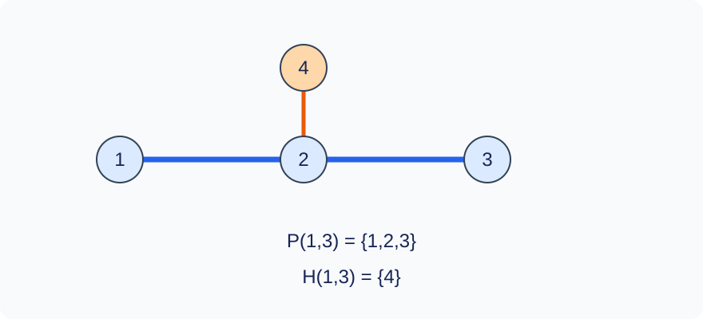

# 心灵终结仪

时间限制：1 秒；内存限制：512 MiB。时限按目标环境标准程序最慢中位数乘2，向上取整至0.5秒；见[评测环境](../../../docs/评测环境与性能.md)。

## 背景故事

心灵终结仪已经基本完工，仅剩下的便是调试以及最终的启动！为了验证心灵终结仪的可靠性，你需要写一个程序来模拟心灵终结仪的运行。心灵终结仪可以看做一棵以 $1$ 号节点为根的树，其运行可以抽象为以下若干操作。

## 形式化问题描述

给定一棵以顶点1为根、有 $n$ 个顶点的树。所有顶点的初始权值均为零。定义：

- $P(a,b)$ ：从 $a$ 到 $b$ 的简单路径上的顶点集合，包括两个端点。
- $H(a,b)$ ：不在 $P(a,b)$ 上、但与路径上至少一个顶点相邻的所有顶点。每个顶点只计一次。
- $T(a)$ ：以 $a$ 为根的子树中的顶点集合，包括 $a$ .

依次执行下表中的 $m$ 个操作。

| 操作 | 作用集合 | 含义 |
| --- | --- | --- |
| `1 a b v` | $P(a,b)$ | 每个权值加 $v$ |
| `2 a b v` | $H(a,b)$ | 每个权值加 $v$ |
| `3 a v` | $T(a)$ | 每个权值加 $v$ |
| `4 a b v` | $P(a,b)$ | 每个权值赋为 $v$ |
| `5 a b v` | $H(a,b)$ | 每个权值赋为 $v$ |
| `6 a v` | $T(a)$ | 每个权值赋为 $v$ |
| `7 a b` | $P(a,b)$ | 查询最大值 |
| `8 a b` | $H(a,b)$ | 查询最大值 |
| `9 a` | $T(a)$ | 查询最大值 |
| `10 a b` | $P(a,b)$ | 查询权值和 |
| `11 a b` | $H(a,b)$ | 查询权值和 |
| `12 a` | $T(a)$ | 查询权值和 |

空邻域的修改没有效果，权值和为0，最大值查询输出大写单词 `EMPTY` .

## 输入格式

第一行 `n m` .接下来 $n-1$ 行，每行 `u v` 表示一条树边。接下来 $m$ 行为操作。不另输入初始权值。

## 输出格式

每个编号7至12的操作输出一行，内容为整数答案或规定的 `EMPTY` .

## 样例 1

### 输入

```text
4 8
1 2
2 3
2 4
5 1 3 7
8 1 3
10 1 3
11 1 3
3 2 -2
9 2
12 2
7 1 3
```

### 输出

```text
7
0
7
5
1
0
```

## 样例 2

### 输入

```text
1 6
8 1 1
11 1 1
2 1 1 5
4 1 1 -7
9 1
12 1
```

### 输出

```text
EMPTY
0
-7
-7
```

## 样例 3

### 输入

```text
3 6
1 2
2 3
3 1 100000000
1 1 3 100000000
6 2 0
10 1 3
9 2
11 1 1
```

### 输出

```text
200000000
0
0
```

## 样例解释

样例1中，路径 $P(1,3)=\{1,2,3\}$ ，邻域 $H(1,3)=\{4\}$ .先令顶点4为7，再给子树 $T(2)$ 加上 $-2$ ，这三个顶点的权值变为 $-2,-2,5$ .样例2展示空邻域。



蓝色顶点是路径 $P(1,3)$ ，橙色顶点是它的外邻域。

## 数据范围与分值

$1\le n,m\le10^5$ ，$1\le a,b,u,v\le n$ ，$|v_{\mathrm{update}}|\le10^8$ .输入图是一棵树。累积权值和答案可能超过32位有符号整数范围。

Codex（GPT-6）重新设计：补全全零初值、空邻域最大值与求和规则，明确操作7至12产生输出。

| 分值 | 额外限制 |
| --- | --- |
| 20% | $n\le30,\ m\le100$ |
| 30% | $n,m\le2000$ |
| 50% | 无额外限制 |

共10个测试点，每点占10%；完整配方见[测试说明](tests/README.md)。
