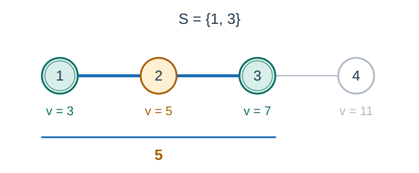

# Psychic Control Tree

- Indicative time limit: **2.0 s** ([environment and measurements](../../../docs/评测环境与性能.md)).
- Actual time limit: twice the reference program's baseline time on the slowest official test file in the target environment, rounded up to a multiple of 0.5 seconds; round up further if the platform requires a coarser unit.
- Memory limit: 128 MB

## Story

The psychic corps controls battlefield units through a control tree. Activating a node also activates all its descendants. The battlefield roads form a tree with the same structure. Controlled units must gather, eliminating any uncontrolled enemies on their routes. Evaluate the minimum cost for every possible activation node.

## Formal Problem Statement

A tree has $n$ vertices numbered $1$ through $n$ and is rooted at vertex $1$ . The same tree represents both the control hierarchy and the battlefield roads.

Battlefield vertex $i$ contains a unit of strength $v_i$ . Control vertex $i$ controls the unit at battlefield vertex $e_i$ , where $e$ is a permutation of $1$ through $n$ .

For each control vertex $u$ , let $S_u$ contain the battlefield vertices controlled by the vertices in the subtree of $u$ . Choose any battlefield vertex as a meeting point and move all units in $S_u$ to it along tree paths. Every uncontrolled unit on the routes must be eliminated, with its strength charged once. Controlled units cost nothing; an uncontrolled unit at the meeting point is also charged.

Find the minimum total cost for each $u$ . These scenarios are independent.



Figure 1: For controlled vertices $\{1,3\}$ , meeting at vertex $1$ , $2$ , or $3$ requires eliminating only the unit at vertex $2$ , at cost $5$ .

## Input Format

The first line contains $n$ . The next $n$ lines contain $v_i,e_i$ for $i=1,\ldots,n$ . Each of the following $n-1$ lines contains the endpoints $a,b$ of an undirected tree edge.

## Output Format

Print $n$ lines. Line $u$ contains the minimum cost for activating vertex $u$ .

## Sample 1

### Input

```text
7
1 1
1 7
1 2
1 6
1 5
1 4
1 3
1 2
2 3
2 4
1 5
5 6
5 7
```

### Output

```text
0
2
0
0
2
0
0
```

### Explanation

Activating vertex $2$ controls battlefield vertices $\{7,2,6\}$ . Connecting them also passes through vertices $1,5$ , costing $2$ . Activating the root controls every unit and costs zero.

## Sample 2

### Input

```text
4
3 2
5 4
7 1
11 3
1 2
2 3
3 4
```

### Output

```text
0
5
5
0
```

### Explanation

Activating vertex $3$ controls battlefield vertices $1,3$ . Their path passes through vertex $2$ , costing $v_2=5$ . Activating vertex $2$ also controls vertex $4$ and still costs only the strength at vertex $2$ .

## Constraints and Guarantees

- $1\le n\le100000$ and $1\le v_i\le5000$ .
- $e$ is a permutation of $1$ through $n$ , and the edges form a tree.

### Test Groups

| Score share | Additional conditions |
| --- | --- |
| 100% | No additional conditions |
