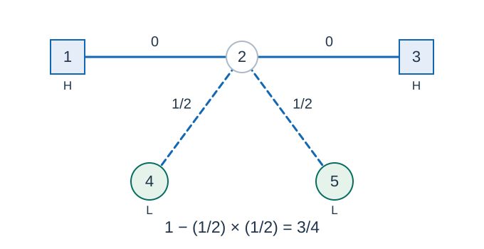

# Spice Routes

- Indicative time limit: **0.5 s** ([environment and measurements](../../../docs/评测环境与性能.md)).
- Actual time limit: twice the reference program's benchmark time on its slowest official test file in the target environment, rounded up to a multiple of 0.5 seconds, then to the platform's supported granularity if coarser.
- Memory limit: 128 MB

## Story

A spice trader has a network of planets. Some sell spice cheaply, and others buy it at a high price. Static interference may block routes to loaded ships. Find the probability that at least one seller and one buyer remain connected.

## Formal Problem Statement

You are given an undirected tree on $n$ nodes. Edge $i$ fails with probability $q_i/p_i$ , independently of all other edges. Failed edges cannot be used; all other edges work in both directions.

You are also given lists of low-price and high-price nodes. Repetition is allowed within and across the lists; repeating a node adds no requirement. If a node belongs to both categories, its zero-length path counts as a connection.

Find the probability that at least one low-price node and one high-price node remain connected after all failed edges are removed. If the probability is $x/y$ in lowest terms, output $x\cdot y^{-1}\bmod P$ , where $P=10^9+7$ and $y^{-1}$ is the multiplicative inverse modulo $P$ .

## Input Format

The first line contains $n$ . Each of the next $n-1$ lines contains $u,v,q_i,p_i$ , describing an edge and its failure probability. Then follow the integer $a$ , a line of $a$ low-price node IDs, the integer $b$ , and a line of $b$ high-price node IDs. An empty list has an empty ID line.

## Output Format

Print the probability modulo $P$ as one integer.

## Example 1

### Input

```text
5
1 2 0 1
2 3 0 1
2 4 1 2
2 5 1 2
2
4 5
2
1 3
```

### Output

```text
750000006
```

## Example 2

### Input

```text
3
1 2 1 2
2 3 1 3
2
1 3
1
2
```

### Output

```text
833333340
```

## Example 3

### Input

```text
1
1
1
2
1 1
```

### Output

```text
1
```

## Example Explanation

In example 1, nodes $1,2,3$ are always connected. At least one of the edges to nodes $4$ and $5$ must survive, with probability $1-(1/2)^2=3/4$ . The probability in example 2 is $1-(1/2)(1/3)=5/6$ . The only node in example 3 belongs to both categories, so the probability is $1$ .



`L` marks low-price nodes and `H` marks high-price nodes. Edge labels give failure probabilities.

## Constraints and Guarantees

All inputs satisfy $1\le n\le100000$ , $0\le a\le n$ , $0\le b\le2$ , $0\le q_i\le p_i\le100000$ , and $p_i\ge1$ . Node IDs are in $[1,n]$ , and the edges form a tree. All denominators are smaller than the prime $P$ , so the required inverse exists.

| Score share | Additional conditions |
| --- | --- |
| 100% | No additional conditions |
