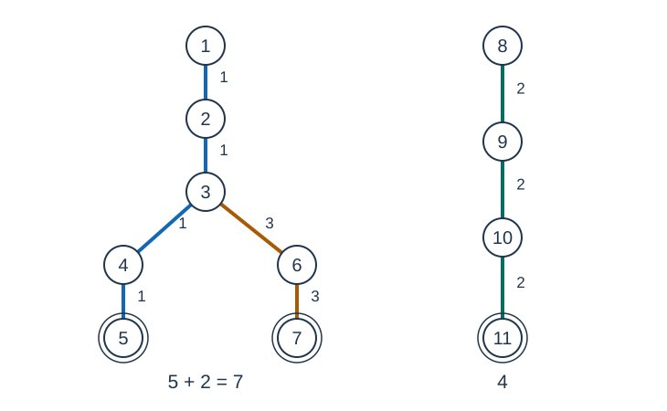

# 砍树

- 参考时间限制：0.5 秒（参考环境：[评测环境与性能](../../../docs/评测环境与性能.md)；仅供预估）
- 实际时间限制：标准程序在目标评测环境中处理最慢正式测试文件的基准时间的 2 倍，按 0.5 秒的倍数向上取整；若平台仅支持更粗的粒度，再向上取整到平台可设置值。
- 内存限制：128 MB

## 背景故事

史蒂夫装上了砍树模组。选中一处树枝，整条通向树根的路径都会被砍下，但每选一个节点都要支付一次费用。他希望用不同预算砍下尽量多的节点；如果收益相同，就尽量少打扰几棵树。

## 形式化问题描述

给定一片有 $n$ 个节点、$m$ 条无向边的森林，节点编号为 $1$ 到 $n$ .每个连通分量是一棵树，其根为该分量中编号最小的节点。

选取若干互不相同的节点后，每个被选节点到所在树根的路径（含两个端点）上的所有节点都会被砍下。一个节点即使出现在多条路径上，也只计一次。

设砍下全部节点所需的最少选点数为 $Need$ .对每个 $k=1,\ldots,Need$ ，考虑恰好选取 $k$ 个节点的方案，求：

1. 最多能砍下的节点数；
2. 在达到这个最大值的方案中，包含至少一个被选节点的树的最少数量。

## 输入格式

第一行两个整数 $n,m$ .接下来 $m$ 行，每行两个整数 $u,v$ ，表示一条无向边。

## 输出格式

第一行输出 $Need$ .接下来 $Need$ 行，第 $k$ 行输出上述两个最优值，以一个空格分隔。

## 样例 1

### 输入

```text
11 9
1 2
2 3
3 4
4 5
3 6
6 7
8 9
9 10
10 11
```

### 输出

```text
3
5 1
9 2
11 2
```

## 样例 2

### 输入

```text
6 4
1 2
2 3
1 4
5 6
```

### 输出

```text
3
3 1
5 2
6 2
```

## 样例 3

### 输入

```text
1 0
```

### 输出

```text
1
1 1
```

## 样例解释

样例 1 可以依次选择节点 $5,11,7$ ，新增砍下的节点数为 $5,4,2$ ，累计为 $5,9,11$ ，涉及的树数为 $1,2,2$ .



双圈表示被选节点，边旁的 1、2、3 表示该路径段在哪次选择时首次被覆盖。样例 3 中单独一个节点也构成一棵树。

## 数据范围与保证

所有数据满足 $1\le n\le500000$ ，$0\le m\le n-1$ ，$1\le u,v\le n$ .保证输入是一片森林，允许存在孤立节点。

| 分值比例 | 额外条件 |
| --- | --- |
| 100% | 无额外条件 |
