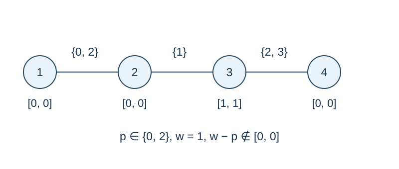

# Tolerance Paths in a Tree

Time limit: 1 seconds. Memory limit: 128 MiB. See the [reference environment and measurements](../../../docs/评测环境与性能.md).

## Story

Sensors pass signals along a tree. Each link offers several possible signal strengths, and each sensor limits how much the strength may change. For each starting sensor, count the positions a signal can reach.

(This story was rewritten by GPT-6.)

## Formal Problem Statement

An undirected tree has $n$ vertices and edges numbered $1,\ldots,n-1$ in input order. There are also $m$ undirected special edges. Each special edge is attached to one tree edge, joins its two endpoints, and has an integer weight. Several special edges may share a tree edge or a weight. A tree edge with no special edge cannot be traversed.

Vertex $v$ has tolerance $[L_v,R_v]$ . Walk only along special edges, using each underlying tree edge at most once. The first special edge has no weight restriction. At each later transition through vertex $v$ , an incoming weight $p$ and outgoing weight $w$ must satisfy

$$L_v\le w-p\le R_v.$$

For every start vertex, count the vertices reachable by at least one legal route. Include the start itself via the empty route. Different destinations may use different routes and special-edge choices.

## Input Format

The first line contains `n m` . The next $n-1$ lines contain tree edges `u v` . The next $n$ lines contain `L_v R_v` for vertices $v=1,\ldots,n$ . The final $m$ lines contain `e w` , specifying a special edge of weight $w$ attached to tree edge $e$ .

## Output Format

Print $n$ integers on one line, in vertex order.

## Sample 1

### Input

```text
4 5
1 2
2 3
3 4
0 0
0 0
1 1
0 0
1 0
1 2
2 1
3 2
3 3
```

### Output

```text
2 4 3 2
```

## Sample 2

### Input

```text
1 0
-1000000000 1000000000
```

### Output

```text
1
```

## Sample 3

### Input

```text
3 0
1 2
2 3
0 0
0 0
0 0
```

### Output

```text
1 1 1
```

## Sample Explanation

In Sample 1, a route from 1 cannot pass through 2: its possible incoming weights are 0 and 2, neither of which can change by zero to weight 1. From 2, weights 1 then 2 reach 3 and 4. Reachability need not be symmetric.



Lines are underlying tree edges; braces list available special-edge weights. The zero tolerance at vertex 2 cannot fill gaps in the weight set.

## Constraints and Scoring

$1\le n\le1000$ , $0\le m\le20000$ , $-10^9\le L_v\le R_v\le10^9$ , and $|w|\le10^9$ . The underlying input graph is a tree. If $n=1$ , then $m=0$ .

Specifications redesigned by Codex (GPT-6): bounds, edge-index input, duplicate weights, empty routes, and first-step semantics.

| Score | Additional constraints |
| --- | --- |
| 20% | $n\le8,\ m\le15$ |
| 30% | $n\le100,\ m\le1000$ |
| 50% | No additional constraints |
